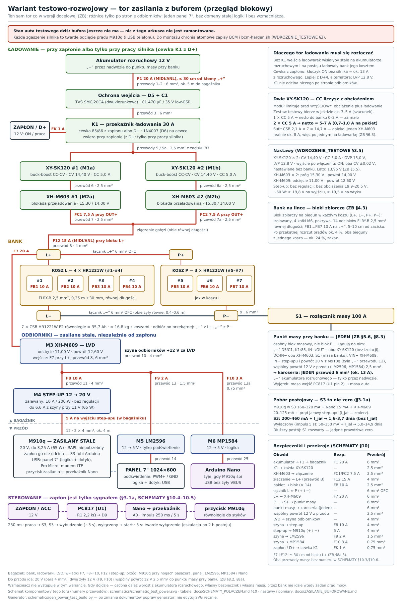
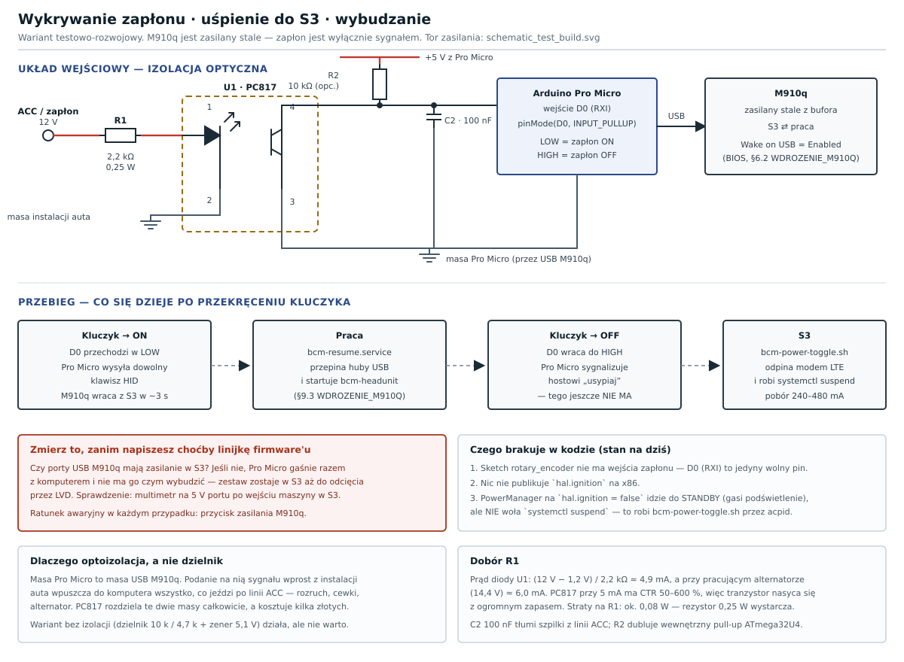

# Wdrożenie testowo-rozwojowe — mało funkcji, pełny tor zasilania

Wariant do bieżącej weryfikacji i poprawek **w jeżdżącym aucie**: Android Auto
wireless + dźwięk przez mini-jack M910q, ekran 7", przyciski SWC, modem LTE.
Wszystko pozostałe wyłączone.

Wdrożenie docelowe (pełne): [`WDROZENIE_M910Q.md`](WDROZENIE_M910Q.md).

> **Instrukcja krok po kroku dla auta testowego** (co się zmieniło w
> #126–#129, migracja ustawień, sekrety, BIOS, główny telefon, audio,
> tabela przełączników, lista sprawdzeń, wycofanie zmian):
> [`WDROZENIE_TESTOWE_TELEFON.md`](WDROZENIE_TESTOWE_TELEFON.md).
> Przygotowanie telefonu w aucie:
> [`PRZYGOTOWANIE_TELEFONU.md`](PRZYGOTOWANIE_TELEFONU.md). Ten dokument
> zostaje opisem technicznym — tam, gdzie się pokrywają, kroki są w tamtych.

> **To nie jest stanowisko biurkowe.** Zestaw jedzie w aucie, więc tor
> zasilania ma być kompletny: ładowanie banku, blokada przeładowania i LVD
> (dziś auto testowe jeździ jeszcze bez bufora — §3).
> Oszczędzamy na funkcjach BCM i na wariancie ładowarki — **nie na
> zabezpieczeniach**.

> **Ekran 7" to konfiguracja tymczasowa.** Docelowy panel to **10,1"
> 1280×800**, opcjonalnie drugi **6,86" 1280×480** — i tak jest ustawione
> w `config/bcm_config.yaml`. Ten wariant używa osobnego pliku
> `config/bcm_config_test.yaml` z 1024×600, żeby nie ruszać konfiguracji
> produkcyjnej.

---

## Spis treści

1. [Co uruchamiamy](#1-co-uruchamiamy)
2. [Co już masz](#2-co-już-masz)
3. [Zasilanie](#3-zasilanie)
4. [Lista zakupowa](#4-lista-zakupowa)
5. [Instalacja software'u](#5-instalacja-softwareu)
6. [Uruchomienie](#6-uruchomienie)
7. [Odbiór](#7-odbiór)
8. [Czego celowo nie ma](#8-czego-celowo-nie-ma)
9. [Droga do wersji docelowej](#9-droga-do-wersji-docelowej)

---

## 1. Co uruchamiamy

Pięć modułów zamiast dwudziestu ośmiu, plus dwa podsystemy potrzebne do
Android Auto wireless — to był punkt wyjścia. Od #127 config testowy włącza
też internet i GPS z telefonu, trasy, pogodę, książkę telefoniczną i stan
telefonu, a dodatki z telefonem w aucie czekają wyłączone; aktualna tabela
przełączników: [`WDROZENIE_TESTOWE_TELEFON.md`](WDROZENIE_TESTOWE_TELEFON.md) §8.

| Przełącznik | Po co | Czego wymaga |
|-------------|-------|--------------|
| `dashboard` | frontend na porcie 5002 | ekran 7" + Chromium |
| `multimedia` | **Android Auto** (openauto) | telefon + BT + P2P-GO |
| `input` | **przyciski SWC** | Arduino Pro Micro (USB HID) |
| `audio` | głośność i EQ | wyjście analogowe M910q |
| `network` | status łącza | modem LTE (przez NetworkManager) |
| `bluetooth` | bootstrap handshake'u AA wireless | karta/dongiel BT |
| `wifi_ap` | P2P-GO — łącze danych AA | karta MT7921 |

Reszta — OBD, kamery, parkowanie, czujniki, przekaźniki, GPS, alarm — jest
**wyłączona**, bo nie ma podłączonego sprzętu. Włączanie modułów bez
hardware'u produkuje tylko szum w logach.

### Trzy ustalenia z kodu, które upraszczają ten wariant

**Dźwięk nie wymaga DAC-a USB.** `src/audio/pipewire_ctrl.py` na x86 używa
**domyślnego sinka PipeWire** — czyli tego, co ustawisz w systemie. Wyjście
analogowe M910q (mini-jack) działa bez żadnych zmian w kodzie. DAC USB
ES9038Q2M to podniesienie jakości, nie warunek uruchomienia.

**Modem LTE nie wymaga konfiguracji w BCM.** `src/network/lte.py` na x86
tylko **raportuje** stan łącza (`lte.connected`, `lte.signal`, `lte.ip`);
samo połączenie robi NetworkManager. Huawei E3372 w trybie HiLink zgłasza się
jako karta sieciowa i działa od podłączenia.

**Moduł `power` nie usypia maszyny — nawet gdy go włączysz.**
`PowerManager` (`src/power/power_manager.py`) na `hal.ignition = false`
przechodzi do STANDBY, co oznacza wygaszenie podświetlenia i
`power.active = false` — **żadnego `systemctl suspend`**. Uśpienie robi
`bcm-power-toggle.sh` przez acpid, poza BCM. Do tego na x86 nikt
`hal.ignition` nie publikuje. Pełne rozpisanie luki: §3.1a.

---

## 2. Co już masz

| Element | Uwaga |
|---------|-------|
| Lenovo M910q | |
| Ekran 7" | 1024×600, HDMI + dotyk USB |
| Karta WiFi MediaTek MT7921 | **AA wireless po P2P-GO już działa** |
| Pody SWC + dekoder | rezystorowa drabinka → wejście analogowe |
| Modem LTE Huawei E3372 | HiLink, USB |
| Akumulatory CSB HR1221W × 8 | AGM 12 V / 5,1 Ah — do banku idzie **7** (§3.4) |
| **XL6019** | step-up 12 → 19,5 V dla M910q |
| **XH-M609** | LVD, ochrona banku przed rozładowaniem |

---

## 3. Zasilanie

> **Stan auta testowego dziś: bufora jeszcze nie ma.** **Każde zgaszenie
> silnika to twarde odcięcie prądu** M910q (a z nim zasilania USB telefonu
> w aucie) w dowolnej chwili, także w trakcie zapisu na dysk. Przed
> skutkami chronią atomowe zapisy BCM (`config/local.yaml`, dane w `data/`)
> i `config/scripts/bcm-harden.sh` (fsck przy starcie, krótsze okno
> niezapisanych danych) — kroki:
> [`WDROZENIE_TESTOWE_TELEFON.md`](WDROZENIE_TESTOWE_TELEFON.md) §3. Ten
> rozdział opisuje tor zasilania, który ma to zmienić.

### 3.1 Tor — co jedzie w aucie



| Rysunek | Co pokazuje |
|---------|-------------|
| [`power_test_build.svg`](../schematics/power_test_build.svg) | przegląd blokowy — ten powyżej |
| [`schematic_test_build.svg`](../schematics/schematic_test_build.svg) | **schemat ideowy** z symbolami elektrycznymi |
| [`wiring_test_build.svg`](../schematics/wiring_test_build.svg) | **schemat połączeniowy** — zaciski i numery przewodów |
| [`ignition_sense.svg`](../schematics/ignition_sense.svg) | **wykrywanie zapłonu** — optoizolacja, wartości elementów |

Tabele „skąd → dokąd": [`SCHEMATY_POLACZEN.md`](SCHEMATY_POLACZEN.md) §10.

```
akumulator rozruchowy
   │  bezpiecznik F1 15 A przy klemie „+", przewód 4 mm²
   ▼
TVS + kondensator 470 µF/35 V        ← ochrona wejścia (§5.4 ZASILANIE)
   │
   ▼
przekaźnik ładowania 30 A            ← cewka z zapłonu, dioda 1N4007
   │
   ▼
dioda MBR2545CT (obie połówki równolegle, radiator)
   │
   ▼
moduł CC-CV boost  (CV 14,40 V, CC wg §3.3)
   │
   ▼
rozłącznik nadnapięciowy (próg 15,30 V)   ← warstwa 2
   │
   ▼
BANK AGM 7 × HR1221W ── bezpiecznik 10 A (FB1…FB7) na „+" każdego pakietu
   │
   ▼
XH-M609 (LVD)  ── bezpiecznik 15 A przed VIN+
   │  odcięcie 11,00 V · powrót 12,60 V
   ▼
wyłącznik główny na „+"  (albo rozłącznik masy na „−" banku)
   │
   ├── bezp. 7,5 A → XL6019 12 → 19,5 V → M910q   ← ZASILANY STALE
   │                                     └── USB: panel 7", dotyk,
   │                                         Pro Micro, modem LTE
   │
   └── bezp. 2 A → LM2596 12 → 5 V → podświetlenie panelu (§3.1b)

sygnał zapłonu ──► wejście Arduino ──► USB ──► M910q: S3 / wybudzenie
```

Pięć rzeczy warto tu zauważyć:

- **Nie ma już domeny B.** M910q wisi na buforze na stałe, a zapłon jest
  tylko **sygnałem** — Arduino go wykrywa i usypia albo wybudza komputer.
  Konsekwencje w §3.1a; jedna z nich jest kosztowna.
- **Przekaźnik przeniósł się do toru ładowania.** Rozłącza ładowanie przy
  zgaszonym silniku — nie odcina już niczego po stronie odbiorników.
- **Panel 7" wisi na USB M910q** — dotyk i zasilanie idą tym samym kablem,
  więc USB musi zostać. Osobno idzie tylko **podświetlenie**, przez LM2596
  na złącze PWM + GND panelu (§3.1b).
- **Jeden bezpiecznik na komputer — ale większy.** Wszystko idzie przez
  XL6019, więc przy 45 W wyjścia i sprawności 85 % to 4,2 A przy 12,6 V,
  a przy napięciu banku bliskim progu LVD **4,6 A**. Bezpiecznik 5 A
  siedziałby na krawędzi i przepalał się bez żadnej usterki — dlatego
  **7,5 A**.
- **Przewody toru ładowania przy CC 8,0 A.** Wejście toru niesie wtedy
  ~9,2 A: na 3 m przewodu 2,5 mm² to 0,39 V (2,8 %) — mieści się w kryterium
  3 %, ale bez zapasu, więc **zalecany jest 4 mm²** (0,24 V). Odcinek
  **ładowarka → szyna „+" banku bierz 4 mm² zawsze**, bo jego spadek siedzi
  w pętli CV i opóźnia wejście w absorpcję (§8.2
  [`ZASILANIE_BUFOROWANE.md`](ZASILANIE_BUFOROWANE.md)). Wkładka F1 15 A
  zostaje bez zmian — 9,2 A to 62 % jej wartości.

### 3.1a Stałe zasilanie i S3 — co to kosztuje

Z buforem zapłon nie odcina już komputera. Zamiast tego **Arduino wykrywa
zmianę stanu zapłonu**, a M910q schodzi do **S3** i z niego wraca. Zysk jest
realny: wybudzenie w ~3 s zamiast ~40 s zimnego startu, a zgaszenie silnika
przestaje ucinać zapis na dysk w połowie. Prąd nadal może zniknąć bez
ostrzeżenia (LVD przy rozładowanym banku, wyłącznik główny, luźny styk), więc
atomowe zapisy BCM i `bcm-harden.sh` zostają także w tej wersji.

Cena też jest realna — i to jest najważniejsza liczba w tej zmianie:

| Stan na postoju | Pobór z banku |
|-----------------|---------------|
| M910q w S3 (przez XL6019) | 160–320 mA |
| Arduino Nano przez MP1584 | ~15 mA |
| XH-M609 — **zmierz**, to jedyna niewiadoma | 20–125 mA |
| **Razem** | **200–460 mA** |

> **Wyświetlacz nie występuje w tej tabeli i to jest sprawdzone.** M910q
> **odcina zasilanie portów USB w S3**, więc panel gaśnie razem
> z komputerem i nie pobiera nic. Z tego samego powodu „Wake on USB" jest
> tu bezużyteczne, a Arduino **musi** mieć własne 5 V z MP1584 — inaczej
> zgaśnie razem z portem i nie będzie czym nacisnąć przycisku.

| Stan | Pobór | 7 pakietów (35,7 Ah, do 50 % DoD) |
|------|-------|-----------------------------------|
| **S3** | 200–460 mA | **1,6–3,7 dnia** |
| **Wyłączony** (impuls 5 s) | 50–150 mA | **5,0–14,9 dnia** |

Dlatego eskalacja z S3 do pełnego wyłączenia po dwóch godzinach jest tu
naprawdę warta zachodu — a przy sterowaniu przyciskiem zasilania kosztuje
tyle, co dłuższy impuls.

> Impuls 5 s dostaje **tylko maszyna stabilnie uśpiona** (z diodą panelu,
> `FEATURE_PWRLED`). Komputer obudzony ręcznie przy zgaszonym zapłonie
> sensor hub najpierw usypia krótkim impulsem, a 2 h liczy od chwili
> wybudzenia — pracujący Linux nie dostaje twardego wyłączenia. Bez diody
> (pętla otwarta) „uśpiona” znaczy tylko „tak zakładamy po własnym impulsie”.
> Po krótkim impulsie na pracującą maszynę sensor hub przez 90 s nie
> naciska drugi raz: `bcm-power-toggle.sh` najpierw zatrzymuje BCM (do
> 45 s), a drugie wciśnięcie uśpiłoby komputer ponownie zaraz po
> wybudzeniu. Jeśli w tym czasie wróci zapłon (zgasł silnik, ponowny
> rozruch), a komputer mimo to zaśnie, dostaje krótki impuls i wstaje.
> Logika jest w `arduino/sensor_hub/power_logic.h`, z testami na PC
> (`make -C arduino sensor_hub-test`), także dla przepełnienia `millis()`
> po ~49,7 dnia pracy płytki.
>
> **Sprawdzenie na stole, zanim zaczniesz polegać na eskalacji.** Rytm
> migania diody M910q w S3 nie jest znany, a eskalacja (i każde
> naciśnięcie) działa tylko na stan, który się utrzymał. BCM zatrzymany
> (trzyma port), `picocom -b 115200 /dev/ttyUSB1`, potem:
>
> 1. komputer pracuje → po kilku sekundach, potem co 2 s, `PWR:RUNNING`;
> 2. uśpij go (`systemctl suspend`) → w ciągu kilku sekund `PWR:SLEEP`
>    i **przez co najmniej 3 minuty wyłącznie `PWR:SLEEP`** — żadnej linii
>    `PWR:RUNNING` ani `PWR:OFF` pomiędzy;
> 3. obudź go przyciskiem → `PWR:RUNNING` (dekoder czeka ~6 s ciągłego
>    światła, zanim uzna pracę);
> 4. wyłącz go → `PWR:OFF`.
>
> Jeśli w kroku 2 stan przeskakuje, dekoder nie rozpoznaje rytmu: sensor
> hub nie wyśle wtedy ani impulsu 5 s, ani krótkiego impulsu eskalacji
> (maszyna zostaje w S3 i pobiera prąd z wiersza **S3**), a pobudkę
> zapłonem wyśle dopiero po ~30 s. Zapisz rytm (ile świeci, ile nie)
> i popraw `PWR_LED_QUIET_WINDOWS` w `power_logic.h` — obecnie rozpoznaje
> miganie z przerwami do ~6 s.

W wierszu **Wyłączony** rozrzut bierze się w całości z XH-M609. W wierszu
**S3** większą część wnosi sam M910q (160–320 mA z tabeli wyżej), więc tam
zmierzyć trzeba oba. Zmierz je raz, a obie liczby zrobią się konkretne.

Co z tym zrobić:

- **Auto używane co dzień lub co drugi dzień** — to nie problem, bank i tak
  doładowuje się podczas jazdy.
- **Dłuższy postój** — użyj **wyłącznika głównego**. To jedyna rzecz, która
  naprawdę zeruje pobór, i dlatego został na liście jako obowiązkowy.
- **XH-M609 jest siatką bezpieczeństwa**, nie planem: odetnie przy 11,00 V,
  więc bank przeżyje, ale wrócisz do wyłączonego zestawu.
- **Eskalacja S3 → pełne wyłączenie** po 2 h postoju: przy sterowaniu
  przyciskiem zasilania to jedna linijka firmware'u (impuls 5 s zamiast
  250 ms), a powrót to znowu krótki impuls. Patrz niżej.

#### Jak to zrobić najmniejszym kosztem — przez fizyczny przycisk zasilania



Przycisk zasilania M910q to zwykły **przycisk chwilowy zwierny**, a Linux ma
na nim już zbudowaną całą potrzebną logikę:

| Stan maszyny | Krótkie wciśnięcie |
|--------------|--------------------|
| praca | acpid → `bcm-power-toggle.sh` → **S3** |
| S3 | **wybudzenie** w ~3 s |
| wyłączona | **start** |
| dowolny, przytrzymanie > 4 s | twarde wyłączenie |

Czyli **jeden impuls obsługuje oba kierunki**. Wystarczy, żeby Arduino umiało
ten przycisk „nacisnąć" — styki **modułu przekaźnika 1-kanałowego wpięte
równolegle** do przycisku, sterowane impulsem 250 ms z pinu **A2**.

Co to daje w porównaniu z wysyłaniem klawiszy HID i osobnym hakiem na hoście:

| | |
|---|---|
| ✅ | **zero zmian po stronie hosta** — `acpid` + `bcm-power-toggle.sh` już są skonfigurowane (§7.3 [`WDROZENIE_M910Q.md`](WDROZENIE_M910Q.md), `HandlePowerKey=ignore` w `logind.conf`) |
| ✅ | wybudzanie **nie zależy od „Wake on USB"** — przycisk zasilania działa zawsze, także po twardym wyłączeniu |
| ✅ | eskalacja S3 → pełne wyłączenie po kilku godzinach to po prostu **dłuższy impuls** (5 s), a powrót — znowu krótki |
| ⚠️ | układ jest **otwarty**: Arduino nie wie, czy maszyna śpi. Pulsujemy na *zmianę* stanu zapłonu, więc rozjazd wymaga zdarzenia z zewnątrz i naprawia się przy następnym cyklu kluczyka |

Domknięcie pętli, jeśli kiedyś zacznie przeszkadzać: wejście z **diody
zasilania panelu przedniego** (świeci = praca, miga = S3). Jeden przewód
więcej, za to stan czytany zamiast zakładanego.

**Zostaje jedna rzecz do dorobienia — firmware Pro Micro:**

| Element | Szczegóły |
|---------|-----------|
| Wejście zapłonu na **D0 (RXI)** | jedyny fizycznie wolny pin. Sygnał 12 V **musi** iść przez optoizolator PC817 — nie wprost na pin 5 V |
| Wyjście na przekaźnik na **A2** | pin jest zajęty przez przycisk dźwigni „brightness cycle”, ale ta funkcja **i tak dziś nic nie robi** (§3.1c), więc jest wolny w praktyce |
| Debounce zapłonu 2 s + impuls 250 ms / 5 s | żeby migotanie na linii ACC nie usypiało maszyny w kółko |

`modules.power` zostaje wyłączony i nie ma to znaczenia: `PowerManager`
w stanie STANDBY gasi podświetlenie, a nie usypia maszynę — uśpienie robi
acpid, poza BCM.

> **Pro Micro musi mieć własne 5 V.** Jeżeli wisi na USB M910q, a ten odcina
> zasilanie portów w S3 — Arduino gaśnie razem z komputerem i nie ma czym
> nacisnąć przycisku. Zasil je z **MP1584** z bufora i **przetnij żyłę VBUS
> w kablu USB** (albo użyj kabla data-only): dwa źródła 5 V zwarte razem to
> proszenie się o kłopoty. Dane po USB zostają.

> **Zanim cokolwiek zlutujesz — zmierz przycisk.** Miernik w tryb ciągłości,
> maszyna odłączona od zasilania: zaciski mają być rozwarte, a przy wciśnięciu
> zwarte. To potwierdza, że to zwykły przycisk chwilowy, i pokazuje, gdzie
> wpiąć styki przekaźnika.

### 3.1b Podświetlenie panelu — osobne zasilanie

Panel ma osobne złącze **PWM + GND** do sterowania podświetleniem, niezależne
od USB. To pozwala rozdzielić dwie rzeczy:

| Co | Skąd |
|----|------|
| logika panelu + dotyk | **USB z M910q** — tu nic się nie zmienia |
| podświetlenie | **LM2596 12 → 5 V** wprost z bufora, bezp. 2 A |

Dzięki temu podświetlenie nie zjada budżetu portu USB (patrz niżej) ani
zapasu XL6019.

**Regulacji jasności w tym wariancie nie ustawiaj z BCM** — dlaczego,
opisuje §3.1c. Wejście PWM podaj na stały poziom, a jasność reguluj
**fizycznymi przyciskami panelu**.

> **Zgaś podświetlenie razem z komputerem.** LM2596 wisi na buforze na stałe,
> więc jeżeli panel świeci przy M910q w S3, dokładasz **2–4 W do poboru
> postojowego** — a to niemal podwaja liczby z §3.1a. Większość paneli gasi
> podświetlenie sama po zaniku sygnału HDMI; **sprawdź to pomiarem**. Jeżeli
> Twój tego nie robi, wstaw na wyjście LM2596 mały przekaźnik albo MOSFET
> sterowany z Arduino — ono i tak zna stan zapłonu.

#### Budżet portu USB

Po zdjęciu podświetlenia z USB zostaje sama logika panelu i dotyk, czyli
0,2–0,4 A przy 5 V. Port USB 3.0 M910q daje 900 mA, USB 2.0 — 500 mA, więc
jeden port wystarcza z zapasem. Gdyby panel jednak przyszedł z kablem
rozgałęzionym na dwa wtyki, podepnij oba do **różnych** portów — objawem
niedoboru jest migotanie albo restart panelu, nie brak obrazu.

#### Zapas XL6019

| Odbiornik | Moc |
|-----------|-----|
| M910q (limit CPU 28 W) | 25–35 W |
| Panel — logika + dotyk przez USB | 1–2 W |
| Pro Micro + modem LTE | 3–5 W |
| **Razem na szynie 19,5 V** | **29–42 W** |

XL6019 daje ok. **45 W**. Przeniesienie podświetlenia na LM2596 odzyskało
kilka watów, ale zapas dalej jest cienki, więc **limit poboru CPU nie jest
zaleceniem, tylko warunkiem działania** — instrukcja w
[`ZASILANIE_BUFOROWANE.md`](ZASILANIE_BUFOROWANE.md) §3.5a. Drugi panel na
tej samej szynie i tak się nie zmieści.

### 3.1c Regulacja jasności — czego nie ma w kodzie

Obserwacja, że w UI nie ma suwaka jasności, jest **trafna**. Stan faktyczny
jest jednak bardziej pokręcony niż „jest tylko czujnik":

| Element | Stan |
|---------|------|
| Suwak jasności w **web UI** | **nie istnieje** |
| `POST /api/config` z kluczem `brightness` | przyjmuje wartość, zapisuje `display.dashboard.brightness` i publikuje `config.changed` — **nikt tego nie konsumuje** |
| Ekran ustawień w **Pygame** (`settings_screen.py`) | ma pozycję „Brightness" 0–100 co 10 — ten sam martwy klucz |
| LDR na **A1 Pro Micro** | sketch czyta go i wysyła po serialu `LIGHT:<0-1023>` co 2 s |
| Przycisk dźwigni / akcja SWC „Brightness" | wysyła **F9** → `action_dispatch` mapuje na `input.brightness_cycle` |
| `BrightnessController` (`src/power/brightness.py`) | subskrybuje jedno i drugie, ma 6 stopni ręcznych i mapę czujnika… ale **nigdy nie jest tworzony** — `start_power()` uruchamia tylko `PowerManager`, `BacklightController` i `ShutdownHandler` |
| Wyjście PWM do sprzętu | `BacklightController` na x86 tylko symuluje; realny PWM idzie przez `central_lock.py` → **Nano #1**, którego tu nie ma |

Czyli: cały łańcuch istnieje, ale **jest rozpięty w dwóch miejscach naraz** —
brakuje instancji kontrolera i brakuje płytki, która wystawia PWM. Ani LDR,
ani przycisk SWC nic dziś nie robią.

**Zgodnie z ustaleniem zostawiamy to jak jest.** Panel ma fizyczną regulację
switchami i to w zupełności wystarcza na czas testów. Domknięcie tego
łańcucha to zadanie na krok 6 roadmapy (§9), razem z Nano #1.

> **Aktualizacja (plan D3, `modules.auto_brightness`, §5.14).** Moduł
> tworzy wreszcie `BrightnessController`: czyta światło z telefonu w aucie
> albo z tego LDR (`LIGHT:`), słucha dźwigienki i nowego suwaka w wierszu
> „Jasność ekranu”, a `POST /api/config` z kluczem `brightness` ma już
> odbiorcę. Ekran w aucie (zasilany z USB) nie ma żadnego sterowania
> jasnością, więc moduł przyciemnia **obraz** nakładką w kiosku (opcjonalnie
> DDC/CI przez `ddcutil`). PWM podświetlenia z tabeli wyżej dalej wymaga
> Nano #1 — bez zmian. Moduł jest domyślnie wyłączony.

### 3.2 Ładowanie — wariant B, i dlaczego akurat on

[`ZASILANIE_BUFOROWANE.md`](ZASILANIE_BUFOROWANE.md) §5 opisuje dwa warianty:
gotową ładowarkę B2B (800–1000 PLN) albo przekaźnik ładowania z diodą
i moduł CC-CV boost (70–180 PLN). Na etapie testowym bierzemy **wariant B**
— różnica to kilkaset złotych za funkcje, które przy jeździe testowej
niewiele wnoszą.

**CV ustawiamy na 14,40 V, nie niżej.** To nie jest wybór estetyczny: boost
ma władzę nad prądem tylko wtedy, gdy faktycznie przetwarza, czyli gdy
wyjście jest wyżej niż wejście. Na wejściu modułu przy pracującym alternatorze
jest 13,4–14,2 V, więc nastawa 13,8 V wepchnęłaby moduł w **pass-through**,
gdzie pętla CC nie ma czym sterować, a rozładowany bank ciągnąłby ponad 30 A
przez sam dławik. Pełne wyprowadzenie: §5.3b
[`ZASILANIE_BUFOROWANE.md`](ZASILANIE_BUFOROWANE.md).

Konsekwencje 14,40 V bez kompensacji temperaturowej — i co je łagodzi:

| | |
|---|---|
| ✅ | CC działa zawsze, więc prąd ładowania jest naprawdę ograniczony |
| ✅ | absorpcja podawana **tylko podczas jazdy** — przekaźnik ładowania jest na postoju rozwarty, bank nie stoi na 14,4 V |
| ✅ | bank ładuje się do 100 %, nie do 90 % |
| ⚠️ | brak kompensacji: przy 40 °C prawidłowa absorpcja to 13,95 V, czyli jedziesz 0,45 V za wysoko |
| ⚠️ | próg warstwy 2 zostaje na **15,30 V** |

Jeśli bagażnik latem dochodzi do 50 °C — zejdź z CV do **14,10 V**. Nadal
powyżej wejścia, więc CC pozostaje sprawne.

**Dlaczego tor ładowania musi być rozłączany:** boost nie potrafi dać
napięcia niższego niż wejściowe, więc gdyby jego wejście wisiało na stałe na
akumulatorze rozruchowym, to przy zgaszonym silniku dalej podawałby 14,4 V
i **rozładowywał akumulator auta**. Przekaźnik przerywa obwód fizycznie,
a dioda MBR2545CT jest drugą barierą, gdyby styki się zespawały. Szczegóły:
§5.3c [`ZASILANIE_BUFOROWANE.md`](ZASILANIE_BUFOROWANE.md).

### 3.2a Konkretne moduły

**Moduł CC-CV** — trzy sensowne opcje, wszystkie to boost:

| Model | Dane | Cena (PLN) | Kiedy ten |
|-------|------|-----------|-----------|
| **„900 W 15 A" z wyświetlaczem** (typ CNC/DPS, wej. 8–60 V, wyj. 10–120 V) | CC 0–15 A, nastawa cyfrowa z odczytem | 90–140 | **bierz ten** — wpisujesz 14,40 V i 8,0 A i odczytujesz z powrotem; przy pierwszej instalacji to warte tych 40 zł różnicy |
| **„1500 W 30 A" boost CC-CV** (wej. 10–60 V, wyj. 12–97 V) | CC 0,8–22 A · sprawność 92–97 % · 130 × 84 × 52 mm, radiator + wentylator | 60–95 | duży zapas mocy, pracuje zimno; nastawa potencjometrami — mierz multimetrem |
| ~~**„600 W 10 A"**~~ (wej. 10–60 V, wyj. 12–80 V) | CC-CV potencjometrami | 50–80 | **odpada** — przy CC 8,0 A to 80 % jego zakresu, a ścieżki tej płytki są słabe |

> **Nie szukaj SZBK07.** Wcześniejsze wydanie wymieniało go tu jako
> „1500 W 30 A" — to przetwornica **obniżająca** (buck 300 W na LM5116),
> więc z 13,7 V nie zrobi 14,4 V. Moduł o podobnych gabarytach szukaj po
> frazie „boost converter 1500W 30A 10-60V". Uzasadnienie: §5.3a
> [`ZASILANIE_BUFOROWANE.md`](ZASILANIE_BUFOROWANE.md).

> **Sprawdź „auto output on power-on"** w module z wyświetlaczem. Jeśli ta
> opcja jest wyłączona, po każdym uruchomieniu silnika wyjście stoi w OFF
> i bank się nie ładuje — bez żadnego objawu, dopóki nie zejdzie do LVD.

Modułu **buck-boost LTC3780** (WD2002SJ / XR-131) *nie* bierz do siedmiu
pakietów: utrzymałby 13,8 V, ale ciągle daje tylko 7 A / 80 W, czyli ~5,8 A
przy 13,8 V. Po odjęciu 3,5 A obciążenia zostaje 2,3 A do banku — czyli
11,6 h fazy CC z progu LVD zamiast 5,95 h.

**Rozdział ładowania** — przekaźnik plus dioda, obie pozycje po kilkanaście
złotych:

| Element | Dane | Cena (PLN) | Uwaga |
|---------|------|-----------|-------|
| **Przekaźnik 30 A SPDT** + podstawka | cewka z zapłonu, dioda 1N4007 równolegle | 15–25 | tor niesie 9,2 A przy CC 8,0 A, więc 30 A styków to spory zapas |
| **MBR2545CT** — 25 A / 45 V, TO-220AB | dwie połówki 12,5 A ze wspólną katodą | 5–12 | **zewrzyj obie anody** — przy 9,2 A łącznie każda wiezie 4,6 A, Vf ≈ 0,48 V. Radiator obowiązkowy (**4,4 W** przy CC 8,0 A — ten sam, co przy czterech pakietach). Blaszka jest katodą, więc izoluj ją od masy |

> **Cewka z zapłonu ma jeden koszt.** Przy kluczyku w ON bez pracującego
> silnika przekaźnik jest zwarty i boost ładuje bank **z akumulatora
> rozruchowego**. Przy normalnym rozruchu to kilka sekund; przy dłuższym
> staniu z kluczykiem — już nie. Jeśli chcesz to wyciąć, podepnij cewkę pod
> **D+/L alternatora** zamiast pod zapłon: jeden przewód inaczej, a sygnał
> znaczy wtedy „alternator ładuje". Sprawdź potem lampkę kontrolną — cewka
> bierze ~150 mA z jej obwodu.

### 3.3 Prąd ładowania — policz go z obciążeniem

Moduł CC-CV limituje **prąd wyjściowy**, czyli obciążenie **plus** ładowanie.
Zestaw testowy pobiera podczas jazdy ok. **3,5 A** — to całe ~37 W z tabeli
w §3.1 przepuszczone przez XL6019 (sprawność ~85 %) i przeliczone na napięcie
banku. Przeniesienie panelu na USB niczego tu nie zmieniło: ta sama energia,
tylko inną drogą. Jeżeli ustawisz CC na 4 A, do banku popłynie 0,5 A
i **nigdy się nie doładuje**.

Reguła:

```
CC = obciążenie (≈3,5 A) + docelowy prąd ładowania
     jednocześnie CC ≤ 2,1 A × liczba pakietów   ← sufit katalogowy CSB
     oraz         CC ≤ 8,0 A                     ← sufit toru: płytka XH-M603
```

| Pakiety | Sufit katalogowy | Zalecane CC | Netto do banku |
|---------|------------------|-------------|----------------|
| **7** | **14,7 A** | **8,0 A** | **4,5 A** |
| 6 (po awarii jednego pakietu) | 12,6 A | 8,0 A | 4,5 A |
| 4 (poprzednia konfiguracja) | 8,4 A | 7,5 A | 4,0 A |

**Przy siedmiu pakietach ten rachunek się odwraca.** Sufit katalogowy wynosi
14,7 A i **przestał być wiążący** — nastawę ogranicza teraz tor ładowania,
konkretnie płytka rozłącznika nadnapięciowego XH-M603 (realna obciążalność
ok. 10 A, spec „≤ 8 A"). Stąd **CC 8,0 A**, czyli 54 % sufitu akumulatorów
i 80 % obciążalności płytki. Element po elemencie: §6.3
[`ZASILANIE_BUFOROWANE.md`](ZASILANIE_BUFOROWANE.md).

Przy takim prądzie tani moduł **wymaga radiatora i przewiewu**; katalogowe
10 A na puszce traktuj jako wartość szczytową, nie roboczą.

> **Zmierz temperaturę zacisków XH-M603 przy 8 A przez 30 min**, zanim
> oprzesz na tej nastawie cały układ. Obciążalność ~10 A jest oszacowaniem,
> nie wartością katalogową. Jeśli moduł się grzeje — zejdź na CC 6,0 A
> i pogódź się z 14–16 h ładowania od progu LVD.

### 3.4 Ile pakietów

**Siedem (35,7 Ah)** — z ośmiu posiadanych; jeden zostaje w zapasie.
Pakiety łączone **równolegle**, więc napięcie zostaje 12 V, a sumuje się
pojemność i dopuszczalny prąd ładowania.

| Pakiety | Pojemność | Praca przy zgaszonym silniku (3,5 A) | Postój w S3 (300 mA) | Doładowanie z 50 % |
|---------|-----------|--------------------------------------|----------------------|--------------------|
| 4 (poprzednio, CC 7,5 A) | 20,4 Ah | ~2,9 h | ~1,4 dnia | ~2,6 h jazdy |
| 6 (po awarii jednego) | 30,6 Ah | ~4,4 h | ~2,1 dnia | ~3,4 h jazdy |
| **7** | **35,7 Ah** | **~5,1 h** | **~2,5 dnia** | **~4,0 h jazdy** |

Wszystko do 50 % DoD. Kolumna „doładowanie" to sama faza CC, bez absorpcji:
dla sześciu i siedmiu pakietów przy nastawie **CC 8,0 A** i obciążeniu 3,5 A
(netto 4,5 A do banku), dla wiersza czteropakietowego przy jego własnej
ówczesnej nastawie CC 7,5 A (netto 4,0 A). Na pełne naładowanie dolicz
mnożnik ×1,3–1,5. Pełny rozrzut poboru w S3 (200–460 mA) jest w §3.1a.

Co daje przejście z czterech pakietów na siedem: **+75 % pojemności**
(20,4 → 35,7 Ah), +5,4 kg masy (7,2 → **12,6 kg**) i sufit ładowania
podniesiony z 8,4 na **14,7 A**. Nastawa CC idzie z 7,5 na **8,0 A** — nie
dlatego, że tyle pozwala akumulator (pozwala na 14,7 A), tylko dlatego, że
tyle wyrabia tor ładowania (§3.3).

> **Uwaga, to jest kontrintuicyjne.** Siedem pakietów kupuje **dłuższy postój**,
> a nie odporność na krótkie przejazdy. Doładowanie po rutynowym postoju
> wydłuża się z ~2,6 h do ~4,0 h fazy CC, bo pojemność urosła o 75 %, a prąd
> netto do banku tylko o 12 %. Minimalna dzienna jazda podtrzymująca bilans
> zależy wyłącznie od prądu ładowania — tabela w §9.4
> [`ZASILANIE_BUFOROWANE.md`](ZASILANIE_BUFOROWANE.md).

> **Miejsce montażu trzeba zmierzyć.** Siedem pakietów to 490 × 90 × 101 mm
> w jednym rzędzie albo 280 × 180 × 101 mm w układzie 4 + 3 (zalecany
> mechanicznie). Ze skrzynką ok. 300 × 200 × 115 mm. Ta dokumentacja nie
> podaje wymiarów przestrzeni pod fotelem pasażera — sprawdź to przed
> zakupem skrzynki. Masa 12,6 kg wymaga też czterech punktów mocowania M8
> z płytkami rozkładającymi ≥ 40 × 40 × 3 mm; §4.7 ZASILANIE_BUFOROWANE.

> Krótkie przejazdy po mieście nie doładują banku po dłuższym postoju.
> Kolumna „doładowanie" zakłada ciągłą jazdę z pracującym alternatorem.

> **Bezpieczników na pakietach nie pomijaj.** Zwarty HR1221W potrafi oddać
> ponad 100 A — 5 Ah wystarczy, żeby zapalić przewód. Siedem sztuk, oznaczenia
> **FB1…FB7** (nie F2…F8 — F7 i F8 są już zajęte). Prąd zwarciowy przez
> wkładkę uszkodzonego pakietu to 637 A, a przez każdą z sześciu zdrowych
> 106 A: stosunek 6 : 1 zamiast 3 : 1, czyli selektywność jest **lepsza** niż
> przy czterech pakietach.

> **Łączenie równoległe siedmiu pakietów wymaga szyny zbiorczej.** Dwa
> płaskowniki miedziane (min. 15 × 2 mm) z siedmioma odczepami co 70 mm,
> odbiór **po przekątnej** — „+" z odczepu 1, „−" z odczepu 7. Ogonki 1,5 mm²
> o równej długości ±30 mm. Nigdy oba bieguny z jednego końca szyny.
> Rysunek i liczby: §4.3 [`ZASILANIE_BUFOROWANE.md`](ZASILANIE_BUFOROWANE.md).

### 3.5 Nastawy modułów

| Moduł | Nastawa | Uwaga |
|-------|---------|-------|
| **XL6019** | wyjście **19,5 V** pod obciążeniem | ustaw multimetrem, zabezpiecz potencjometr |
| **XH-M609** | odcięcie **11,00 V**, powrót **12,60 V** | sprawdź, czy pracuje stabilnie przy 11 V |
| **Przekaźnik ładowania** | cewka z zapłonu (albo D+) | dioda 1N4007 równolegle, katodą do „+” |
| **CC-CV boost** | CV **14,40 V**, CC wg §3.3 | ustaw CV **bez obciążenia**, CC na sztucznym obciążeniu; nigdy poniżej napięcia wejściowego — §3.2 |
| **Rozłącznik nadnapięciowy** (XH-M603) | próg **15,30 V**, powrót **14,00 V** | test zasilaczem laboratoryjnym, nie „na aucie"; steruje cewką przekaźnika mocy — §6.3 ZASILANIE |

Obowiązkowe sprawdzenia XL6019 i XH-M609 przed pierwszym załączeniem:
[`ZASILANIE_BUFOROWANE.md`](ZASILANIE_BUFOROWANE.md) §3.4 i §7.3.

> **Limit poboru CPU ustaw od razu**, nie „potem". XL6019 daje ok. 45 W,
> a M910q pod pełnym obciążeniem czterech wątków dobija do 55 W. Instrukcja:
> [`ZASILANIE_BUFOROWANE.md`](ZASILANIE_BUFOROWANE.md) §3.5a.

### 3.6 Wyłączanie — dopóki Arduino nie usypia, robisz to ręcznie

Gdy tor z §3.1 jest zamontowany, zgaszenie silnika nie tnie już zasilania
komputera — to główny zysk z §3.1a. Ryzyko ucięcia zapisu maleje, ale nie
znika: XH-M609 (LVD), wyłącznik główny albo luźny styk dalej odcinają prąd
bez ostrzeżenia. Dopóki brakuje trzech elementów z tabeli w §3.1a, przejście
do S3 wywołujesz sam:

```
1. Zaparkuj.
2. Przycisk zasilania M910q  →  S3  (acpid + bcm-power-toggle.sh, §7.3 WDROZENIE_M910Q)
3. Kluczyk OFF — zasilanie i tak zostaje, więc kolejność nie ma znaczenia.
4. Dłuższy postój? Wyłącznik główny — inaczej S3 zjada bank (§3.1a).
```

Wybudzenie: przycisk zasilania — ręcznie albo przekaźnikiem z Arduino
(§3.1a). Wraca w ~3 s. Klawisz z Pro Micro komputera **nie** obudzi: M910q
w S3 odcina zasilanie portów USB, więc **Wake on USB** w BIOS-ie zostaw
**wyłączone** — daje tylko fałszywe wybudzenia
([`WDROZENIE_TESTOWE_TELEFON.md`](WDROZENIE_TESTOWE_TELEFON.md) §4).

Zapomniany krok 2 nie jest groźny — maszyna po prostu pracuje dalej i szybciej
zjada bank. Zapomniany krok 4 przy tygodniowym postoju kończy się odcięciem
przez LVD.

---

## 4. Lista zakupowa

Cała lista — jedna tabela, z cenami i uzasadnieniem każdej pozycji — jest
w osobnym dokumencie: **[`LISTA_ZAKUPOWA.md`](LISTA_ZAKUPOWA.md)**.

| | |
|---|---|
| **Razem do kupienia** | **~670–1305 PLN** |
| Największe pozycje | moduł CC-CV boost (50–140), skrzynka na bank na 7 pakietów (100–200), szyny zbiorcze banku (60–140), rozłącznik nadnapięciowy (40–80), rozłącznik masy (40–70) |
| Czego **nie** kupujesz | VSR, ładowarka B2B, DAC USB, karta WiFi, buck dla panelu — pełna lista z powodami tamże |
| Warto dołożyć | multimetr z pomiarem prądu DC 10 A — bez niego nie odbierzesz instalacji |

Masz już: M910q, ekran 7", MT7921, pody SWC, modem LTE, 8 × HR1221W
(**do banku idzie 7** — §3.4, jeden zostaje w zapasie), XL6019, XH-M609,
Pro Micro, Nano V3, LM2596 i MP1584.

---

## 5. Instalacja software'u

### 5.1 System i BCM

Debian 13 (Trixie) minimal + pakiety + `/opt/bcm` + venv —
kroki §5 i §6 z [`WDROZENIE_M910Q.md`](WDROZENIE_M910Q.md). Bez zmian.

### 5.2 Nazwy złączy — sprawdź, nie zakładaj

```bash
for f in /sys/class/drm/card*-*/status; do echo "$f: $(cat $f)"; done
xrandr | grep " connected"
```

Na referencyjnym M910q złącza enumerują się jako `HDMI-A-1` / `HDMI-A-2`,
a główny panel wyszedł na **złączu 2**. Twoja sztuka może mieć inaczej.

### 5.3 Wyjście audio na mini-jack

```bash
# lista sinków
wpctl status

# ustaw analogowe wyjście M910q jako domyślne (podstaw swoje ID)
wpctl set-default <ID_sinka_analogowego>

# test
speaker-test -c2 -twav -l1
```

BCM nie wymaga tu żadnej konfiguracji — bierze domyślny sink.

### 5.4 Konfiguracja wariantu testowego

Repozytorium zawiera gotowy plik `config/bcm_config_test.yaml` (ekran
1024×600, przełączniki modułów dla auta testowego). Usługa startuje z nim
(`BCM_CONFIG` w unicie), nakłada `config/local.yaml` (zmiany z ekranu, poza
gitem) i sekrety z `/etc/bcm/bcm.env`. Opis warstw, bezpieczna ręczna
edycja `local.yaml` i migracja starego `bcm_config_temp.yaml`:
[`WDROZENIE_TESTOWE_TELEFON.md`](WDROZENIE_TESTOWE_TELEFON.md) §2–§3.

> `--config` **podmienia całą konfigurację bazową**, nie nakłada się na
> `bcm_config.yaml`. Dlatego jest to pełna kopia z pozmienianymi kluczami;
> nakładką jest dopiero `config/local.yaml`.

### 5.5 Firmware Pro Micro

```bash
make -C arduino rotary_encoder-upload PORT=/dev/ttyACM0
```

Pody SWC podłącz do **A0** (Pod 1) i **A6** (Pod 2), dekoder: czerwony → ACC,
czarny → masa. **Uwaga: na płytce nie ma pola „A6" — to pad opisany `4`**
(na 32U4 kanały A6–A11 siedzą pod numerami cyfrowymi; opisane analogowo są
tylko A0–A3). Kalibracja: przytrzymaj HOME + BACK przy starcie płytki
i naciskaj kolejne przyciski wg podpowiedzi na porcie szeregowym. Progi
zapisują się w EEPROM.

Szczegóły: [`ARDUINO_SETUP_GUIDE.md`](ARDUINO_SETUP_GUIDE.md).

> **Pierwszy raz z Arduino?** Zanim dojdziesz do kalibracji SWC, wgraj
> firmware wg [`ARDUINO_OD_ZERA.md`](ARDUINO_OD_ZERA.md) — od kabla
> i sterownika USB, przez IDE, po test na biurku. Ten dokument zakłada,
> że nie miałeś wcześniej płytki w ręku.

### 5.6 Android Auto wireless (P2P-GO)

`openauto` kompilowany ze źródeł — procedura w
[`WDROZENIE_M910Q.md`](WDROZENIE_M910Q.md) §13.3. Łącze jest **bezprzewodowe**:
Bluetooth zestawia handshake, dane lecą po Wi-Fi Direct z karty MT7921.

Co robi który element (wprost z kodu):

| Element | Rola |
|---------|------|
| `modules.bluetooth` | rejestruje PBAP-PCE i MAP-MCE, wymusza Class-of-Device **0x620420** (carkit) |
| **autoapp / btservice** | właściwy handshake AA po RFCOMM — BCM celowo **nie** rejestruje UUID Android Auto |
| `modules.wifi_ap` | tworzy grupę **P2P-GO** i zapisuje `wifi.bssid_runtime` |
| `openauto.py` | czyta `wifi.bssid_runtime` i podaje telefonowi adres punktu |

Klucze w `config/bcm_config_test.yaml`, sekcja `wifi:` — ustawione domyślnie:

```yaml
wifi:
  enabled: true       # openauto ostrzega w logu, jeśli false
  mode: p2p_go
  band: a             # AA wireless wymaga 5 GHz
  channel: 149        # kanał 149 istnieje tylko w regdom US
  country: US
  regdom: US
```

Dwie pułapki, obie udokumentowane w kodzie:

- **Class-of-Device.** `bluetoothd` sam syntezuje CoD z zarejestrowanych
  wtyczek — PipeWire rejestruje A2DP/HFP i nadpisuje klasę carkit na
  „Computer". Telefon używa bitów CoD do bramkowania AA, więc z klasą
  „Computer" **wireless nigdy się nie pojawi**. `_force_carkit_cod()`
  przestempluje ją po każdej burzy rejestracji.
- **`wifi_hotspot` (ALFA-NET) musi zostać wyłączony.** MT7921 zgłasza
  `#{AP, P2P-GO} <= 1` — druga sieć na tym samym radiu rozwali grupę P2P.
  Współdzielenie internetu wymaga **osobnego** dongla USB.

Parowanie: telefon → BT → sparuj z adapterem BCM → Android sam zaproponuje
Android Auto. Kolejne uruchomienia łączą się automatycznie (boot sweep
w `BluetoothManager`).

**autoapp tylko bezprzewodowo.** `config/scripts/install-openauto.sh`
domyślnie (`BCM_AA_USB=0`) łata autoapp tak, że w ogóle nie dotyka USB.
Bez tej łatki autoapp wysyła handshake Android Auto (AOAP) do **każdego**
urządzenia USB i przełączyłby telefon w aucie (§5.7) w tryb akcesorium.
Binarka zbudowana wcześniej nie ma łatki — przebuduj:
`sudo BCM_AA_USB=0 bash config/scripts/install-openauto.sh --force`
(`BCM_AA_USB=1` = zachowanie upstream, AA także po kablu).

### 5.7 Telefon w aucie (Redmi na USB, `modules.car_phone`)

Drugi telefon zamontowany na stałe (plan, sekcja C) daje internet przez
tethering USB, pozycję GPS i zegar; BCM pilnuje jego baterii i temperatury.
Moduł `src/network/car_phone.py`, domyślnie **wyłączony** (w kodzie,
w `bcm_config.yaml` i w `bcm_config_test.yaml`) — włącz go w Ustawieniach →
Moduły, gdy telefon jest podłączony. `car_phone_hotspot` (wymaga
`car_phone`) dokłada do wiersza „Telefon w aucie” stan hotspotu Wi-Fi
telefonu (tylko odczyt).

Kolejność:

1. autoapp bez USB (§5.6, `BCM_AA_USB=0 … --force`).
2. `adb` z pakietu Debiana — instalują go `setup-x86.sh` i `apply-fixes.sh`
   (głośne ostrzeżenie, gdy się nie uda); `bcm-harden.sh` krok 8 tylko
   raportuje.
3. Telefon przygotowany według
   [`PRZYGOTOWANIE_TELEFONU.md`](PRZYGOTOWANIE_TELEFONU.md) §1–§6: opcje
   programisty (debugowanie USB, „Disable adb authorization timeout”) i serwer NMEA TCP
   na porcie 50000 (`network.car_phone.gps_remote_port`) z nasłuchem na
   **127.0.0.1** — BCM i tak czyta pozycję przez `adb forward`, a przy
   włączonym hotspocie dla pasażerów serwer na 0.0.0.0 pokazywałby pozycję
   auta każdemu podłączonemu.
4. Zgoda adb raz, **przez gniazdo BCM** (niżej, „Bezpieczeństwo”) —
   polecenia: [`PRZYGOTOWANIE_TELEFONU.md`](PRZYGOTOWANIE_TELEFONU.md)
   §8.2; w telefonie „Zawsze zezwalaj z tego komputera”.
   Katalog `/run/bcm-adb` moduł tworzy sam; ręcznie tylko przed jego
   startem. Klucz adb to `/root/.android/adbkey` (generuje go adb; nigdy
   w repo).
   Zwykłe `sudo adb …` uruchamia **drugi** serwer adb na `127.0.0.1:5037`,
   który walczy z serwerem BCM o telefon na USB — jeśli to się zdarzyło:
   `sudo adb kill-server`. Wygodny alias:
   `alias bcm-adb='sudo env ADB_SERVER_SOCKET=localfilesystem:/run/bcm-adb/adb.sock adb'`.
5. Przy dwóch urządzeniach Android na USB wpisz serial z `bcm-adb devices -l`
   do `network.car_phone.serial` w `config/local.yaml` (bez tego moduł nic
   nie robi i pokazuje podpowiedź).

Co robi moduł (co `check_sec`, wszystko listami argumentów, bez powłoki):

| Krok | Polecenie | Uwagi |
|------|-----------|-------|
| telefon | `adb devices -l` | tylko urządzenia USB; stany `device` / `unauthorized` / `offline` |
| AOAP | `/sys/bus/usb/devices/*/idVendor,idProduct` | 18d1:2d0x = ktoś (autoapp) przełączył telefon w tryb AA — podpowiedź `aa_usb_probe` |
| łącze | `nmcli … connection show --active` | profil `bcm-car-phone` aktywny = „połączono”, niezależnie od adb |
| profil | `nmcli connection add type ethernet … match.driver "rndis_host cdc_ncm"` | metryka 650 (PAN 750, modem 700); **bez** `cdc_ether` — tego sterownika używa modem E3372 |
| tethering | `adb shell svc usb getFunctions` / `setFunctions rndis` | wynik `getFunctions` jest na stderr; 3 nieudane próby = `tether_blocked` |
| GPS | `adb forward tcp:950 tcp:50000` | sprawdzane w każdym przebiegu (restart BCM zabija serwer adb z forwardami); lokalny port 950 z `bcm_config_test.yaml` (`gps_local_port`, 0 = `hardware.gps.tcp.port`) |
| czujniki | `adb forward tcp:951 tcp:8080` | tylko z `modules.phone_sensors` (§5.8); jedno `forward --list` na przebieg dla wszystkich forwardów |
| agent | `adb forward tcp:952 tcp:8765` | tylko z `modules.car_phone_agent` (agent Termux, §5.9) |
| bateria | `adb shell dumpsys battery` | co `battery_sec`; powyżej `warn_temp_c`/`critical_temp_c` powiadomienie, gaśnie poniżej `warn_temp_c − 3` |
| zegar | `adb shell date +%s` → `timedatectl set-time @…` | tylko gdy `bcm-timesync` nie zadziałał w ostatnim okresie timera (1 h + 15 min zapasu; znacznik `/run/bcm-timesync.ok`) i dryf ≥ `time_sync_drift_s`; walidacja niżej |
| hotspot | `adb shell dumpsys tethering` | tylko odczyt, z `car_phone_hotspot`; nieznany format = brak informacji |

Zegar z telefonu — kiedy **nie** jest używany. Telefon, który stracił czas
(bateria rozładowana na długim postoju, potem włączony ręcznie), startuje
z zegarem ustawionym na datę zbudowania ROM-u (`ro.build.date.utc`) i liczy
od niej, dopóki nie dostanie czasu z sieci. Ustawienie z tego headunitu
cofnęłoby go o miesiące, a `set-time` zapisuje też RTC — wtedy HTTPS
(„certificate not yet valid”) blokuje `bcm-timesync` i błąd przetrwałby
odcięcie prądu. Dlatego moduł:

- odrzuca odczyt krótszy niż 48 h od daty ROM-u (`adb shell getprop
  ro.build.date.utc`, raz na podłączenie; nieczytelna = zegar nieużywany);
  świeżo wgrany ROM oznacza więc do 2 dni bez czasu z telefonu (internet
  przez tethering i `bcm-timesync` działają normalnie);
- cofa zegar o więcej niż 1 h tylko wtedy, gdy drugi odczyt 10 min później
  pokazuje ten sam dryf (±5 s); mniejsze różnice i przesunięcie do przodu
  stosuje od razu.

GPS: `hardware.gps.tcp.host: auto` łączy się z forwardem adb
(`127.0.0.1:950` — port bierze z `net.car_phone`), gdy moduł go zgłasza,
a w przeciwnym razie — jak
dotąd — z głównym telefonem po Bluetooth PAN (`pan-gateway`). Sesja
z `pan-gateway` co 5 s sprawdza, czy forward się pojawił, i wtedy od razu
przechodzi na niego. Forward przyjmuje połączenie także wtedy, gdy
aplikacja NMEA w telefonie nie działa (adb zaraz je zamyka): po 3 takich
pustych sesjach z rzędu wejście bierze `pan-gateway`, forward dostaje
kolejną szansę co 5 min i wraca na pierwsze miejsce, gdy tylko poda zdania.
`hardware.gps.tcp.backoff_max_sec: 10` w `bcm_config_test.yaml` — pozycja
przychodzi najpóźniej ~10 s po starcie aplikacji NMEA.
`hardware.gps.priority: [tcp, udp]` sprawia, że pozycje z dwóch telefonów
się nie przeplatają: UDP (główny telefon) jest brany dopiero wtedy, gdy TCP
nie ma ważnej pozycji od `priority_hold_sec` (3 s). UDP przyjmuje datagramy
tylko z `10.0.0.0/24` i PAN — **nie** z `127.0.0.1`: prędkość z GPS decyduje
o wykrywaniu stłuczki (§5.8), a lokalnie mógłby ją podać każdy proces, także
kiosk. Do testów na stole (`nc -u 127.0.0.1 10110`) dopisz `'127.0.0.0/8'`
do `hardware.gps.udp.allowed_sources` w `config/local.yaml`.

Bezpieczeństwo:

- adb tylko po kablu USB; nigdy `adb tcpip`, moduł nigdy nie woła `su`.
- `adb shell` skleja argumenty w jedną linię bez escapowania, dlatego do
  telefonu trafiają wyłącznie stałe słowa i zwalidowane liczby (porty);
  serial jest walidowany i idzie tylko do lokalnego klienta adb po `-s`.
- Serwer adb (uruchamiany przez BCM jako root) domyślnie słuchałby na
  `127.0.0.1:5037`, czyli byłby osiągalny dla **każdego lokalnego**
  użytkownika, także kiosku: pełne `adb shell` na telefonie i nasłuchy po
  stronie hosta zakładane jako root (`forward local:<ścieżka>` najpierw
  usuwa tę ścieżkę). Dlatego każde wywołanie adb z modułu ma
  `ADB_SERVER_SOCKET=localfilesystem:/run/bcm-adb/adb.sock` — gniazdo Unix
  w katalogu `0700` roota. Moduł tworzy katalog przed każdym przebiegiem
  (musi być prawdziwym katalogiem, nie dowiązaniem, i należeć do roota);
  gdy się nie da, adb w ogóle nie rusza (stan „błąd adb”). Do sprawdzenia
  na stole: `sudo ss -xlp | grep bcm-adb` pokazuje gniazdo, a
  `ss -ltn | grep 5037` — nic. Forward GPS słucha tylko na 127.0.0.1.
- Forwardy czujników i agenta słuchają na portach **uprzywilejowanych**
  (domyślnie 951 i 952, `network.car_phone.{sensors,agent}_local_port`),
  a w `bcm_config_test.yaml` także forward GPS (950 — prędkość decyduje
  o stłuczce; w kodzie domyślnie `hardware.gps.tcp.port`, czyli 50000).
  BCM ufa temu, co odpowie na `127.0.0.1:<port>` — akcelerometr może
  wywołać alarm stłuczki, agent wysyła SMS-y. Port ≥ 1024 mógłby zająć
  wcześniej dowolny lokalny użytkownik (np. kiosk), gdy telefon jest
  odłączony albo BCM się restartuje, i podszyć się pod telefon. Poniżej
  `net.ipv4.ip_unprivileged_port_start` (1024 w Debianie; sprawdź `sysctl
  net.ipv4.ip_unprivileged_port_start`) nasłuch może założyć tylko root,
  czyli serwer adb. Inny port w configu jest przyjmowany, ale moduł loguje
  ostrzeżenie; port zajęty przez GPS, drugi forward albo 5002/5003
  wyłącza tylko ten jeden forward (błąd w `net.car_phone` → `forwards`).
  Moduły czujników i agenta nigdy nie uruchamiają adb — port i gotowość
  forwardu biorą z szyny (`net.car_phone`).
- Port uprzywilejowany chroni tylko przed **zajęciem** go, nie przed
  **połączeniem**: każdy lokalny proces (także JavaScript w kiosku) może
  otworzyć `ws://127.0.0.1:951`. SensorServer nie ma uwierzytelniania —
  obcy klient może czytać strumień, a wiele równoległych strumieni przez
  USB może obciążyć telefon tak, że częstotliwość spadnie poniżej 80 Hz
  i wykrywanie z akcelerometru odrzuca dane (nigdy nie wywoła przez to
  alarmu). Agent na 952 (kolejny etap) musi więc traktować każdego klienta
  jak wrogiego: HMAC na żądaniach i odpowiedziach, limity, których nie
  zużyją żądania bez podpisu.
- Forwardy wynikają z przełączników w **configu** czytanych przy starcie:
  `main.py --modules car_phone,phone_sensors` przy `phone_sensors: false`
  w YAML-u uruchamia czujniki bez forwardu (stan `waiting_forward` mówi
  dlaczego).

Na później (opisane, **nie** instalowane przez skrypty — do sprawdzenia
w aucie):

- `/etc/NetworkManager/conf.d/bcm-connectivity.conf` z `[connectivity]`
  `uri=…` i `interval=60`: NM dodaje wtedy 20000 do metryki łącza bez
  internetu, więc „kabel jest, ale telefon bez zasięgu” przełączy się na PAN.
  Adres URI do potwierdzenia na Debianie.
- `[main] no-auto-default=driver:rndis_host,driver:cdc_ncm` w osobnym pliku,
  jeśli NM zacznie tworzyć dla telefonu „Wired connection N” z metryką 100.
- Hotspot z BCM (`cmd wifi start-softap`) — niesprawdzone na tym ROM-ie.

Podgląd: wiersz „Telefon w aucie” w Ustawieniach (stan, IP, bateria, °C,
GPS, hotspot, przycisk „Ponów”), `bcm-adb devices -l` (alias z kroku 4),
`nmcli connection show --active`, `journalctl -u bcm-headunit | grep -i "car phone"`.

**Wyłączenie modułu.** `modules.car_phone: false` kończy tylko nadzór BCM.
Profil NetworkManagera `bcm-car-phone` zostaje (autoconnect, metryka 650,
pasuje do **każdego** urządzenia `rndis_host`/`cdc_ncm`), więc NM dalej
kieruje ruch przez dowolny telefon z włączonym tetheringiem USB — także
Redmi z „Default USB configuration: USB tethering” albo telefon kierowcy
wpięty z tetheringiem — już bez alarmu temperatury. Po wyłączeniu modułu:

```bash
sudo nmcli connection delete bcm-car-phone
```

### 5.7a ROM telefonu: crDroid (Android 13) — co ustawić

Kod BCM potrzebuje Androida **11 lub nowszego** (`svc usb setFunctions`,
„Disable adb authorization timeout”, `dumpsys tethering`). Zalecany ROM to
czysty Android bez MIUI, np. **crDroid na Androidzie 13** dla Redmi Note 8
Pro (begonia), najlepiej bez usług Google (GPS działa bez nich, pierwszy
fix bywa tylko wolniejszy). Androidy 14 i 15 nic tu nie dodają, a mocniej
ograniczają pracę w tle i aplikacje spoza sklepu — nie były sprawdzane.

Kroki na Androidzie 13 (AOSP/crDroid) są w
[`PRZYGOTOWANIE_TELEFONU.md`](PRZYGOTOWANIE_TELEFONU.md):

- **phantom process killer wyłączony** (inaczej Android ubija procesy
  Termuxa — agenta z §5.9 — w tle), **powiadomienia** i **bateria „Bez
  ograniczeń”** dla Termux, Termux:API, Termux:Boot, SensorServer
  i aplikacji NMEA — §5 tamże;
- **Termux i wtyczki z jednego źródła** (F-Droid, ten sam podpis) — §4;
  kroki „Xiaomi (MIUI/HyperOS)” z nagłówka `bcm_agent.py` (Autostart,
  kłódka) na crDroid **nie dotyczą**;
- **hotspot dla pasażerów** (`car_phone_hotspot`): WPA2/WPA3, SensorServer
  z Local Host, serwer NMEA i agent tylko na 127.0.0.1 — §17;
- **poprawki bezpieczeństwa:** crDroid 13 raczej ich już nie dostaje; dla
  telefonu tylko do auta akceptowalne przy braku kont, wyłączonych BT i NFC,
  ADB tylko po kablu (nigdy `adb tcpip`) i usługach na 127.0.0.1 — §19;
- **sprawdzenia na tym ROM-ie** przed montażem (SMS i zwykłe połączenie —
  nigdy próbnie na 112; MediaTek bez VoLTE schodzi na 2G; SensorServer
  ~100 Hz; kamera przednia; `svc usb setFunctions rndis`; nadajnik IR) — §15.

### 5.8 Czujniki telefonu i wykrywanie stłuczki (`phone_sensors`, `crash_detect`)

**Czujniki** (`src/sensors/phone_sensors.py`, `modules.phone_sensors`,
wymaga `car_phone`, domyślnie wyłączony wszędzie). Aplikacja open-source
**SensorServer** (umer0586, F-Droid) wysyła akcelerometr, żyroskop i czujnik
światła jako JSON przez WebSocket; BCM łączy się z nią przez forward
`sensors` z §5.7 (`127.0.0.1:951` → telefon `:8080`). Żyroskop służy tylko
do rozpoznania telefonu, który spada, obracając się; gdy SensorServer go
odmówi (zamknięcie z kodem 4xxx przed pierwszą ramką), BCM łączy się dalej
bez niego i loguje to raz.

W telefonie, w SensorServer
([`PRZYGOTOWANIE_TELEFONU.md`](PRZYGOTOWANIE_TELEFONU.md) §7): **Local
Host** (tylko 127.0.0.1 telefonu — dostępny przez adb, nie przez Wi-Fi),
port **8080** (`network.car_phone.sensors_remote_port`), **próbkowanie 10000
µs** (100 Hz; domyślne jest dużo wolniejsze, a poniżej 80 Hz —
`crash_detection.min_rate_hz` — wykrywanie stłuczki z akcelerometru jest
wyłączone), start przy uruchomieniu telefonu, bateria bez ograniczeń.

BCM publikuje `phone.g_force` (≤ 10 Hz: szczyty poziomo/pionowo w g, zmiana
prędkości w poziomie w oknie 150 ms, swobodny spadek, nasycenie,
częstotliwość, `calib_ok`, opóźnienie próbek `lag_ms`, `overrun` = ramki
odrzucone przez limit 1000/s) i `phone.light_lux` (≤ 2 Hz, mediana; pod
przyszłą automatyczną jasność). **Nigdy** `alarm.sensor.*` — alarm każdą
wartość tam traktuje jak włamanie. Stan: `phone_sensors.state`
(`waiting_forward` / `connecting` / `streaming` / `stale` / `error`; przy
`waiting_forward` pole `error` mówi, czego brakuje).

Połączenie: brak nasłuchu na `127.0.0.1:951` (forward właśnie odtwarzany
po ponownym podłączeniu telefonu) = ponowienie najpóźniej co 3 s; inne
błędy — 1 s, 2 s … do 60 s, a gdy forward wróci, od razu. Sesję
podtrzymują tylko próbki akcelerometru (10 s bez nich = ponowne łączenie).
Znaczniki czasu SensorServer muszą być w nanosekundach; jeśli po 5 s
przyrastają za wolno, moduł loguje to raz i dla tego połączenia bierze
czas odbioru.

Kalibracja: przy pierwszych ~10 s postoju (silnik na wolnych obrotach
wystarczy, jazda po drodze nie) moduł zapisuje kierunek grawitacji do
`data/phone_sensors.json` — średnią z bloków postoju, które się ze sobą
zgadzają (blok odbiegający o ponad 2,5°, np. łagodne hamowanie tuż przed
zatrzymaniem, zaczyna zbieranie od nowa). Po restarcie wystarczą ~3 s
postoju na potwierdzenie; postój na rampie po restarcie nie wyłącza
kalibracji (liczy się kierunek długoterminowy, τ 60 s). Gdy telefon
przesunie się w uchwycie o ponad 10° na dłużej, `calib_ok` gaśnie (wraca
poniżej 7°); przełożenie o ponad 20° (np. gdy BCM był wyłączony) wyłącza
ją już po kilku sekundach postoju. Po przełożeniu telefonu: usuń
`data/phone_sensors.json` i zrestartuj BCM.
Zakres akcelerometru (`sensors.phone.accel_range_g`, domyślnie 8 g):
`bcm-adb shell dumpsys sensorservice`.

**Wykrywanie stłuczki** (`src/safety/crash_detect.py`, `modules.crash_detect`,
wymaga `location`; w `bcm_config_test.yaml` włączone, w produkcji nie).
Kamery **nie** są potrzebne.

- Z akcelerometrem (zdarzenie `source: accel`, jedyne, które w przyszłości
  może wysłać SMS): prędkość z GPS ≥ 25 km/h w ostatnich 10 s, zmiana
  prędkości w poziomie ≥ 15 km/h w 150 ms i ≥ 4 g przez ≥ 3 próbki.
  Odrzucane: dziura (przewaga pionu — tylko gdy żadna próbka nie dobiła do
  zakresu; przy nasyceniu oba szczyty są obcięte i o „przewadze” decyduje
  znak, nie fizyka), upadek telefonu (swobodny spadek ≥ 80 ms tuż przed;
  z żyroskopem także spadek z obrotem, przy którym telefon czyta 0,3–0,8 g),
  brak kalibracji, < 80 Hz, odrzucone ramki (`overrun`), dane starsze niż
  1 s (wiek wiadomości plus `lag_ms`). Bez żadnej prędkości z GPS (tunel,
  garaż podziemny) uderzenie jest zapisywane i chroni nagranie, ale nie
  kwalifikuje się do SMS.
- Bez ważnych danych z telefonu — **sam GPS** (`source: gps`): spadek
  prędkości liczony na ≥ 2 s, średnio ≥ 0,6 g, potwierdzony następną próbką.
  Wykrywa uderzenia od ok. 45 km/h, ale tak samo wygląda gwałtowne
  hamowanie do zera — dlatego tylko log, zapis zdarzenia i ochrona nagrania,
  **nigdy SMS**.
- Po zdarzeniu `crash.detected` (pozycja: ostatnia znana z jej wiekiem;
  prędkość „przed” — z próbki sprzed uderzenia), `dvr.protect_segment`
  i powiadomienie na ekranie; najwyżej jedno na 60 s, ale zdarzenie
  z akcelerometru zastępuje wcześniejsze „tylko GPS”. `crash.outcome`:
  `stopped` (prędkość ≤ 5 km/h), `cancelled` (auto jechało dalej > 25 km/h
  przez 10 s), `unconfirmed` (brak danych przez 120 s).
- Zapis: `data/crash_events/crash_<data UTC>_<id>.json` (atomowo, 50
  ostatnich). Podgląd: `journalctl -u bcm-headunit | grep -i crash`.

Do sprawdzenia na stole, zanim ktokolwiek zaufa tym danym: rzeczywista
częstotliwość SensorServer (≥ 100 Hz) i czy przeżywa w tle, pole `type`
w ramkach (README opisuje je tylko słownie), znaczniki czasu w ns, czy
żyroskop przychodzi (w logu „gyroscope frames arriving”; ostrzeżenie
„without the gyroscope” = telefon go nie podaje), `lag_ms` przy wygaszonym
ekranie telefonu (stale > 1 s = telefon buforuje czujniki), zakres
akcelerometru (moduł przy starcie ostrzega, gdy progi są dla niego
nieosiągalne), progi „postoju” kalibracji przy pracującym silniku
(odchylenie < 0,35 m/s²), sztywność uchwytu (sekcja G planu).

### 5.9 Agent w telefonie (Termux, `modules.car_phone_agent`)

**Po co.** SMS po stłuczce musi wyjść także wtedy, gdy BCM po uderzeniu już
nie działa. Dlatego BCM tylko „uzbraja” zdarzenie, a termin wysyłki, treść
SMS-a (stałe szablony GSM-7, bez polskich liter) i limity (1 zdarzenie na
10 min, 3 na dobę) pilnuje agent w Redmi: `tools/car_phone/termux/bcm_agent.py`
(sam Python z biblioteką standardową). Ten sam agent obsługuje też
„Zadzwoń 112” (§5.11), alarm na postoju (§5.12) i czuwanie kabiny (§5.13). Moduł w BCM
(`src/network/car_phone_agent.py`, wymaga `car_phone`, domyślnie wyłączony
wszędzie) sprawdza stan agenta co 30 s, wysyła mu ustawienia, gdy się
zmienią, i paruje go. Sam przebieg SMS-owy (odliczanie na ekranie,
ANULUJ) to kolejny moduł, `crash_sms` (§5.10).

**W telefonie:** [`PRZYGOTOWANIE_TELEFONU.md`](PRZYGOTOWANIE_TELEFONU.md) §9
(Termux, Termux:API i Termux:Boot z F-Droid, `pkg install python
termux-api`, `bcm_agent.py` w `~/bcm_agent/`, `boot_bcm_agent.sh` w
`~/.termux/boot/` — bierze `termux-wake-lock` i restartuje agenta po awarii;
uprawnienia Termux:API; log `~/.config/bcm_agent/agent.log`, rotowany).
**Tylko Xiaomi z MIUI/HyperOS** ma dwie własne blokady — Autostart dla
Termux i Termux:Boot oraz „Wysyłanie SMS: Zezwalaj”, nie „Pytaj” (przy
„Pytaj” każdy SMS czeka na kliknięcie na ekranie, alarm po stłuczce nigdy by
nie wyszedł); opis w nagłówku `bcm_agent.py`. Na crDroid zamiast tego §5.7a.

**W BCM:**

1. Sekret (≥ 64 znaki hex): `python3 -c 'import secrets;print(secrets.token_hex(32))'`
   → `/etc/bcm/bcm.env` jako `BCM_CAR_PHONE_AGENT_SECRET=…`
   (`config/bcm.env.example`). Nigdy w YAML ani w `local.yaml` — BCM go
   tam nie zapisze.
2. Ustawienia → Moduły: `car_phone` i `car_phone_agent`, restart BCM.
3. W Termuxie `python ~/bcm_agent/bcm_agent.py --pair` — wypisze
   jednorazowy **kod parowania** (10 cyfr, zapisany w
   `~/.config/bcm_agent/PAIRING`). W BCM Ustawienia → „Agent w telefonie”:
   wpisz kod → **Sparuj** (działa tylko z ekranu samochodu, nie z sieci).
   Agent przyjmuje parowanie wyłącznie przy pliku `PAIRING` i z podpisem
   zrobionym tym kodem; potem sam usuwa plik (po 5 złych kodach też —
   wtedy nowy kod: znowu `--pair`). Wiersz pokazuje: stan, wersję agenta,
   kartę SIM i godzinę ostatniego kontaktu.
4. Odbiorcy SMS tylko w `config/local.yaml` (`crash_detection.sms.recipients`,
   najwyżej 3 numery `+48…`; wygodniej: Ustawienia → „SMS po stłuczce”,
   §5.10); `crash_detection.sms.dry_run: true` (domyślnie)
   = SMS-y o wypadku i odwołujące agent tylko loguje. Testowy SMS idzie
   naprawdę tylko na wyraźne żądanie „prawdziwy test” (`real_test`), mimo
   `dry_run` — po to, żeby sprawdzić wysyłkę, zanim alarm wyjdzie z trybu
   testowego; w BCM to przycisk „Wyślij testowy SMS” (moduł `crash_sms`,
   tylko z ekranu auta, z limitem i po potwierdzeniu kierowcy).

**Bezpieczeństwo.** Agent słucha tylko na 127.0.0.1 telefonu; BCM łączy się
przez forward adb na uprzywilejowanym porcie 952 (kiosk go nie ZAJMIE).
Połączyć się z agentem może jednak każdy lokalny proces: każda aplikacja
w telefonie (127.0.0.1:8765) i każdy użytkownik komputera BCM, także
nieuprzywilejowany użytkownik kiosku (port 952). Dlatego:

- każde żądanie i każda odpowiedź są podpisane HMAC-SHA256 (okno ±60 s,
  rosnący nonce zapisywany po obu stronach, więc powtórka nie przejdzie ani
  po restarcie);
- parowanie wymaga kodu, który powstaje w telefonie i trafia do BCM tylko
  z rąk kierowcy — proces, który czeka na okno parowania, nie sparuje się
  pierwszy; odpowiedzi bez podpisu nie zdradzają, czy okno jest otwarte;
- odpowiedź 2xx (albo nieznany błąd) bez ważnego podpisu = stan „obca
  odpowiedź — nie ufam”. Niepodpisane 401/403 („niesparowany”, „inny
  sekret”, zegar) są tylko informacją;
- gdy agent, z którym BCM już raz potwierdził parowanie tym sekretem, nagle
  „nie zna sekretu”, wiersz pokazuje ostrzeżenie (agent reinstalowany albo
  na porcie 8765 odpowiada inna aplikacja po śmierci agenta), a parowanie
  wymaga **„Sparuj mimo to”** — sekret jedzie przy parowaniu otwartym
  tekstem przez forward i dostałby go każdy, kto zajął port;
- do `termux-sms-send` trafia wyłącznie zwalidowany numer i slot karty;
  tekst idzie na stdin.

Ryzyko, które zostaje: przejęty użytkownik kiosku (ta sama sesja X) mógłby
podejrzeć wpisywany kod; parowanie rób, gdy w telefonie nie ma obcych
aplikacji.

**Aktualizacja agenta.** Po każdej aktualizacji BCM, która zmienia
`tools/car_phone/termux/bcm_agent.py`, skopiuj nowy plik do
`~/bcm_agent/` w telefonie i zrestartuj agenta: `pkill -f bcm_agent.py`
(pętla w `boot_bcm_agent.sh` uruchomi go po 10 s) albo restart telefonu.
Sekret, nonce, zdarzenia i parowanie w `~/.config/bcm_agent` zostają.
Wiersz „Agent w telefonie” pokazuje wersję — po tej aktualizacji **1.1.0**.
Stary agent (1.0.0) z nowym BCM działa dalej, dopóki `modules.call112` jest
wyłączony (pola 112 nie liczą się wtedy do skrótu konfiguracji); przy
włączonym `call112` wiersz pokaże „agent w telefonie jest starszy niż BCM —
skopiuj nowy … bcm_agent.py”, a SMS po stłuczce przejdzie w tryb testowy,
dopóki agent nie zostanie zaktualizowany.

**Potwierdzanie wysyłki.** Agent czyta `termux-sms-list -t all` i patrzy na
typ wiadomości: w „wysłanych” = wysłany; w „nieudanych” = ponowienie (do 3,
po 30/60/120 s); w żadnej = jeszcze w drodze (Android zapisuje SMS dopiero,
gdy radio skończy) — czeka do 5 min i uznaje „wysłany, niepotwierdzony”
bez ponownej wysyłki. Odwołanie jest ostateczne: odbiorca, do którego SMS
jeszcze nie wyszedł, już go nie dostanie (także po restarcie agenta w
trakcie); każdy, do kogo alarm mógł wyjść, dostaje jeden SMS odwołujący.

Do sprawdzenia na stole: czy `termux-sms-send` czyta tekst ze stdin na tym
ROM-ie; czy wysłane SMS-y pojawiają się w `termux-sms-list -t all` z polem
`type` (`sent` / `failed`) i po jakim czasie (bez odczytu agent uznaje
„przekazany do Androida” za wysłany, niepotwierdzony); czy
`sim_state`/`network_operator` z `termux-telephony-deviceinfo` są
wypełnione; czy po restarcie telefonu wiersz sam wraca do „działa”
(Autostart); czy Android nie zabija Termuxa w tle (phantom process killer);
strefa czasowa godziny w SMS-ie.

### 5.10 SMS po stłuczce: okno z odliczaniem (`modules.crash_sms`)

**Co robi.** Po uderzeniu, które `crash_detect` uznał za zdarzenie z prawem
do SMS-a (tylko akcelerometr; sam GPS nigdy), `src/safety/crash_sms.py` od
razu uzbraja agenta w telefonie (§5.9) z odliczaniem `countdown_sec`
(domyślnie 45 s). Od tej chwili **termin trzyma telefon**: bez anulowania
wyśle SMS także wtedy, gdy BCM padnie albo komputer straci zasilanie. Na
ekranie BCM — na każdym, także na Android Auto — pojawia się okno:

- wielkie odliczanie, liczba odbiorców, stan telefonu;
- „ANULUJ – nic się nie stało” (≥ 1/3 ekranu) i „Wyślij teraz”;
- żółta plakietka **„TRYB TESTOWY – SMS nie zostanie wysłany”** oraz powód,
  gdy tryb testowy jest wymuszony;
- krótki pisk co 5 s, dopóki odliczanie naprawdę trwa;
- po wysyłce / anulowaniu wynik; zamyka się po stuknięciu albo po 60 s;
  po wysłanym SMS-ie przycisk „Jestem OK – wyślij SMS odwołujący” (osobna
  trasa — spóźnione ANULUJ nigdy nie wyśle SMS-a odwołującego).

Uzbrajanie jest ponawiane co 2 s, dopóki na ekranie zostało więcej niż 15 s
(minimum telefonu) — po uderzeniu USB potrafi się przełączyć, a `car_phone`
odtwarza przekierowanie dopiero w kolejnym przebiegu (do 30 s). Po
restarcie BCM (np. zanik zasilania przy uderzeniu) zdarzenie jest
uzbrajane ponownie aż do 2 min od zdarzenia; telefon dostaje wtedy co
najmniej swoje 15 s. Dopiero potem okno mówi **„Brak połączenia z
telefonem – SMS NIE zostanie wysłany”** — i tylko wtedy, gdy żadne żądanie
nie mogło do telefonu dojść. Gdy mogło (przekroczony czas, połączenie
zerwane po wysłaniu żądania — agent zapisuje zdarzenie przed odpowiedzią),
okno mówi **„SMS MOŻE zostać wysłany”**, zostawia ANULUJ, a BCM dalej pyta
telefon o zdarzenie. Gdy telefon przestanie odpowiadać po terminie, okno
cichnie i mówi „Brak potwierdzenia z telefonu – telefon mógł już wysłać
SMS” (da się zamknąć). Gdy auto pojedzie dalej (> 25 km/h przez 10 s,
`crash.outcome: cancelled`), alarm odwołuje się sam, zanim cokolwiek
wyjdzie. Zdarzenie zapisuje się atomowo w `data/crash_sms.json` (bez
numerów; pozycja tylko do chwili, gdy telefon ją ma); po restarcie BCM okno
wraca, jeśli odliczanie trwa.

**Włączenie:** Ustawienia → Moduły → `crash_sms` (wymaga `crash_detect`,
`phone_sensors`, `car_phone_agent`), restart BCM. Potem Ustawienia →
**„SMS po stłuczce”**:

1. **Odbiorcy** — do 3 numerów z kierunkowym kraju (pole ma już „+”,
   klawiatura ekranowa nie ma tego znaku), „Zapisz odbiorców”. Polski numer
   wpisz z 48 (`48 601 234 567`); same 9 cyfr jest odrzucane — po „+”
   byłby to inny kraj (601… → +60, Malezja). Zapis idzie tylko do
   `config/local.yaml`; BCM od razu wysyła je do telefonu.
2. **„Wyślij testowy SMS”** — dwa stuknięcia (drugie potwierdza, nie
   wcześniej niż po 0,7 s), bo to PRAWDZIWY SMS do wszystkich odbiorców.
   Zaraz po zmianie odbiorców BCM czeka, aż telefon ma nową listę
   („telefon nie ma jeszcze nowych odbiorców”). Wiersz pokazuje, kiedy test
   był ostatnio potwierdzony w „wysłanych”. **Każda zmiana odbiorców albo
   slotu SIM kasuje potwierdzenie** — nowy numer musi przejść własny test.

**Tryb testowy** (`crash_detection.sms.dry_run: true`, domyślnie) zostaje,
dopóki sam go nie wyłączysz w `local.yaml`. Nawet przy `dry_run: false` BCM
wysyła prawdziwe SMS-y tylko, gdy: agent jest sparowany i zdrowy (ma
aktualną konfigurację) i testowy SMS do **obecnych** odbiorców był
potwierdzony w ciągu 30 dni. Inaczej — wymuszony tryb testowy z powodem
w oknie i w Ustawieniach (i jedna linia w logu). Czujniki telefonu (≥
`min_rate_hz`, kalibracja) Ustawienia pokazują tylko jako wskaźnik: samo
zdarzenie z akcelerometru dowodzi, że były w porządku (sprawdza je
`crash_detect`), więc nie zamieniają prawdziwej stłuczki w test.

**Limity:** BCM `cooldown_min` (10) i `max_per_day` (3); telefon ma też
własne (1 na 10 min, 3 na dobę). Alarm odwołany, zanim cokolwiek wyszło,
się nie liczy; zdarzenia w trybie testowym nie blokują prawdziwego.

**Kierownica:** akcja SWC „Anuluj SMS po stłuczce” (`crash_cancel`) — bez
domyślnego przycisku; widoczna w Ustawieniach → SWC tylko przy włączonym
`crash_sms`. Arduino wysyła stały kod klawisza, więc **przycisk zachowuje
też swoją zwykłą akcję** — wybierz rzadko używany, **nigdy rozłącz ani
odbierz** (po stłuczce dzwoni rodzina). Przycisk działa tylko w trakcie
odliczania; nigdy w czasie wysyłki ani jako „Jestem OK” po wysłanym SMS-ie.
Przypisać go można tylko z ekranu auta.

Trasy `/api/crash/{cancel,send_now,follow_up,test,recipients}` działają
**wyłącznie z ekranu auta** (loopback), także przy `remote_access: full`,
i mają limit żądań; telefon pasażera widzi okno bez przycisków. Przycisk
„Zadzwoń 112” w tym samym oknie opisuje §5.11.

### 5.11 „Zadzwoń 112” w oknie wypadku (`modules.call112`)

**Co robi.** W oknie wypadku (to samo okno co w §5.10; działa też bez
`crash_sms`) pojawia się czerwony przycisk **„PRZYTRZYMAJ 2 s – ZADZWOŃ
112”** — po przeciwnej stronie niż ANULUJ / Zamknij, z odstępem ≥ 15%
szerokości ekranu. **Zawsze ręcznie:** nic nie dzwoni samo, odliczanie
dotyczy tylko SMS-a, żadna akcja kierownicy nie dzwoni na 112. Przycisk
trzeba **przytrzymać** 2 s (pierścień się zapełnia); przez pierwsze 0,7 s
po pojawieniu się nie reaguje wcale, puszczenie albo zjechanie palcem
z przycisku zeruje odliczanie. Numer nigdy nie przychodzi z ekranu: to
stałe 112 (w trybie testowym — wyłącznie numer testowy). Okno otwiera
każde zdarzenie `crash.detected` (także „sam GPS”) i pozwala dzwonić przez
`window_min` (30) minut. Zamyka je (nigdy w trakcie rozmowy):

- „Zamknij”;
- jazda dalej: prędkość z `gps.speed` powyżej
  `crash_detection.min_speed_kmh` (25 km/h) przez 10 s bez przerwy dłuższej
  niż 2,5 s między próbkami — liczona od zdarzenia, także po zatrzymaniu
  (moduł `crash_detect` po „zatrzymał się” nie mówi już nic więcej, więc
  okno 112 liczy to samo);
- SMS do bliskich odwołany (ANULUJ / kierownica / jazda dalej), gdy dla
  tego zdarzenia nic nie wybierano — 60 s później, kiedy znika wynik
  z kolumną 112. Okno nie wraca wtedy samo na cały ekran.

Zdarzenie zapisuje się w `data/call112.json` — po zaniku prądu
i ponownym przekręceniu kluczyka okno wraca, jeśli nie minęło 30 min.

**Którędy dzwoni** (wybór w chwili przytrzymania; napis na przycisku mówi
którędy):

- **„telefon główny”** — przez Bluetooth (HFP). Tylko gdy telefon jest
  połączony, oFono ma modem z VoiceCallManager, `phone_status` pokazuje
  zasięg (`registered`/`roaming` — potrzebny `modules.phone_status`), nie
  trwa inna rozmowa i **jest mikrofon** (`audio.mic_state: ok`; bez
  mikrofonu dyspozytor słyszałby ciszę, więc ta droga nie jest wtedy
  proponowana). Gdy telefon nie potwierdzi połączenia w 10 s albo zgłosi
  błąd, przycisk od razu proponuje drugą drogę (jedno dodatkowe
  przytrzymanie, bez czekania na limit). To samo, gdy rozmowa trwa, ale
  `audio.call_route` (kilka sekund po „active”) pokazuje, że mikrofon nie
  jest podpięty do rozmowy (brak wejścia SCO albo tylko cichy
  `bcm_null_mic`): okno mówi „Dyspozytor może Cię nie słyszeć”, a przycisk
  112 wraca W TRAKCIE rozmowy z drogą „telefon w aucie” — BCM najpierw
  rozłącza rozmowę przez telefon główny, potem dzwoni Redmi (nigdy dwa
  połączenia z 112 naraz). Po takiej rozmowie przycisk proponuje dalej
  telefon w aucie, nie główny (ten sam mikrofon by nie działał).
- **„telefon w aucie, głośnik”** — Redmi przez agenta (§5.9): BCM wysyła
  podpisane `POST /v1/call112` (bez numeru), agent przez Magisk `su`
  uruchamia stałe polecenie
  `am start -a android.intent.action.CALL_PRIVILEGED -d tel:112 --ez android.telecom.extra.START_CALL_WITH_SPEAKERPHONE true`
  i podnosi głośność rozmowy. BCM na czas rozmowy wycisza swoje media.
- **żadna** — napis „Zadzwoń 112 ze swojego telefonu” i powód (np. „telefon
  główny: brak mikrofonu; telefon w aucie: agent niegotowy”).

Najwyżej jedno połączenie na 60 s (wyjątek: jedna próba drugą drogą po
nieudanej); telefon ma ten sam limit u siebie. Telefon główny NIE jest
proponowany od razu, gdy Redmi może właśnie dzwonić: agent odpowiedział
„zajęty” (BCM śledzi wtedy jego trwającą rozmowę) albo „limit”, albo
odpowiedź zginęła i rozmowy nie widać przez 20 s — po minucie zwykły wybór
drogi wraca.

**Widok rozmowy i panel dla dyspozytora.** W trakcie rozmowy okno pokazuje
„Łączenie z 112…” / „Rozmowa mm:ss”, drogę, „PRZYTRZYMAJ 1 s – ROZŁĄCZ”
i tekst „Jeśli połączenie było przypadkowe – nie rozłączaj się, powiedz
dyspozytorowi, że to pomyłka.” Pisk odliczania milknie. Gdy dyspozytor
oddzwania na telefon główny — „Odbierz”. Przycisk „rozłącz” na
kierownicy jest w trakcie rozmowy z 112 **ignorowany** (jedna linia
w logu). Trwające odliczanie SMS-a zostaje widoczne w wierszu stanu („·
SMS do bliskich za X s”), a po prawej jest stuknięciowe **„ANULUJ SMS –
nic się nie stało”** (≥ 15% szerokości od „Rozłącz”). Jeśli „Rozłącz” nie
zadziała (rozmowa trwa 10 s po rozłączeniu), przycisk znów daje się
przytrzymać. Gdy stanu rozmowy nie widać (Redmi nie odczytuje stanu,
przestał odpowiadać albo agent się zrestartował), BCM śledzi ją najwyżej
5 min, potem uznaje za zakończoną („stanu rozmowy nie widać – jeśli trwa,
zakończ ją w telefonie”): okno da się zamknąć, wracają media BCM i
przycisk „rozłącz” na kierownicy. Panel (od otwarcia okna: „Pozycja dla 112”, w trakcie rozmowy
sam) pokazuje czcionką ≥ 48 px: pozycję „52,22968 N  21,01223 E” i w
stopniach/minutach/sekundach, wiek fixa i satelity (albo „ostatnia znana
pozycja sprzed X min”), kierunek i prędkość przed uderzeniem, godzinę,
opis auta oraz gotowe zdanie do przeczytania. Bez odwrotnego geokodowania.

**SMS do bliskich** (§5.10) nie jest odwoływany. Gdy połączenie z 112
przeszło (telefon główny je przyjął albo Redmi je wybrał), SMS TEGO
zdarzenia (BCM podaje telefonowi jego `event_id`; zdarzenia, którego
telefon nie zna — np. „sam GPS” — nic nie oznacza), który jeszcze nie
wyszedł, dostaje dopisek „Z auta wybrano 112 o hh:mm.” (może mieć wtedy 3
części) — „Jestem OK” po jego wysłaniu zostaje. Jeśli SMS już wyszedł —
idzie JEDEN SMS uzupełniający „ALFA 156: Z auta wybrano 112 o hh:mm
(alarm o wypadku z hh:mm).” z budżetu SMS-a odwołującego; BCM pyta wtedy
telefon (`follow_up_left`) i do jego odpowiedzi „Jestem OK” jest ukryte.
W trybie testowym SMS-ów to nie dotyczy.

**Włączenie:** Ustawienia → Moduły → `call112` (wymaga `crash_detect` oraz
`car_phone_agent` albo `bluetooth`), restart BCM. W `config/bcm_config_test.yaml`
blok `safety.call112` ma **`test_mode: true`** — 112 nie da się wtedy
wybrać. Numer testowy (zaufana osoba, która wie o teście) i opis auta
wpisz TYLKO do `config/local.yaml`, nigdy do repo:

```yaml
safety:
  call112:
    test_number: '+48…'        # E.164: '+', kierunkowy, 8–15 cyfr
  vehicle:
    label: Alfa Romeo 156      # do 32 znaków
    colour: czerwona           # do 20 znaków
    plate: WX 12345            # litery, cyfry, spacja, '-', do 12 znaków
```

Pozostałe klucze `safety.call112`: `paths: [hfp, car_phone]` (kolejność
i dozwolone drogi), `hold_ms: 2000`, `arm_delay_ms: 700`, `window_min: 30`.
Przełącznik `modules.call112` jest jedynym włącznikiem (bez klucza
`enabled`).

**Telefon w aucie (droga „głośnik”):** Magisk `su` tylko dla Termuxa,
z wyłączonymi powiadomieniami, sprawdzenie `su -c 'id -u'` = `0` —
[`PRZYGOTOWANIE_TELEFONU.md`](PRZYGOTOWANIE_TELEFONU.md) §11. Agent zgłasza
gotowość w `/v1/health` jako `call112_capable` (przełącznik `call112`
włączony, `su` działa, w trybie testowym jest numer); wiersz „Agent
w telefonie” w Ustawieniach pokazuje to jako „112: gotowy (test)” /
„112: gotowy” albo „112: niegotowy (su / numer testowy)”. Ta droga wymaga
agenta **≥ 1.1.0** — po aktualizacji BCM skopiuj nowy
`tools/car_phone/termux/bcm_agent.py` do `~/bcm_agent/` i zrestartuj go
(`pkill -f bcm_agent.py`, patrz „Aktualizacja agenta” w §5.9); starszy
agent przy włączonym `call112` daje w wierszu „agent w telefonie jest
starszy niż BCM”.

**Test na stole — TYLKO numerem testowym, NIGDY prawdziwym 112:**

1. W `config/local.yaml` numer testowy (wyżej); `test_mode: true` zostaje.
2. Ustawienia → Moduły: `call112` (i jego zależności), restart BCM.
3. Okno bez wypadku, na samym komputerze BCM:
   `curl -s -X POST -H 'Content-Type: application/json' -d '{}' http://127.0.0.1:5002/api/crash/call112/test`
   — działa tylko w trybie testowym z numerem testowym (inaczej 409),
   najwyżej raz na 10 s; nie wysyła SMS-a i nie zapisuje zdarzenia stłuczki.
   Treść musi być obiektem JSON (bez nagłówka `Content-Type:
   application/json` — 400): takiego żądania obca strona otwarta
   w przeglądarce na komputerze BCM nie wyśle bez zgody CORS.
4. Przycisk mówi „PRZYTRZYMAJ 2 s – TEST” i „TEST – dzwoni na +48...xyz”.
   Sprawdź: za krótko / zjechanie palcem — nic; 2 s — dzwoni numer testowy;
   „Rozłącz” 1 s; drogę „telefon główny” (z mikrofonem) i „telefon
   w aucie” (np. odłącz Bluetooth); głośnik i głośność w Redmi; czy BCM
   ścisza muzykę; „Odbierz”, gdy numer testowy oddzwoni.
5. Do sprawdzenia na tym ROM-ie (crDroid 13) — **niesprawdzone**: czy
   `START_CALL_WITH_SPEAKERPHONE` z `am start` włącza głośnik, format
   wyjścia `cmd media_session volume --stream 0 --get` (strumień 0 =
   rozmowa), czy `mCallState` w `dumpsys telephony.registry` pokazuje
   rozmowę (agent nie odróżnia „łączy” od „rozmawia”; gdy stanu nie widać,
   okno mówi „stanu rozmowy nie widać”) i czy `input keyevent
   KEYCODE_ENDCALL` kończy rozmowę. Custom ROM na MediaTeku często nie ma
   VoLTE — rozmowa idzie wtedy przez 2G.
6. Prawdziwe 112 dopiero po tych sprawdzeniach: `test_mode: false`
   w `config/local.yaml` (numer testowy może zostać — w trybie
   prawdziwym nie jest używany).

Trasy `/api/crash/call112`, `/api/crash/call112/hangup`,
`/api/crash/call112/close` i `/api/crash/call112/test` działają
**wyłącznie z ekranu auta** (loopback), także przy `remote_access: full`,
i wymagają treści JSON (obiekt; `Content-Type: application/json`) — obca
strona w przeglądarce na komputerze BCM nie wyśle takiego żądania bez
zgody CORS; treść żądania nigdy nie wybiera numeru. `/api/phone/dial` z sieci dalej
odrzuca numery alarmowe (403). Telefon pasażera widzi okno i panel bez
przycisków.

**Czego nie obiecujemy:** zestawienia połączenia, automatycznego
przekazania pozycji dyspozytorowi, jakości głośnika Redmi pod podsufitką.
To nie eCall.

### 5.12 Pozycja i alarm auta na postoju (`modules.parking_guard`)

**Po co i gdzie działa.** Na postoju BCM nie działa — w wariancie testowym
każde zgaszenie silnika odcina prąd M910q, a razem z nim zasilanie USB
telefonu. Dlatego cały alarm działa **w telefonie**, w tym samym agencie
co SMS po stłuczce (§5.9; `tools/car_phone/termux/bcm_agent.py`, klasa
`ParkGuard`, opis w nagłówku pliku). BCM (moduł
`src/safety/parking_guard.py`, wymaga `car_phone_agent`, domyślnie
wyłączony w kodzie i w obu configach) robi tylko trzy rzeczy, gdy działa:
wysyła telefonowi ustawienia, rozbraja go, gdy połączy się telefon
właściciela, i pokazuje stan w Ustawieniach → wiersz **„Postój”**.
Tematu `alarm.sensor.*` (syrena) moduł nigdy nie publikuje.

**Jak telefon się uzbraja** (sam, bez BCM):

1. Zgaszenie silnika → brak zasilania USB (`termux-battery-status`,
   pole `plugged` = `UNPLUGGED`; telefon sprawdza baterię co 60 s);
2. przez `arm_after_min` (3) min żadnego podpisanego żądania od BCM
   (BCM pyta agenta co 30 s, więc dopóki działa, alarm się nie uzbroi);
3. stan **„uzbrajanie”** i jeszcze `arm_delay_min` (2) min na wyjście
   z auta (wysiadanie nie alarmuje); prąd, który wróci w tym czasie,
   przerywa uzbrajanie;
4. **„uzbrojony”** — razem ok. 5 min po zgaszeniu. Tuż przed tym telefon
   bierze jedną paczkę próbek akcelerometru (1 s): ruch jak w jeździe
   (rozrzut > 0,25 m/s²) przesuwa uzbrojenie o minutę, najwyżej 30 razy
   (potem uzbraja mimo to) — kabel USB, który odpadnie w czasie jazdy,
   nie uzbraja telefonu w jadącym aucie.

Do tego „Uzbrój” w wierszu „Postój” (od razu po oknie wyjścia; BCM
odmawia — „auto jedzie” — gdy świeże `gps.speed`, nie starsze niż 10 s,
przekracza 5 km/h), SMS
`PARK ON <kod>` i — w wersji docelowej z buforem — podpisane
`POST /v1/park/arm` od BCM. Opcjonalna strefa **„dom”** (`home`): przy
uzbrajaniu samym i przez BCM telefon sprawdza pozycję i w strefie się nie
uzbraja (w wierszu: „dom — bez uzbrojenia”); pozycja nieznana albo
z dokładnością gorszą niż 500 m niczego nie rozstrzyga — wtedy telefon się
uzbraja. Po rozbrojeniu bez prądu
(np. `PARK OFF` z daleka albo strefa „dom”) samo uzbrojenie czeka na
następne odcięcie zasilania (najpierw jazda).

**Jak się rozbraja — tylko dowodem właściciela,** nigdy samym prądem ani
zapłonem (złodziej też przekręca kluczyk):

- **telefon właściciela połączony z BCM** przez Bluetooth (HFP/A2DP;
  bezprzewodowe Android Auto też zaczyna od Bluetooth): na zboczu
  połączenia BCM wysyła JEDNO podpisane `POST /v1/park/disarm` (ponawia,
  aż telefon potwierdzi — BCM startuje szybciej niż forward agenta —
  najdłużej 15 min). Telefon właściciela: `parking_guard.owner_macs`
  (gdy podane — tylko te), inaczej telefon połączony ostatnio PRZED
  startem BCM (`multimedia.last_bt_device` odczytany raz przy starcie
  modułu: nowo sparowany telefon staje się „właściciela” dopiero od
  następnej jazdy);
- **SMS `PARK OFF <kod>`** z numeru z listy;
- **kod TOTP wpisany w wierszu „Postój”** (pole „kod TOTP” + Rozbrój) —
  sprawdza go TELEFON, BCM sekretu nie zna; gdy telefon właściciela jest
  połączony, wystarczy „Rozbrój”.

Prąd, który wróci przy uzbrojonym, daje `grace_min` (3) min na dowód;
potem **alarm „zasilanie wrocilo bez telefonu wlasciciela”**.

**Okno wejścia (`entry_s`, 90 s; 0 = alarm od razu).** Właściciel, który
otwiera drzwi i siada, porusza autem tak samo jak złodziej, a jego dowód
(telefon połączony z BCM) przychodzi dopiero po zapłonie, starcie M910q,
przekierowaniu adb i połączeniu Bluetooth — zwykle 1–2 min po otwarciu
drzwi. Dlatego przechył i wstrząs przy uzbrojonym nie alarmują od razu:
telefon czeka `entry_s` (kolejne wstrząsy nie przesuwają terminu; wiersz
„Postój” pokazuje „wykryto ruch — alarm bez rozbrojenia o hh:mm”,
odpowiedź na `PARK STATUS` — „ruch - alarm o hh:mm bez rozbrojenia”). W tym czasie bateria jest czytana co 15 s, a tuż przed
terminem jeszcze raz. Prąd, który wróci w oknie (zapłon), przesuwa termin
do końca `grace_min` od powrotu prądu; dowód właściciela kasuje czekający
alarm i SMS-y alarmowe, które jeszcze czekają w kolejce (na zasięg, na
ponowienie). Nie da się cofnąć tylko SMS-a, który już jest w
`termux-sms-send`. Rozbrojenie z powodu niskiej baterii alarmu NIE kasuje.

Co robi właściciel po powrocie do auta: **zapala silnik w ciągu
`entry_s`** (prąd wraca → `grace_min` na połączenie telefonu z BCM →
„rozbrojony”, `by owner_bt`) albo **wcześniej wysyła `PARK OFF <kod>`**.
Otwarcie auta bez zapalania (np. tylko po coś z bagażnika) = alarm po
`entry_s`. Podnośnik i holowanie prądu nie przywracają, więc alarmują po
`entry_s`.

**Czujniki (tylko przy uzbrojonym, oszczędnie):** jeden długo żyjący
`termux-sensor -s <akcelerometr> -d 100` (nazwę agent bierze raz z
`termux-sensor -l`), bateria co 3 min. Każde zatrzymanie strumienia
(rozbrojenie, restart po zawieszeniu, przejście na wersję lekką): SIGTERM
do całej grupy procesów (skrypt `termux-sensor` i jego pomocnik
`termux-api`), po 3 s SIGKILL, potem `termux-sensor -c` — Termux:API
inaczej dalej próbkuje, a następny strumień i paczki `-n` nie dostają
nic. Wyzwalacze: **przechył** ≥ `tilt_deg`
(0,5°) przez ≥ 3 s względem wolnego odniesienia (podnośnik, holowanie;
powolny dryf, np. siadające koło, się nie liczy), **kołysanie/wstrząs**
ponad `shake_k` (6) × szum czujnika przez ≥ 0,5 s (pojedynczy pik — nie),
**zasilanie bez właściciela**. GPS tylko na żądanie albo przy alarmie:
`termux-location -p gps -r once` (do 60 s), potem `-p network`, potem
ostatnia znana pozycja. Po nieudanym GPS (garaż) polecenia SMS i strefa
„dom” przez 10 min pytają od razu sieć; alarm zawsze próbuje GPS (auto
mogło właśnie zostać wywiezione spod dachu).

**Pierwszy tydzień: `log_only: true`** (tak jest w kodzie i w
`bcm_config_test.yaml`) — wyzwalacze trafiają tylko do logu telefonu
(`~/.config/bcm_agent/agent.log`, linie `PARK (log only, no SMS): tilt (0.80)`
itp.; wiersz „Postój” pokazuje „uzbrojony — tylko log, bez SMS” i ostatnie
zdarzenie na pomarańczowo). Żaden automatyczny SMS (alarm, bateria) nie
wychodzi. Po tygodniu porównaj zdarzenia z tym, co się działo (wiatr,
ciężarówki, ktoś oparty o auto), dostrój `tilt_deg` / `shake_k`
w `config/local.yaml` i dopiero wtedy `log_only: false`. Odpowiedzi na
polecenia SMS idą zawsze (o nie prosi właściciel).

**Polecenia SMS** — z numerów z listy, zawsze z 6-cyfrowym kodem TOTP
(wielkość liter i spacje bez znaczenia, np. `park off 123 456`):

| SMS | Odpowiedź |
|---|---|
| `POZYCJA <kod>` albo `GDZIE <kod>` | `ALFA 156: POZYCJA https://maps.google.com/?q=52.22968,21.01223 (GPS sprzed 4 s, dokladnosc 12 m)` |
| `PARK ON <kod>` | `ALFA 156: POSTOJ uzbrajanie za 2 min.` |
| `PARK OFF <kod>` | `ALFA 156: POSTOJ rozbrojony.` |
| `PARK STATUS <kod>` | `ALFA 156: POSTOJ uzbrojony od 19.11 03:12, bateria 64%, ostatnie: przechyl 19.11 04:12.` |

Agent czyta skrzynkę odbiorczą co 30 s (`termux-sms-list -t inbox -l 10`;
tylko z włączonym alarmem, numerami i sekretem TOTP). Kod liczy się
względem czasu, w którym SMS dotarł do telefonu w aucie (pole `received`),
a nie chwili odczytu skrzynki — odczyt co 30 s albo trwające szukanie
pozycji nie unieważniają dobrego kodu (okno ±30 s wokół odbioru). Pomija wiadomości
już przeczytane, starsze niż 10 min i sprzed startu agenta; obcy numer —
po cichu (bez odpowiedzi). Zły albo już użyty kod: odpowiedź
`ALFA 156: POSTOJ zly albo zuzyty kod.`; 5 złych kodów w godzinie z
jednego numeru = ten numer ignorowany do końca godziny. Odpowiedź idzie na
numer z LISTY (nigdy na tekst z SMS-a), najwyżej 1 na numer na 2 min
i 10 na dobę.

**SMS alarmowy** (GSM-7, do wszystkich numerów z listy):
`ALFA 156: ALARM przechyl (podnosnik albo holowanie) 19.11 03:12. Pozycja: https://maps.google.com/?q=…`
(albo `wstrzas albo kolysanie`, `zasilanie wrocilo bez telefonu wlasciciela`).
Najwyżej 1 na 10 min i 6 na dobę — budżet osobny od SMS-a po stłuczce,
a kolejka wysyłki zawsze najpierw obsługuje wypadek. Z czuwaniem kabiny
(§5.13) ten budżet jest wspólny: wejście do auta daje jeden SMS („RUCH
W KABINIE”), który obejmuje też czekający alarm „wstrząs”. Stan zostaje
„ALARM” do rozbrojenia; po starcie BCM pokazuje jedno powiadomienie
„Alarm na postoju”.

**Bateria telefonu na postoju** (szacunek, niesprawdzone na tym
telefonie): blokada uśpienia Termuxa 30–80 mA, strumień akcelerometru kilka
mA, skrzynka co 30 s i bateria co 3 min po ułamku sekundy — razem ok.
1–2% na godzinę; przy ACC 40–60% to ok. 1–2,5 doby. Po dobie uzbrojenia
albo poniżej 30% wersja **„lekka”** (co 20 s paczka 10 próbek,
`termux-sensor -n 10`, zamiast ciągłego strumienia; w wierszu
„oszczędzanie baterii”); poniżej 15% **rozbrojenie z jednym SMS-em**
(`ALFA 156: POSTOJ rozbrojony - bateria telefonu 14%. …`; w `log_only`
bez SMS-a) — telefon ma mieć jeszcze siłę na SMS po stłuczce, a
rozładowany trzeba włączać ręcznie.

**W telefonie:** [`PRZYGOTOWANIE_TELEFONU.md`](PRZYGOTOWANIE_TELEFONU.md)
§12 — agent **≥ 1.2.0**, uprawnienia Termux:API **SMS** i **Lokalizacja:
„Zezwalaj cały czas”** (Android 13 — inaczej `termux-location` w tle nic nie
zwraca), sekret TOTP z `bcm_agent.py --park-setup` (plik
`~/.config/bcm_agent/park_totp`, 0600, nigdy w logu; działający agent bierze
go bez restartu; `--new` = nowy sekret) do aplikacji authenticator na SWOIM
telefonie i opcjonalnie numery w samym telefonie (`--park-numbers`).

**W BCM:**

1. Ustawienia → Moduły: `car_phone`, `car_phone_agent`, `parking_guard`;
   restart BCM.
2. W `config/local.yaml` (nigdy w repo — dane osobowe) — wpisz własne
   numery w miejsce przykładowego:

   ```yaml
   parking_guard:
     numbers: ['+48XXXXXXXXX']            # wpisz własny; ≤ 3, E.164: alarm i polecenia SMS
     owner_macs: ['AA:BB:CC:DD:EE:FF']    # telefon(y) właściciela, ≤ 4
     home: {lat: 52.2297, lon: 21.0122, radius_m: 150}   # opcjonalnie, ≥ 50 m
   ```

   Reszta (`log_only`, `arm_after_min` 1–60, `arm_delay_min` 0–30,
   `grace_min` 1–15, `entry_s` 0–300 (domyślnie 90), `tilt_deg` 0,2–10,
   `shake_k` 2–50) ma wartości domyślne; wartość spoza zakresu BCM przycina (jedno ostrzeżenie
   w logu). BCM wysyła je telefonowi tylko z włączonym
   `modules.parking_guard`.
3. Wiersz „Postój” w Ustawieniach: stan (od kiedy, bateria telefonu,
   ostatnie zdarzenie), czego brakuje (kod TOTP, numery, telefon
   właściciela) i przyciski **Uzbrój** / **Rozbrój**. Trasy
   `/api/parking_guard/arm` i `/api/parking_guard/disarm` działają
   **wyłącznie z ekranu auta** (loopback), także przy `remote_access:
   full`, z treścią JSON; kod TOTP idzie tylko w treści jednego żądania
   (nie do logu ani na szynę).

**Sprawdzenie na stole** (`log_only: true`, bez prawdziwych alarmów):

1. Redmi na kablu, BCM działa: wiersz „Postój: rozbrojony”.
2. `PARK STATUS <kod>` ze swojego numeru → odpowiedź w ciągu ~1 min; ten
   sam kod drugi raz → „zly albo zuzyty kod”.
3. Odłącz kabel USB od telefonu (BCM traci wtedy kontakt z agentem):
   po ~3 min „uzbrajanie”, po kolejnych 2 min w logu agenta
   `PARK: ARMED (power) — LOG ONLY, no SMS`.
4. Przechyl uchwyt / pobujaj telefonem → w logu `PARK (log only, no SMS):
   tilt …` / `shake …`; SMS-a brak.
5. Podłącz kabel z powrotem, telefon właściciela bez Bluetooth → po 3 min
   w logu `PARK (log only, no SMS): power`. Telefon dalej jest uzbrojony
   (`log_only` niczego nie zmienia, wiersz: „uzbrojony — tylko log, bez
   SMS”).
   Wyłącz i włącz Bluetooth w swoim telefonie (rozbraja NOWE połączenie,
   nie to, które trwało cały czas) → „rozbrojony” (`by owner_bt`). Żeby
   powtórzyć, odłącz kabel jeszcze raz (krok 3).
6. `POZYCJA <kod>` → link do mapy.

Okna wejścia nie da się sprawdzić przy `log_only: true` (wyzwalacz idzie
wtedy tylko do logu). Po tygodniu, z `log_only: false` i własnym numerem
na liście: uzbrojony telefon, otwórz drzwi i usiądź → w logu `PARK: tilt
… — alarm in 90 s unless the owner disarms (entry window)`; zapal silnik
→ po połączeniu telefonu z BCM „rozbrojony”, SMS-a brak. Bez zapalania →
SMS alarmowy po 90 s.

**NIESPRAWDZONE na crDroid 13 / Redmi Note 8 Pro:** format wyjścia
`termux-sensor` (agent czyta obiekty JSON wielo- i jednoliniowe) i czy
strumień działa przy wygaszonym ekranie; czy `-n 10` po paczce zwalnia
czujnik; pole `plugged` w `termux-battery-status` przy ograniczniku
ładowania ACC (agent nie patrzy na `status`); format pola `received`
w `termux-sms-list` (`RRRR-MM-DD GG:MM:SS`, czas lokalny); `termux-location`
w tle przy uprawnieniu „cały czas”; realne zużycie baterii.

**Czego nie obiecujemy:** zatrzymania złodzieja, alarmu przy martwym,
wyłączonym albo zabitym przez Androida telefonie, doręczenia SMS-a (zasięg
na parkingu podziemnym), dokładnej pozycji w garażu. Dopóki telefon
właściciela się nie połączy, właściciel i złodziej wyglądają dla auta tak
samo — stąd okno wejścia `entry_s`, okno `grace_min` i kod TOTP. Złodziej,
który w oknie wejścia zapali auto, a nie połączy telefonu właściciela,
wywoła alarm dopiero po `grace_min` od zapłonu (razem do ok. 4–5 min od
otwarcia drzwi) — to cena za brak fałszywego alarmu przy każdym powrocie
właściciela.

### 5.13 Czuwanie kabiny przednią kamerą telefonu (`modules.cabin_watch`)

**Po co i gdzie działa.** Warstwa nad alarmem na postoju (§5.12): gdy
telefon jest uzbrojony, patrzy przednią kamerą w kabinę (wisi ekranem
w dół, więc przednia kamera i czujnik światła są po stronie kabiny) i przy
wejściu do auta robi 3 zdjęcia. Tak jak alarm na postoju działa **w
telefonie**, w tym samym agencie (`tools/car_phone/termux/bcm_agent.py`,
klasa `CabinWatch`, opis w nagłówku pliku), bo BCM na postoju nie ma prądu.
Moduł w BCM (`src/safety/cabin_watch.py`; wymaga `car_phone_agent`
i `parking_guard`, domyślnie wyłączony w kodzie i w obu configach) niczego
nie uzbraja i nie robi zdjęć: wysyła telefonowi ustawienia, co 30 s pyta
o stan (`GET /v1/cabin`) i pokazuje go w Ustawieniach → wiersz **„Czuwanie
kabiny”**; każde zdarzenie (także te z czasu, gdy BCM był wyłączony)
publikuje raz w historii na szynie (`park.cabin_event`). Tematu
`alarm.sensor.*` (syrena) nigdy nie używa. **Zdjęcia nigdy nie trafiają do
BCM** — ani przez API, ani do Ustawień.

**Kamera działa tylko przy uzbrojonym alarmie na postoju** (stan
„uzbrojony”, także „tylko log”) — nigdy przy rozbrojonym, nigdy dźwięk.

**Kiedy robi zdjęcia (T0 — sygnały).** Ten sam strumień `termux-sensor` co
alarm na postoju, z dopisanym czujnikiem światła:
`termux-sensor -s <akcelerometr>,<światło> -d 100` (nazwy agent bierze raz
z `termux-sensor -l`; bez czujnika światła strumień zostaje sam
akcelerometr, a wiersz mówi „brak czujnika światła”). Sygnały:

- **światło** — skok ×5 **i** +5 lux (domyślnie; `light_ratio`,
  `light_lux` niżej) względem najciemniejszej próbki z ostatnich 2 s
  (lampka sufitowa po otwarciu drzwi); chmura, zmierzch czy powolna zmiana
  się nie liczą, zgaśnięcie lampki też nie;
- **ruch** i **przechył** — z detektora alarmu na postoju (§5.12:
  `shake_k`, `tilt_deg`); ruch liczy się dla kabiny najwyżej **raz na
  10 s** (alarm na postoju dalej raz na 30 s), więc ok. 20 s ciągłego
  kołysania to 3 ruchy;
- **drzwi** — podpisane `POST /v1/park/event {"kind": "door"}` od BCM
  (wersja docelowa, gdy Nano #2 obudzi BCM otwarciem drzwi — plan E; dziś
  nikt go nie wysyła). Sam sygnał drzwi **nigdy nie rozbraja**.

Zdarzenie kabiny: **światło i ruch w ciągu 10 s** albo **przechył** albo
**drzwi** albo **3 słabe sygnały w 60 s, w tym co najmniej dwa ruchy** —
wszystkie skoki światła z tej minuty liczą się jak jeden sygnał
(powtarzające się błyski: światła awaryjne auta obok, koguty lawety, burza,
kolejne przejeżdżające auta). Pojedynczy wstrząs (ciężarówka, wiatr), sama
chmura albo same światła bez ruchu auta to za mało — zdjęć nie ma. Za to
ok. 20 s kołysania (ktoś wsiada w dzień, kiedy w jasnej kabinie lampka nie
daje skoku ×5) wystarcza. Na czas zdjęć (ekran się włącza, a czujnik
światła patrzy w ekran) i 5 s po nich skoki światła się nie liczą.
W wersji „lekkiej” alarmu na postoju (po dobie albo przy < 30% baterii —
bez aparatu i bez czujnika światła) przechył i ruch obsługuje sam alarm na
postoju (jego treść SMS-a), a do kabiny trafia tylko sygnał drzwi.

**Zdjęcia (T1) — od razu,** w osobnym wątku agenta (`cabin`), żeby wątek
postoju nie czekał na aparat: przez Magisk `su` stałe ciągi
`input keyevent KEYCODE_WAKEUP` i
`am start -W -a android.intent.action.MAIN -c android.intent.category.LAUNCHER com.termux`
(Termux na pierwszym planie — Android 11+ daje aparat tylko aplikacji
„w użyciu”, a Termux:API ma ten sam UID co Termux; `-W` czeka, aż ekran
Termuxa się wyświetli, zanim pójdzie pierwsze zdjęcie), potem 3 ×
`termux-camera-photo -c <id> <ścieżka>` w 0/3/6 s i
`input keyevent KEYCODE_SLEEP`. Id przedniej kamery agent bierze raz
z `termux-camera-info` (tylko liczba 0–99), ścieżka jest zawsze w jego
katalogu. Do `su` trafiają wyłącznie te trzy stałe ciągi. **Bez aparatu**
(alarm SMS i tak idzie z czujników): temperatura baterii telefonu poniżej
0 °C albo powyżej 45 °C, ładowanie przy ≥ 40 °C, bateria poniżej 30%,
wersja „lekka” alarmu na postoju (po dobie albo < 30% — wtedy nie ma też
czujnika światła), brak odczytu temperatury, mniej niż 100 MB wolnego
miejsca, brak przedniej kamery. Wiersz w Ustawieniach mówi, dlaczego
(„kamera wyłączona: za zimno (< 0 °C)” itd.).

**Analiza w telefonie (T2)** — tylko z Pillow (`pkg install
python-pillow`; pakiet Termuxa, nie pip; bez niego wszystko działa, analiza
jest pomijana: „bez analizy”). Klatki 320×240 w odcieniach szarości,
rozmycie, wyrównanie średniej jasności (automatyka ekspozycji nie udaje
zmiany), porównanie ze zdjęciem odniesienia **z tej samej klasy światła**
(ciemno < 10 lux, półmrok < 200 lux, jasno). Odniesienie: jedno zdjęcie 30 s
po uzbrojeniu (pusta kabina — właściciel wyszedł w oknie wyjścia); w pliku
zostaje tylko przetworzona klatka 320×240 (`ref_<klasa>.png`), surowe zdjęcie
jest usuwane. W ciemnej kabinie (< 10 lux) odniesienia nie ma wcale — klatka
byłaby czarna, a zapalony ekran pod podsufitką pustego auta nocą tylko
kosztuje baterię (w logu `CABIN: no reference photo (dark cabin, …)`).
Bez odniesienia z tej klasy (typowo: noc, lampka zapalona przy wejściu) —
porównanie z pierwszym zdjęciem serii. Zmiana ≥ `diff_pct` (3%) pikseli poza maską okien =
„zmiana w kabinie”; klatki średnio ciemniejsze niż próg = „zdjęcia ciemne”
(noc bez lampki — przednia kamera ma filtr IR, więc w ciemności nic nie
widać). **SMS nigdy nie czeka na analizę** — jej wynik widać w wierszu
„Czuwanie kabiny” i w historii.

**Alarm (T3) — najpierw SMS** (GSM-7, do numerów z `parking_guard.numbers`)
po oknie wejścia `entry_s` (45–60 s, domyślnie 60; zapłon w tym czasie
przesuwa termin do końca `parking_guard.grace_min`, tak jak w alarmie na
postoju):

    ALFA 156: RUCH W KABINIE 19.11 03:12 (swiatlo+ruch). Zdjecia: 3. Pozycja: https://maps.google.com/?q=…

(w nawiasie wszystkie sygnały z ostatniej minuty: `drzwi`, `swiatlo`,
`ruch`, `przechyl`, `zasilanie` = prąd wrócił bez dowodu właściciela;
dopisek `3 slabe sygnaly`, gdy zdarzenie dały trzy słabe sygnały).
„RUCH W KABINIE” jest tylko wtedy, gdy wśród sygnałów jest światło albo
drzwi. Zdarzenie z samego przechyłu albo ruchu (podnośnik, laweta, ktoś
kołysze autem — czujnik nie odróżni tego od wsiadania) ma treść alarmu na
postoju dla najważniejszego powodu (przechył, potem wstrząs), z liczbą
zdjęć:

    ALFA 156: ALARM przechyl (podnosnik albo holowanie) 19.11 03:12. Zdjecia: 3. Pozycja: https://maps.google.com/?q=…

Budżet SMS-ów jest **wspólny z alarmem na postoju** — jeden alarm auta na
10 min i 6 na dobę: jedno wejście do auta = jeden SMS (czekający alarm
postoju — „wstrząs” albo „przechył” — z tego samego wejścia i powrót prądu
obejmuje SMS kabiny), osobny od SMS-ów o wypadku, które w kolejce zawsze
idą pierwsze. Gdy `parking_guard.entry_s` jest krótsze niż `entry_s`
kabiny, czekający alarm postoju skraca okno kabiny do swojego terminu —
dalej jeden SMS, o czasie z `parking_guard.entry_s` (wiersz „Postój”
pokazuje ten wcześniejszy termin). Przy `parking_guard.entry_s: 0` alarm
postoju idzie od razu osobnym SMS-em, a zdarzenie kabiny z tego samego
wejścia kończy się na limicie („limit SMS — tylko log”, zdjęcia zostają).
Serii zdjęć najwyżej 1 na 10 min i 6 na dobę, 3 zdjęcia na serię (serie
odwołane przez właściciela się nie liczą). `parking_guard.log_only: true`
(pierwszy tydzień) obowiązuje także tu: zdarzenia i zdjęcia tak, SMS-a
nie (wiersz: „tylko log”). Wysyłki zdjęć (ntfy, szyfrowanie `age`) w tej
wersji nie ma — zdjęcia zostają w telefonie.

**Dowód właściciela w oknie wejścia** — telefon właściciela połączony
z BCM (Bluetooth/HFP/AA), SMS `PARK OFF <kod>`, kod TOTP w wierszu
„Postój” — rozbraja alarm na postoju, **odwołuje alarm kabiny i usuwa
zdjęcia tego zdarzenia** (to był właściciel; wiersz: „właściciel — zdjęcia
usunięte”), także w trakcie serii (seria się przerywa, ekran gaśnie).
Zdjęcia zdarzeń, po których poszedł alarm, zostają. Rozbrojenie z powodu
niskiej baterii wysyła czekający alarm kabiny od razu.

**Zdjęcia w telefonie:** `~/.config/bcm_agent/cabin/` (katalog 0700, pliki
0600; dowiązanie symboliczne w tym miejscu wyłącza aparat), nazwy
`cab_<id zdarzenia>_<0..2>.jpg`, **bez EXIF** (z Pillow — przekodowane do
najwyżej 1280 px bez metadanych; bez Pillow — wycięte segmenty APP1–APP15
i komentarz, obraz bit w bit ten sam; plik, który nie jest poprawnym JPEG-iem,
zostaje bez zmian i trafia do logu). **Retencja: 72 h i 200 MB** (najstarsze
pierwsze), sprawdzana co 10 min — także przy wyłączonym czuwaniu.

**Prywatność i prawo** (to nie jest porada prawna):

- kamera tylko po uzbrojeniu, nigdy przy właścicielu (jego dowód kasuje
  zdjęcia), nigdy dźwięk; maska okien (`mask`) — analiza nie patrzy na
  szyby, a zdjęcia nie opuszczają telefonu;
- **naklejka informacyjna** na szybie (np. „Pojazd monitorowany — kamera
  w kabinie”) i **poinformuj domowników**, że auto robi zdjęcia kabiny;
- wyjątek RODO dla celów czysto osobistych/domowych jest prawdopodobny, ale
  wąski (wyroki TSUE Ryneš C-212/13, Buivids C-345/17); art. 267 §3
  i art. 191a k.k. to realne ryzyko przy zdjęciach bliskich;
- skradziony, odblokowany telefon (blokada ekranu „Brak”!) ujawnia zdjęcia
  z ostatnich 72 h i sekrety agenta.

**W telefonie:** [`PRZYGOTOWANIE_TELEFONU.md`](PRZYGOTOWANIE_TELEFONU.md)
§13 — agent **≥ 1.3.0**, uprawnienie Termux:API **Aparat**, Magisk `su` dla
Termuxa (jak przy „Zadzwoń 112”), blokada ekranu **Brak** i wygaszanie po 15
s, **wyłączone każde inne budzenie ekranu** (wyświetlacz otoczenia, budzenie
przy powiadomieniach i po podłączeniu ładowarki itd. — czujnik światła jest
po stronie ekranu, więc każde takie zapalenie to dla agenta „skok światła”;
na postoju ekran ma zapalać wyłącznie agent) i opcjonalnie `pkg install
python-pillow` (analiza zdjęć; bez niego wiersz „Czuwanie kabiny” pokazuje
„bez analizy zdjęć”).

**W BCM:**

1. Ustawienia → Moduły: `car_phone`, `car_phone_agent`, `parking_guard`,
   `cabin_watch`; restart BCM.
2. W `config/local.yaml` (opcjonalnie):

   ```yaml
   cabin_watch:
     entry_s: 60                                  # 45–60 s
     diff_pct: 3.0                                # 0,5–50 (% pikseli)
     mask: [[0, 0, 15, 100], [85, 0, 100, 100]]   # ≤ 4 prostokąty w % kadru
     light_ratio: 5.0                             # 2–50: skok światła ×…
     light_lux: 5.0                               # 1–1000: … i o tyle lux
   ```

   Wartości spoza zakresu BCM przycina (jedno ostrzeżenie w logu), zła
   maska = bez maski. BCM wysyła je telefonowi tylko z włączonym
   `modules.cabin_watch`. Maskę wpisz dopiero po obejrzeniu zdjęcia
   testowego (krok 2 sprawdzenia niżej): układ kadru zależy od tego, jak
   telefon wisi. `light_ratio` / `light_lux` stroisz w tygodniu `log_only`
   z logu agenta (`CABIN: weak signal light (…)` przy lampce, przy
   fałszywych skokach — za nisko); telefon stosuje nowe progi od razu.
3. Wiersz „Czuwanie kabiny”: stan („czuwa”, „ruch w kabinie — alarm bez
   rozbrojenia o hh:mm”, „czeka na uzbrojenie postoju”), stan kamery,
   liczba i rozmiar zdjęć w telefonie, ostatnie zdarzenie (sygnały, zdjęcia,
   wynik analizy, co się stało) i czego brakuje. Bez przycisków — rozbraja
   się w wierszu „Postój”.

**Sprawdzenie na stole** (`parking_guard.log_only: true`):

1. **Id przedniej kamery** —
   [`PRZYGOTOWANIE_TELEFONU.md`](PRZYGOTOWANIE_TELEFONU.md) §13, krok 6.
2. **Zdjęcie przy wygaszonym ekranie, po restarcie telefonu** (te same
   stałe polecenia, które wykonuje agent) — tamże, krok 7; w tym kadrze
   ustalasz maskę okien.
3. **Czujnik światła przy wygaszonym ekranie** — tamże, krok 8. Jeśli
   czujnik przy wygaszonym ekranie milczy, zdjęcia dają już tylko przechył,
   drzwi (wersja docelowa) i ok. 20 s kołysania (3 ruchy w 60 s) — krótkie
   wejście bez lampki ich nie da, alarm na postoju i tak wyśle SMS „wstrząs”.
4. **Cała ścieżka:** uzbrój — „Uzbrój” w wierszu „Postój” (uzbrojony po
   `parking_guard.arm_delay_min`, domyślnie 2 min) albo odłącz kabel USB
   (po `arm_after_min` + `arm_delay_min`, domyślnie 3 + 2 min bez prądu
   i bez kontaktu z BCM) — i poczekaj, aż wiersz „Postój” pokaże
   „uzbrojony — tylko log, bez SMS”. Po kolejnych 30 s agent robi zdjęcie
   odniesienia — tylko z Pillow i przy świeżym odczycie światła, a w
   ciemnej kabinie (< 10 lux) wcale (w logu `CABIN: no reference photo
   (…)`). Potem zgaś światło, otwórz drzwi i usiądź → w logu agenta
   (`~/.config/bcm_agent/agent.log`) `CABIN: motion in the cabin
   (swiatlo+ruch) — photos now …`, w `~/.config/bcm_agent/cabin/` 3 pliki,
   po 60 s `CABIN (log only, no SMS)`; wiersz „Czuwanie kabiny” pokazuje
   zdarzenie. Potem połącz telefon właściciela z BCM w ciągu okna — zdjęcia
   nowego zdarzenia znikają.
5. **Prąd w mA na warstwę** (telefon bez kabla, po 5 min w każdym stanie):
   `su -c 'cat /sys/class/power_supply/battery/current_now'` (µA; znak
   zależy od ROM-u) albo pole `current` z `termux-battery-status`, jeśli
   jest. Stany: sam agent (rozbrojony), uzbrojony bez czuwania kabiny
   (akcelerometr), uzbrojony z czuwaniem (akcelerometr + światło), w trakcie
   serii zdjęć. Szacunek bez pomiaru: czujnik światła ułamek mA, seria
   zdjęć z ekranem ok. 10 s po kilkaset mA.

**NIESPRAWDZONE na crDroid 13 / Redmi Note 8 Pro:** zdjęcie przy
wygaszonym ekranie po `KEYCODE_WAKEUP` i `am start` (czy ROM daje aparat
Termux:API, gdy Termux jest na pierwszym planie); czy `termux-camera-photo`
kończy się dopiero po zapisaniu pliku (agent sprawdza pliki 2 s po
ostatnim zdjęciu); czy `am start -W` wraca szybko także wtedy, gdy Termux
już jest na wierzchu (agent czeka najwyżej 15 s, potem i tak robi
zdjęcie); format wpisu czujnika światła w `termux-sensor` (agent czyta
pierwszą wartość `values`) i to, czy czujnik raportuje przy wygaszonym
ekranie; progi światła (×5, +5 lux — do strojenia `light_ratio`,
`light_lux`), rytm ruchu 10 s (czy wiatr w nocy nie daje 3 ruchów w 60 s)
i `diff_pct` w prawdziwym aucie; realny prąd.

**Czego nie obiecujemy:** rozpoznania człowieka (to tylko różnica klatek),
zdjęć w nocy bez lampki (czarne klatki), zdjęć wybitej szyby bez wejścia,
działania aparatu, gdy Android go odmówi (ROM, temperatura), ani tego, że
zdjęcia przetrwają kradzież telefonu. Do połączenia telefonu właściciela
z BCM właściciel i złodziej wyglądają tak samo — stąd okno wejścia.

### 5.14 Automatyczna jasność ekranu (`modules.auto_brightness`)

**Po co i jak działa.** Jasność ekranu dopasowuje się do światła w aucie:
w nocy ekran nie oślepia, w słońcu jest czytelny. Moduł to dokończony stary
`BrightnessController` (`src/power/brightness.py`, opis w nagłówku pliku),
który do tej pory nikt nie uruchamiał. Wymaga `phone_sensors` **albo**
`input` (źródło światła, niżej); domyślnie wyłączony w kodzie i w obu
configach. Bez modułu nic się nie zmienia (produkcja bez zmian, brak
nakładki).

**Sprzęt w aucie: ekran bez sterowania jasnością.** Ekran jest zasilany
z USB i nie ma podpiętego żadnego sterowania jasnością, więc domyślne
ściemnianie jest **programowe** (`backend: css`): kiosk kładzie na cały
ekran jedną czarną, półprzezroczystą nakładkę. To przyciemnia **obraz**, nie
podświetlenie: mniej oślepia w nocy, ale nie oszczędza prądu i nie daje
głębokiej czerni. Przy 100 % nakładki nie ma, a nawet przy 0 % ekran nie
robi się czarny (krycie najwyżej `css_max_dim`, domyślnie 0,85).
Ściemniane są ekrany i obraz Android Auto. **Nad nakładką, zawsze w pełnej
jasności:** okno wypadku z przyciskiem 112, widokiem rozmowy i panelem dla
dyspozytora (§5.10, §5.11) oraz kamera cofania; także klawiatura ekranowa,
okna potwierdzeń i powiadomienia. Nakładka nie przechwytuje dotyku.

**Źródła światła.**

- **Telefon w aucie:** `phone.light_lux` z SensorServer (§5.8). Czujnik
  światła już jest w strumieniu, w telefonie nic więcej nie trzeba
  ustawiać.
- **LDR Arduino:** linie `LIGHT:<0-1023>` czytane przez `arduino_serial`
  (moduł `input`), przeliczane starą tabelą progów (niski odczyt ADC =
  jasno).
- **Oba świeże → telefon.** Telefon podaje skalibrowane luksy, pod które
  napisana jest krzywa; LDR to surowy odczyt ADC zależny od dzielnika.
- Odczyt jest świeży przez `stale_s` (10 s) od nadejścia. Starszy: BCM
  trzyma ostatnią jasność (wiersz: „czujnik światła nie odpowiada — trzymam
  ostatnią jasność”). Bez żadnego odczytu od startu obowiązuje wartość
  z suwaka (`display.dashboard.brightness`): „brak czujnika światła —
  jasność ręczna”.

**Krzywa i spokojny obraz.** Klucze w `display.auto_brightness`
(`config/bcm_config_test.yaml`, zmiany w `config/local.yaml`). Stary blok
`brightness:` (`mode`, `steps`) na najwyższym poziomie configów nie jest
czytany przez kod: tryb to `display.auto_brightness.mode`, a stopnie
dźwigienki są stałe w `src/power/brightness.py`.

| Klucz | Domyślnie | Co robi |
|-------|-----------|---------|
| `curve` | `[[0,15],[10,25],[100,45],[1000,70],[10000,100]]` | lux → %: liniowo w skali `log10(1 + lux)`, poniżej pierwszego punktu pierwszy %, powyżej ostatniego ostatni; 2–16 punktów, lux rosnąco |
| `min_pct` | 15 | podłoga: nigdy ciemniej, także ręcznie (nie mniej niż 5) |
| `max_pct` | 100 | sufit automatu |
| `hysteresis_pct` | 10 | nowy cel dopiero przy zmianie o > 10 % lux (co najmniej 0,5 lux); dla LDR: > 30 jednostek ADC |
| `hysteresis_pp` | 5 | w trakcie przejścia jasność zmienia się krokami ≥ 5 pp; po ustaleniu jeden mniejszy krok dokładnie na cel |
| `smoothing_s` | 3 | wygładzanie (EMA, stała czasowa w sekundach); 0 = bez wygładzania |
| `stale_s` | 10 | po tylu sekundach bez odczytu BCM trzyma ostatnią jasność |
| `manual_hold_min` | 10 | na tyle minut dźwigienka lub suwak wstrzymują automat |
| `mode` | `auto` | `auto` albo `manual` („Ręczna”) |
| `backend` | `auto` (= `css`) | `css`, `ddc` albo `xrandr` (niżej); config testowy: `css` |
| `css_max_dim` | 0,85 | krycie nakładki przy 0 % (0,3–0,9) |
| `ddc_display` | brak | numer monitora dla `ddcutil --display N` (1–16), gdy jest ich kilka |
| `xrandr.output` / `xrandr.display` / `xrandr.xauthority` | `""` / `:0` / `""` | tylko `backend: xrandr` |

Wygładzanie działa **tak samo w obie strony**. Przy wjeździe do tunelu
ekran ciemnieje w kilka sekund; oczy są jeszcze przyzwyczajone do dnia,
więc jasny ekran przez 3 s nie oślepia. Przy wyjeździe ekran jest przez
kilka sekund za ciemny w słońcu. To świadomy kompromis na rzecz jednej,
przewidywalnej reguły. Pierwszy odczyt po starcie działa od razu, bez
przejścia.

**Ręcznie.**

- **Dźwigienka** (akcja SWC „Brightness”, klawisz F9 →
  `input.brightness_cycle`): 6 stopni 15 / 30 / 45 / 60 / 80 / 100 %.
  Pierwsze naciśnięcie wybiera stopień najbliższy obecnej jasności.
- **Suwak** w Ustawieniach → „Jasność ekranu” (zapis
  `display.dashboard.brightness`).
- Dźwigienka i suwak **wstrzymują automat na `manual_hold_min`** (10 min).
  Wiersz pokazuje wtedy „Ręczna — wraca do auto za N min”, a potem automat
  płynnie wraca od wartości ręcznej.
- **„Ręczna”** (`mode: manual`) wyłącza automat do czasu wybrania „Auto”;
  obowiązuje suwak i dźwigienka. „Ręczna” **zamraża jasność, która jest
  teraz na ekranie**: BCM zapisuje ją też jako wartość suwaka
  (`display.dashboard.brightness`), więc ani w tej chwili, ani po
  następnym starcie ekran nie skacze do starszej, może dużo jaśniejszej
  wartości suwaka w ciemnej kabinie.
- `power.ignition_off` kończy pauzę (stare zachowanie). W wariancie
  testowym prąd po prostu znika, więc to nie ma znaczenia.

Każda wartość, automatyczna i ręczna, idzie przez wybrany backend. Dziś
na x86 tylko w ten sposób suwak i dźwigienka cokolwiek zmieniają
(podświetlenie jest symulowane, §3.1c).

**Wiersz „Jasność ekranu” w Ustawieniach** (tylko przy działającym
module). Pokazuje tryb, źródło, aktualne lux i %, np. „Auto (telefon) ·
120 lx · 47%”. Pod spodem są przyciski Auto / Ręczna, suwak oraz
„Ściemnianie: Programowe / Sprzętowe (DDC/CI)”. Zmiany idą przez
`POST /api/config` (biała lista: `brightness` 0–100, `brightness_mode`
`auto|manual`, `brightness_backend` `css|ddc`) do `config/local.yaml`
i działają od razu, bez restartu BCM.

**Sprzętowe ściemnianie (DDC/CI) — opcjonalne.** DDC/CI to kanał
sterowania monitorem w kablu wideo (HDMI/DP), niezależny od tego, skąd
monitor ma prąd, więc część monitorów zasilanych z USB go obsługuje.
Sprawdzenie robi BCM, terminal nie jest potrzebny:

1. Ustawienia → „Jasność ekranu” → **„Sprzętowe (DDC/CI)”**. W tle BCM
   uruchamia `ddcutil detect --brief`, a potem `ddcutil getvcp 10 --brief`
   (osobny wątek, limity czasu 15 s i 5 s). Do tego czasu wiersz pokazuje
   „sprawdzam monitor (DDC/CI)…”, a nakładka zostaje.
2. **Działa:** „Sprzętowe: DDC/CI działa”, nakładka znika. Jasność ustawia
   monitor (`ddcutil setvcp 10 <wartość>`, przeliczone na maksimum
   z `getvcp`).
3. **Nie działa:** „Sprzętowe niedostępne: <powód> — używam
   programowego”. Możliwe powody:
   - brak programu ddcutil;
   - brak `/dev/i2c-*`;
   - monitor nie odpowiada przez DDC/CI;
   - monitor nie podaje jasności (VCP 10);
   - ddcutil nie odpowiedział na czas;
   - monitor przestał przyjmować jasność (3 nieudane zapisy z rzędu).

   Przy błędzie przejściowym (ddcutil nie odpowiedział na czas, monitor
   nie odpowiada, monitor nie podaje jasności) BCM sam sprawdza monitor
   jeszcze najwyżej 3 razy: po 20 s, 60 s i 180 s. Pomaga to zaraz po
   starcie, gdy monitor zasilany z USB jeszcze się budzi (w aucie testowym
   każda jazda to zimny start). Wiersz pokazuje wtedy znowu „sprawdzam
   monitor (DDC/CI)…”. Brak programu ddcutil albo `/dev/i2c-*` jest
   ostateczny, tak samo 3 nieudane zapisy z rzędu po udanym sprawdzeniu.
   Potem kolejna próba tylko po ponownym stuknięciu „Sprzętowe” albo po
   restarcie BCM, żeby nie męczyć szyny I2C bez końca.

Wybór zostaje w `config/local.yaml` (`backend: ddc`), więc po restarcie
BCM znów sprawdza monitor. „Programowe” wraca do nakładki, a BCM ustawia
monitor na 100 %, żeby nakładka nie przyciemniała już przyciemnionego
obrazu. Robi to dopiero po 1,5 s, gdy nakładka zdąży się pojawić (płynnie
przez 1 s), żeby w nocy ekran nie błysnął pełną jasnością. Ochrona I2C
i pamięci EEPROM monitora: zapis tylko
przy zmianie o ≥ 5 pp (wartość ręczna zawsze) i nie częściej niż co 5 s.
Wartości pośrednie przepadają, monitor dostaje ostatnią.

Jednorazowe sprawdzenie z terminala, dla chętnych (przycisk robi to samo):

```bash
sudo apt install ddcutil
sudo modprobe i2c-dev
sudo ddcutil detect
sudo ddcutil getvcp 10
```

Jeśli `detect` pokazuje „Display 1”, a `getvcp 10` zwraca jasność
z wartością bieżącą i maksymalną, DDC/CI działa. Wtedy wystarczy przycisk
albo wpis w `config/local.yaml`:

```yaml
display:
  auto_brightness:
    backend: ddc
    # ddc_display: 2   # tylko gdy detect pokazał kilka monitorów
```

**Instalacja.** `setup-x86.sh` i `apply-fixes.sh` instalują `ddcutil`
jako osobny, sprawdzany pakiet. Brak pakietu to tylko ostrzeżenie, a BCM
zostaje przy ściemnianiu programowym. Oba skrypty ładują też `i2c-dev` od
razu i przy każdym starcie (`/etc/modules-load.d/bcm-i2c.conf`), więc po
`apply-fixes.sh` reboot nie jest potrzebny. `cleanup-x86.sh` usuwa ten
plik; pakiet `ddcutil` zostaje, tak jak `adb`.

**xrandr (tylko z configu, NIESPRAWDZONE).** `backend: xrandr` ustawia
`xrandr --output <wyjście> --brightness <0.20-1.00>`. To korekta gammy
całego ekranu X `:0`, niezależna od strony kiosku: obejmuje też splash
startowy, kursor i okna X poza kioskiem. Android Auto nie jest powodem do
wyboru xrandr: na x86 jego obraz jest w kiosku elementem ``, więc
nakładka przyciemnia go tak samo. BCM działa jako root, a serwer X należy do użytkownika kiosku, więc
potrzebne są jego `DISPLAY` i `XAUTHORITY`:

```yaml
display:
  auto_brightness:
    backend: xrandr
    xrandr:
      output: HDMI-1                         # z: xrandr --query
      display: ":0"
      xauthority: /home/<użytkownik kiosku>/.Xauthority
```

Nazwa wyjścia, `DISPLAY` i ścieżka są sprawdzane (litery, cyfry, `-_.`,
`:N`, ścieżka bezwzględna bez `..`). Zły config albo błąd xrandr przełącza
na ściemnianie programowe z powodem w wierszu. Tego trybu nie ma
w przełączniku w Ustawieniach.

**Włączenie.**

1. Źródło światła: `phone_sensors` (§5.8) albo LDR Arduino (moduł
   `input`).
2. Ustawienia → Moduły → `auto_brightness` (wymaga `phone_sensors` albo
   `input`), potem restart BCM.
3. Po starcie pojawia się wiersz „Jasność ekranu”. Zasłoń czujnik telefonu
   dłonią: po kilku sekundach ekran ciemnieje.

Log: `journalctl -u bcm-headunit | grep -i brightness`.

**Wyłączenie.** `modules.auto_brightness: false` i restart: nakładka
znika, ekran wraca do stanu sprzed modułu. Wyłączenie w Ustawieniach →
Moduły (także wyłączenie jedynego źródła światła, `phone_sensors` albo
`input`, gdy moduł przez to nie wystartuje) od razu oddaje sprzęt: BCM
ustawia monitor DDC/CI albo gammę xrandr na 100 %, a do restartu
ściemnia nakładka. Bez tego monitor zostałby na ostatniej wartości
(trzyma ją w EEPROM), a po restarcie nic by jej nie cofnęło. Przy ręcznej
zmianie `config/local.yaml` (bez Ustawień) najpierw wybierz
„Programowe”. Gdy DDC/CI albo xrandr padnie w trakcie jazdy, BCM raz
próbuje ustawić 100 %, a jeśli to się nie uda, monitor lub gamma zostają
na ostatniej wartości i nakładka ściemnia dodatkowo.

**NIESPRAWDZONE w aucie:**

- krzywa i progi w prawdziwym aucie: czujnik telefonu pod podsufitką
  patrzy w kabinę, nie na drogę, więc pod latarniami i w tunelu może
  reagować inaczej niż oczy kierowcy;
- czytelność nakładki w pełnym słońcu;
- DDC/CI na tym konkretnym ekranie USB;
- czy monitor zapisuje jasność w EEPROM przy każdej zmianie;
- `xrandr --brightness` z `XAUTHORITY` kiosku;
- czy LDR Arduino jest w aucie podłączony.

---

## 6. Uruchomienie

### 6.1 Ręcznie (do rozwoju)

```bash
cd /opt/bcm
source .venv/bin/activate
python3 main.py --platform x86 --config config/bcm_config_test.yaml --frontend
```

Dashboard: `http://localhost:5002`. Zatrzymanie: `Ctrl+C`.

Sprawdzenie bez startowania modułów:

```bash
python3 main.py --platform x86 --config config/bcm_config_test.yaml --dry-run
```

Wypisuje każdy moduł jako `ENABLED`, `NOT STARTED (powód)` albo `disabled`
i na końcu `N modules would load` — `N` zależy od przełączników (także
z `config/local.yaml`, chyba że dodasz `--no-local-config`). Podsystemy bez
własnego punktu startu (np. `bluetooth`, `wifi_ap`, `phonebook`,
`phone_status`) uruchamia wprost `main.py`, więc nie liczą się do tej sumy.

### 6.2 Kiosk

Na etapie testów wystarczy Chromium ręcznie:

```bash
chromium --app=http://localhost:5002 --window-size=1024,600 --start-fullscreen
```

Pełny kiosk z autologinem, splashem i usługami systemd zostaw na wersję
docelową — §7–§8 [`WDROZENIE_M910Q.md`](WDROZENIE_M910Q.md).

### 6.3 Kolejność załączania

```
 1. Rozłącznik masy ROZWARTY, bank odłączony, ładowarka odłączona
 2. Nastawy XL6019, XH-M609, boostu i rozłącznika nadnapięciowego
    sprawdzone na zasilaczu laboratoryjnym — wszystkie cztery
 3. Bezpieczniki na pakietach założone, bank złożony i zmierzony
 4. Bank → XH-M609 (bezpiecznik 15 A)
 5. Pomiar napięcia na wyjściu XL6019 BEZ podłączonego M910q → 19,5 V
 6. Dopiero teraz M910q
 7. Tor ładowania podłączany JAKO OSTATNI, przy zgaszonym silniku
 8. Rozruch silnika i pomiar prądu ładowania cęgami/bocznikiem
```

Punkt 5 pomijany „bo przecież ustawiałem" to najczęstszy sposób na zabicie
płyty głównej. Punkt 7 pomijany to najczęstszy sposób na zabicie banku.

Pełna procedura siedmioetapowa (z pomiarami na każdym kroku):
[`ZASILANIE_BUFOROWANE.md`](ZASILANIE_BUFOROWANE.md) §11.

---

## 7. Odbiór

**Software**

```
[ ] python3 main.py --dry-run: żaden włączony moduł nie jest NOT STARTED
[ ] curl http://localhost:5002 zwraca HTML
[ ] Dashboard widoczny na ekranie 7", dotyk działa
[ ] wpctl status pokazuje analogowe wyjście jako domyślny sink
[ ] Dźwięk słychać (speaker-test)
[ ] Przyciski SWC wywołują akcje (głośność, utwory)
[ ] Modem LTE widoczny w nmcli device, BCM raportuje łącze
[ ] hciconfig pokazuje class 0x620420 PO starcie BCM
[ ] Android Auto łączy się bezprzewodowo, bez kabla
[ ] Po restarcie telefon łączy się sam (boot sweep)
```

**Zasilanie — postój**

```
[ ] Napięcie na wtyku M910q ≥ 19,0 V pod obciążeniem — z podłączonym
    panelem, bo on też wisi na tej szynie (§3.1)
[ ] Panel nie miga i nie restartuje się przy jasnym obrazie (budżet USB)
[ ] Po 30 min pracy XL6019 nie parzy w dotyku
[ ] XH-M609 odcina przy 11,00 V (test zasilaczem, nie rozładowywaniem banku)
[ ] Pro Micro pracuje przy M910q w S3 (zasilany z MP1584, nie z USB — §3.1a)
[ ] Impuls 250 ms z A2 usypia maszynę, kolejny ją budzi
[ ] Impuls 5 s wyłącza twardo, krótki startuje z powrotem
[ ] Pobór z banku przy M910q w S3 — ZMIERZ i zapisz; od tej liczby zależy,
    ile dni auto może postać (§3.1a)
```

**Zasilanie — ładowanie**

```
[ ] Kluczyk OFF → przekaźnik ładowania rozwarty, zerowy prąd z akumulatora
    rozruchowego
[ ] Kluczyk ON → przekaźnik zwiera się, prąd ładowania rusza
[ ] Dioda MBR2545CT po 30 min jazdy ciepła, ale nie parząca (radiator)
[ ] Prąd wyjściowy boostu nie przekracza nastawy CC (§3.3)
[ ] Napięcie na banku po godzinie jazdy w przedziale 14,35–14,45 V
[ ] Prąd ładowania spada w miarę ładowania (dowód, że moduł REGULUJE,
    a nie stoi w pass-through — §3.2)
[ ] Rozłącznik nadnapięciowy odcina przy 15,30 V (test zasilaczem)
[ ] Moduł boost po 30 min jazdy w granicach temperatury (radiator, przewiew)
```

Pomiar poboru w S3 jest tu ważniejszy niż cokolwiek innego na tej liście —
decyduje, czy zestaw przeżyje weekendowy postój, czy trzeba będzie za każdym
razem pamiętać o wyłączniku głównym (§3.1a).

---

## 8. Czego celowo nie ma

| Nie ma | Wróci przy |
|--------|-----------|
| Domeny A (Nano ×2, HM-10, RXB6, przekaźniki) | dokupieniu płytek + MP1584 12 → 5 V |
| Kompensacji temperaturowej ładowania | ładowarce B2B (wariant A, §5.2 `ZASILANIE_BUFOROWANE.md`) |
| Automatycznego S3 na zapłon | wejściu zapłonu w Pro Micro + hakowi po stronie hosta — §3.1a |
| Sprzężenia zwrotnego o stanie maszyny | wejściu z diody zasilania panelu przedniego — §3.1a |
| Regulacji podświetlenia (PWM) z BCM | Nano #1 — §3.1c; przyciemnianie obrazu (nakładka, opcjonalnie DDC/CI) daje już `modules.auto_brightness` — §5.14 |
| Drugiego ekranu | panelu 6,86" — hot-plug, ale **nie na USB M910q**: dwa panele nie zmieszczą się w zapasie XL6019 (§3.1) |
| OBD / K-Line | CP2102 + L9637D |
| Kamer, parkowania, czujników | grabera, HC-SR04, DS18B20, obu Nano |
| Wzmacniacza i głośników | zakupie gotowego modułu (osobna gałąź) |
| Współdzielenia internetu (ALFA-NET) | osobnym dongle'u WiFi — §5.6 |

---

## 9. Droga do wersji docelowej

Kolejność, w jakiej warto to rozbudowywać — każdy krok jest niezależny
i weryfikowalny osobno:

| Krok | Co dochodzi | Co włączyć w configu |
|------|-------------|---------------------|
| 1 | ekran 10,1" 1280×800 | `display.dashboard` → 1280×800 (czyli `bcm_config.yaml`) — sprawdź pobór, 10,1" częściej wychodzi poza budżet USB niż 7" |
| 2 | wzmacniacz + głośniki | bez zmian w configu — osobna gałąź zasilania |
| 3 | DAC USB ES9038Q2M | bez zmian — zmiana domyślnego sinka PipeWire |
| 4 | CP2102 + L9637D | `obd`, `obd.use_real_hardware: true` |
| 5 | Nano #2 (sensor hub) | `environment`, `rain_sensor`, `blinker_monitor` |
| 6 | Nano #1 + przekaźniki + MP1584 domeny A | `central_lock`, `lighting` — wtedy dopina się też **regulacja jasności** z §3.1c |
| 7 | kamery + graber | `camera` (`crash_detect` działa bez kamer — §5.8; z nimi chroni też nagranie) |
| 8 | GPS | `location`, `tracking` |
| 9 | ekran 6,86" | `small_display` (hotplug — wystarczy wpiąć) |
| 10 | ładowarka B2B zamiast przekaźnika + boostu | bez zmian w configu — absorpcja 14,4 V z kompensacją, przewód 6 mm² |

Po każdym kroku przełóż odpowiedni klucz z `bcm_config_test.yaml` albo
przejdź na `bcm_config.yaml`, gdy większość będzie już podłączona.

---

## Powiązane dokumenty

| Dokument | Zakres |
|----------|--------|
| [`WDROZENIE_TESTOWE_TELEFON.md`](WDROZENIE_TESTOWE_TELEFON.md) | **auto testowe krok po kroku**: migracja, sekrety, BIOS, telefony, audio, przełączniki, sprawdzenia |
| [`PRZYGOTOWANIE_TELEFONU.md`](PRZYGOTOWANIE_TELEFONU.md) | **telefon w aucie** (Redmi, crDroid 13): ROM, Termux, agent, 112, postój, kabina |
| [`LISTA_ZAKUPOWA.md`](LISTA_ZAKUPOWA.md) | **wszystko do kupienia w jednej tabeli** |
| [`WDROZENIE_M910Q.md`](WDROZENIE_M910Q.md) | wdrożenie docelowe, pełne |
| [`ZASILANIE_BUFOROWANE.md`](ZASILANIE_BUFOROWANE.md) | warianty ładowania, nastawy modułów, sprawdzenia przed załączeniem |
| [`SCHEMATY_POLACZEN.md`](SCHEMATY_POLACZEN.md) | tabele połączeń dla wersji docelowej |
| [`QA_ODBIOR.md`](QA_ODBIOR.md) | **ankieta odbiorowa** — co sprawdzić po wgraniu zmian |
| [`ARDUINO_OD_ZERA.md`](ARDUINO_OD_ZERA.md) | **pierwsze wgranie firmware — dla zupełnie początkujących** |
| [`ARDUINO_SETUP_GUIDE.md`](ARDUINO_SETUP_GUIDE.md) | Pro Micro, kalibracja SWC |
| [`URUCHOMIENIE.md`](URUCHOMIENIE.md) | symulacja bez sprzętu, przełączniki modułów |
