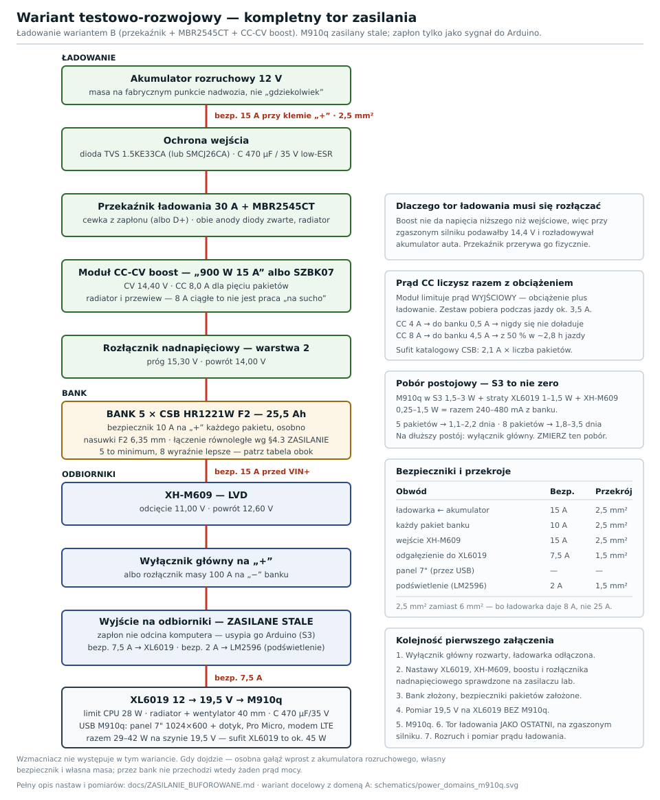
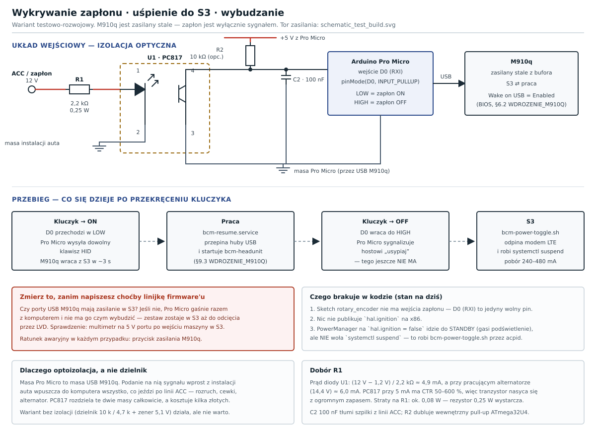

# Wdrożenie testowo-rozwojowe — mało funkcji, pełny tor zasilania

Wariant do bieżącej weryfikacji i poprawek **w jeżdżącym aucie**: Android Auto
wireless + dźwięk przez mini-jack M910q, ekran 7", przyciski SWC, modem LTE.
Wszystko pozostałe wyłączone.

Wdrożenie docelowe (pełne): [`WDROZENIE_M910Q.md`](WDROZENIE_M910Q.md).

> **To nie jest stanowisko biurkowe.** Zestaw jedzie w aucie, więc tor
> zasilania jest kompletny: ładowanie banku, blokada przeładowania i LVD.
> Oszczędzamy na funkcjach BCM i na wariancie ładowarki — **nie na
> zabezpieczeniach**.

> **Ekran 7" to konfiguracja tymczasowa.** Docelowy panel to **10,1"
> 1280×800**, opcjonalnie drugi **6,86" 1280×480** — i tak jest ustawione
> w `config/bcm_config.yaml`. Ten wariant używa osobnego pliku
> `config/bcm_config_test.yaml` z 1024×600, żeby nie ruszać konfiguracji
> produkcyjnej.

---

## Spis treści

1. [Co uruchamiamy](#1-co-uruchamiamy)
2. [Co już masz](#2-co-już-masz)
3. [Zasilanie](#3-zasilanie)
4. [Lista zakupowa](#4-lista-zakupowa)
5. [Instalacja software'u](#5-instalacja-softwareu)
6. [Uruchomienie](#6-uruchomienie)
7. [Odbiór](#7-odbiór)
8. [Czego celowo nie ma](#8-czego-celowo-nie-ma)
9. [Droga do wersji docelowej](#9-droga-do-wersji-docelowej)

---

## 1. Co uruchamiamy

Pięć modułów zamiast dwudziestu ośmiu, plus dwa podsystemy potrzebne do
Android Auto wireless:

| Przełącznik | Po co | Czego wymaga |
|-------------|-------|--------------|
| `dashboard` | frontend na porcie 5002 | ekran 7" + Chromium |
| `multimedia` | **Android Auto** (openauto) | telefon + BT + P2P-GO |
| `input` | **przyciski SWC** | Arduino Pro Micro (USB HID) |
| `audio` | głośność i EQ | wyjście analogowe M910q |
| `network` | status łącza | modem LTE (przez NetworkManager) |
| `bluetooth` | bootstrap handshake'u AA wireless | karta/dongiel BT |
| `wifi_ap` | P2P-GO — łącze danych AA | karta MT7921 |

Reszta — OBD, kamery, parkowanie, czujniki, przekaźniki, GPS, alarm — jest
**wyłączona**, bo nie ma podłączonego sprzętu. Włączanie modułów bez
hardware'u produkuje tylko szum w logach.

### Trzy ustalenia z kodu, które upraszczają ten wariant

**Dźwięk nie wymaga DAC-a USB.** `src/audio/pipewire_ctrl.py` na x86 używa
**domyślnego sinka PipeWire** — czyli tego, co ustawisz w systemie. Wyjście
analogowe M910q (mini-jack) działa bez żadnych zmian w kodzie. DAC USB
ES9038Q2M to podniesienie jakości, nie warunek uruchomienia.

**Modem LTE nie wymaga konfiguracji w BCM.** `src/network/lte.py` na x86
tylko **raportuje** stan łącza (`lte.connected`, `lte.signal`, `lte.ip`);
samo połączenie robi NetworkManager. Huawei E3372 w trybie HiLink zgłasza się
jako karta sieciowa i działa od podłączenia.

**Moduł `power` nie usypia maszyny — nawet gdy go włączysz.**
`PowerManager` (`src/power/power_manager.py`) na `hal.ignition = false`
przechodzi do STANDBY, co oznacza wygaszenie podświetlenia i
`power.active = false` — **żadnego `systemctl suspend`**. Uśpienie robi
`bcm-power-toggle.sh` przez acpid, poza BCM. Do tego na x86 nikt
`hal.ignition` nie publikuje. Pełne rozpisanie luki: §3.1a.

---

## 2. Co już masz

| Element | Uwaga |
|---------|-------|
| Lenovo M910q | |
| Ekran 7" | 1024×600, HDMI + dotyk USB |
| Karta WiFi MediaTek MT7921 | **AA wireless po P2P-GO już działa** |
| Pody SWC + dekoder | rezystorowa drabinka → wejście analogowe |
| Modem LTE Huawei E3372 | HiLink, USB |
| Akumulatory CSB HR1221W × 8 | AGM 12 V / 5,1 Ah — do banku idzie **7** (§3.4) |
| **XL6019** | step-up 12 → 19,5 V dla M910q |
| **XH-M609** | LVD, ochrona banku przed rozładowaniem |

---

## 3. Zasilanie

### 3.1 Tor — co jedzie w aucie



| Rysunek | Co pokazuje |
|---------|-------------|
| [`power_test_build.svg`](../schematics/power_test_build.svg) | przegląd blokowy — ten powyżej |
| [`schematic_test_build.svg`](../schematics/schematic_test_build.svg) | **schemat ideowy** z symbolami elektrycznymi |
| [`wiring_test_build.svg`](../schematics/wiring_test_build.svg) | **schemat połączeniowy** — zaciski i numery przewodów |
| [`ignition_sense.svg`](../schematics/ignition_sense.svg) | **wykrywanie zapłonu** — optoizolacja, wartości elementów |

Tabele „skąd → dokąd": [`SCHEMATY_POLACZEN.md`](SCHEMATY_POLACZEN.md) §10.

```
akumulator rozruchowy
   │  bezpiecznik F1 15 A przy klemie „+", przewód 4 mm²
   ▼
TVS + kondensator 470 µF/35 V        ← ochrona wejścia (§5.4 ZASILANIE)
   │
   ▼
przekaźnik ładowania 30 A            ← cewka z zapłonu, dioda 1N4007
   │
   ▼
dioda MBR2545CT (obie połówki równolegle, radiator)
   │
   ▼
moduł CC-CV boost  (CV 14,40 V, CC wg §3.3)
   │
   ▼
rozłącznik nadnapięciowy (próg 15,30 V)   ← warstwa 2
   │
   ▼
BANK AGM 7 × HR1221W ── bezpiecznik 10 A (FB1…FB7) na „+" każdego pakietu
   │
   ▼
XH-M609 (LVD)  ── bezpiecznik 15 A przed VIN+
   │  odcięcie 11,00 V · powrót 12,60 V
   ▼
wyłącznik główny na „+"  (albo rozłącznik masy na „−" banku)
   │
   ├── bezp. 7,5 A → XL6019 12 → 19,5 V → M910q   ← ZASILANY STALE
   │                                     └── USB: panel 7", dotyk,
   │                                         Pro Micro, modem LTE
   │
   └── bezp. 2 A → LM2596 12 → 5 V → podświetlenie panelu (§3.1b)

sygnał zapłonu ──► wejście Arduino ──► USB ──► M910q: S3 / wybudzenie
```

Pięć rzeczy warto tu zauważyć:

- **Nie ma już domeny B.** M910q wisi na buforze na stałe, a zapłon jest
  tylko **sygnałem** — Arduino go wykrywa i usypia albo wybudza komputer.
  Konsekwencje w §3.1a; jedna z nich jest kosztowna.
- **Przekaźnik przeniósł się do toru ładowania.** Rozłącza ładowanie przy
  zgaszonym silniku — nie odcina już niczego po stronie odbiorników.
- **Panel 7" wisi na USB M910q** — dotyk i zasilanie idą tym samym kablem,
  więc USB musi zostać. Osobno idzie tylko **podświetlenie**, przez LM2596
  na złącze PWM + GND panelu (§3.1b).
- **Jeden bezpiecznik na komputer — ale większy.** Wszystko idzie przez
  XL6019, więc przy 45 W wyjścia i sprawności 85 % to 4,2 A przy 12,6 V,
  a przy napięciu banku bliskim progu LVD **4,6 A**. Bezpiecznik 5 A
  siedziałby na krawędzi i przepalał się bez żadnej usterki — dlatego
  **7,5 A**.
- **Przewody toru ładowania przy CC 8,0 A.** Wejście toru niesie wtedy
  ~9,2 A: na 3 m przewodu 2,5 mm² to 0,39 V (2,8 %) — mieści się w kryterium
  3 %, ale bez zapasu, więc **zalecany jest 4 mm²** (0,24 V). Odcinek
  **ładowarka → szyna „+" banku bierz 4 mm² zawsze**, bo jego spadek siedzi
  w pętli CV i opóźnia wejście w absorpcję (§8.2
  [`ZASILANIE_BUFOROWANE.md`](ZASILANIE_BUFOROWANE.md)). Wkładka F1 15 A
  zostaje bez zmian — 9,2 A to 62 % jej wartości.

### 3.1a Stałe zasilanie i S3 — co to kosztuje

Zapłon nie odcina już komputera. Zamiast tego **Arduino wykrywa zmianę stanu
zapłonu**, a M910q schodzi do **S3** i z niego wraca. Zysk jest realny:
wybudzenie w ~3 s zamiast ~40 s zimnego startu, bez ryzyka ucięcia zapisu
na dysk w połowie.

Cena też jest realna — i to jest najważniejsza liczba w tej zmianie:

| Stan na postoju | Pobór z banku |
|-----------------|---------------|
| M910q w S3 (przez XL6019) | 160–320 mA |
| Arduino Nano przez MP1584 | ~15 mA |
| XH-M609 — **zmierz**, to jedyna niewiadoma | 20–125 mA |
| **Razem** | **200–460 mA** |

> **Wyświetlacz nie występuje w tej tabeli i to jest sprawdzone.** M910q
> **odcina zasilanie portów USB w S3**, więc panel gaśnie razem
> z komputerem i nie pobiera nic. Z tego samego powodu „Wake on USB" jest
> tu bezużyteczne, a Arduino **musi** mieć własne 5 V z MP1584 — inaczej
> zgaśnie razem z portem i nie będzie czym nacisnąć przycisku.

| Stan | Pobór | 7 pakietów (35,7 Ah, do 50 % DoD) |
|------|-------|-----------------------------------|
| **S3** | 200–460 mA | **1,6–3,7 dnia** |
| **Wyłączony** (impuls 5 s) | 50–150 mA | **5,0–14,9 dnia** |

Dlatego eskalacja z S3 do pełnego wyłączenia po dwóch godzinach jest tu
naprawdę warta zachodu — a przy sterowaniu przyciskiem zasilania kosztuje
tyle, co dłuższy impuls.

> Impuls 5 s dostaje **tylko maszyna stabilnie uśpiona** (z diodą panelu,
> `FEATURE_PWRLED`). Komputer obudzony ręcznie przy zgaszonym zapłonie
> sensor hub najpierw usypia krótkim impulsem, a 2 h liczy od chwili
> wybudzenia — pracujący Linux nie dostaje twardego wyłączenia. Bez diody
> (pętla otwarta) „uśpiona” znaczy tylko „tak zakładamy po własnym impulsie”.
> Po krótkim impulsie na pracującą maszynę sensor hub przez 90 s nie
> naciska drugi raz: `bcm-power-toggle.sh` najpierw zatrzymuje BCM (do
> 45 s), a drugie wciśnięcie uśpiłoby komputer ponownie zaraz po
> wybudzeniu. Jeśli w tym czasie wróci zapłon (zgasł silnik, ponowny
> rozruch), a komputer mimo to zaśnie, dostaje krótki impuls i wstaje.
> Logika jest w `arduino/sensor_hub/power_logic.h`, z testami na PC
> (`make -C arduino sensor_hub-test`), także dla przepełnienia `millis()`
> po ~49,7 dnia pracy płytki.
>
> **Sprawdzenie na stole, zanim zaczniesz polegać na eskalacji.** Rytm
> migania diody M910q w S3 nie jest znany, a eskalacja (i każde
> naciśnięcie) działa tylko na stan, który się utrzymał. BCM zatrzymany
> (trzyma port), `picocom -b 115200 /dev/ttyUSB1`, potem:
>
> 1. komputer pracuje → po kilku sekundach, potem co 2 s, `PWR:RUNNING`;
> 2. uśpij go (`systemctl suspend`) → w ciągu kilku sekund `PWR:SLEEP`
>    i **przez co najmniej 3 minuty wyłącznie `PWR:SLEEP`** — żadnej linii
>    `PWR:RUNNING` ani `PWR:OFF` pomiędzy;
> 3. obudź go przyciskiem → `PWR:RUNNING` (dekoder czeka ~6 s ciągłego
>    światła, zanim uzna pracę);
> 4. wyłącz go → `PWR:OFF`.
>
> Jeśli w kroku 2 stan przeskakuje, dekoder nie rozpoznaje rytmu: sensor
> hub nie wyśle wtedy ani impulsu 5 s, ani krótkiego impulsu eskalacji
> (maszyna zostaje w S3 i pobiera prąd z wiersza **S3**), a pobudkę
> zapłonem wyśle dopiero po ~30 s. Zapisz rytm (ile świeci, ile nie)
> i popraw `PWR_LED_QUIET_WINDOWS` w `power_logic.h` — obecnie rozpoznaje
> miganie z przerwami do ~6 s.

W wierszu **Wyłączony** rozrzut bierze się w całości z XH-M609. W wierszu
**S3** większą część wnosi sam M910q (160–320 mA z tabeli wyżej), więc tam
zmierzyć trzeba oba. Zmierz je raz, a obie liczby zrobią się konkretne.

Co z tym zrobić:

- **Auto używane co dzień lub co drugi dzień** — to nie problem, bank i tak
  doładowuje się podczas jazdy.
- **Dłuższy postój** — użyj **wyłącznika głównego**. To jedyna rzecz, która
  naprawdę zeruje pobór, i dlatego został na liście jako obowiązkowy.
- **XH-M609 jest siatką bezpieczeństwa**, nie planem: odetnie przy 11,00 V,
  więc bank przeżyje, ale wrócisz do wyłączonego zestawu.
- **Eskalacja S3 → pełne wyłączenie** po 2 h postoju: przy sterowaniu
  przyciskiem zasilania to jedna linijka firmware'u (impuls 5 s zamiast
  250 ms), a powrót to znowu krótki impuls. Patrz niżej.

#### Jak to zrobić najmniejszym kosztem — przez fizyczny przycisk zasilania



Przycisk zasilania M910q to zwykły **przycisk chwilowy zwierny**, a Linux ma
na nim już zbudowaną całą potrzebną logikę:

| Stan maszyny | Krótkie wciśnięcie |
|--------------|--------------------|
| praca | acpid → `bcm-power-toggle.sh` → **S3** |
| S3 | **wybudzenie** w ~3 s |
| wyłączona | **start** |
| dowolny, przytrzymanie > 4 s | twarde wyłączenie |

Czyli **jeden impuls obsługuje oba kierunki**. Wystarczy, żeby Arduino umiało
ten przycisk „nacisnąć" — styki **modułu przekaźnika 1-kanałowego wpięte
równolegle** do przycisku, sterowane impulsem 250 ms z pinu **A2**.

Co to daje w porównaniu z wysyłaniem klawiszy HID i osobnym hakiem na hoście:

| | |
|---|---|
| ✅ | **zero zmian po stronie hosta** — `acpid` + `bcm-power-toggle.sh` już są skonfigurowane (§7.3 [`WDROZENIE_M910Q.md`](WDROZENIE_M910Q.md), `HandlePowerKey=ignore` w `logind.conf`) |
| ✅ | wybudzanie **nie zależy od „Wake on USB"** — przycisk zasilania działa zawsze, także po twardym wyłączeniu |
| ✅ | eskalacja S3 → pełne wyłączenie po kilku godzinach to po prostu **dłuższy impuls** (5 s), a powrót — znowu krótki |
| ⚠️ | układ jest **otwarty**: Arduino nie wie, czy maszyna śpi. Pulsujemy na *zmianę* stanu zapłonu, więc rozjazd wymaga zdarzenia z zewnątrz i naprawia się przy następnym cyklu kluczyka |

Domknięcie pętli, jeśli kiedyś zacznie przeszkadzać: wejście z **diody
zasilania panelu przedniego** (świeci = praca, miga = S3). Jeden przewód
więcej, za to stan czytany zamiast zakładanego.

**Zostaje jedna rzecz do dorobienia — firmware Pro Micro:**

| Element | Szczegóły |
|---------|-----------|
| Wejście zapłonu na **D0 (RXI)** | jedyny fizycznie wolny pin. Sygnał 12 V **musi** iść przez optoizolator PC817 — nie wprost na pin 5 V |
| Wyjście na przekaźnik na **A2** | pin jest zajęty przez przycisk dźwigni „brightness cycle”, ale ta funkcja **i tak dziś nic nie robi** (§3.1c), więc jest wolny w praktyce |
| Debounce zapłonu 2 s + impuls 250 ms / 5 s | żeby migotanie na linii ACC nie usypiało maszyny w kółko |

`modules.power` zostaje wyłączony i nie ma to znaczenia: `PowerManager`
w stanie STANDBY gasi podświetlenie, a nie usypia maszynę — uśpienie robi
acpid, poza BCM.

> **Pro Micro musi mieć własne 5 V.** Jeżeli wisi na USB M910q, a ten odcina
> zasilanie portów w S3 — Arduino gaśnie razem z komputerem i nie ma czym
> nacisnąć przycisku. Zasil je z **MP1584** z bufora i **przetnij żyłę VBUS
> w kablu USB** (albo użyj kabla data-only): dwa źródła 5 V zwarte razem to
> proszenie się o kłopoty. Dane po USB zostają.

> **Zanim cokolwiek zlutujesz — zmierz przycisk.** Miernik w tryb ciągłości,
> maszyna odłączona od zasilania: zaciski mają być rozwarte, a przy wciśnięciu
> zwarte. To potwierdza, że to zwykły przycisk chwilowy, i pokazuje, gdzie
> wpiąć styki przekaźnika.

### 3.1b Podświetlenie panelu — osobne zasilanie

Panel ma osobne złącze **PWM + GND** do sterowania podświetleniem, niezależne
od USB. To pozwala rozdzielić dwie rzeczy:

| Co | Skąd |
|----|------|
| logika panelu + dotyk | **USB z M910q** — tu nic się nie zmienia |
| podświetlenie | **LM2596 12 → 5 V** wprost z bufora, bezp. 2 A |

Dzięki temu podświetlenie nie zjada budżetu portu USB (patrz niżej) ani
zapasu XL6019.

**Regulacji jasności w tym wariancie nie ustawiaj z BCM** — dlaczego,
opisuje §3.1c. Wejście PWM podaj na stały poziom, a jasność reguluj
**fizycznymi przyciskami panelu**.

> **Zgaś podświetlenie razem z komputerem.** LM2596 wisi na buforze na stałe,
> więc jeżeli panel świeci przy M910q w S3, dokładasz **2–4 W do poboru
> postojowego** — a to niemal podwaja liczby z §3.1a. Większość paneli gasi
> podświetlenie sama po zaniku sygnału HDMI; **sprawdź to pomiarem**. Jeżeli
> Twój tego nie robi, wstaw na wyjście LM2596 mały przekaźnik albo MOSFET
> sterowany z Arduino — ono i tak zna stan zapłonu.

#### Budżet portu USB

Po zdjęciu podświetlenia z USB zostaje sama logika panelu i dotyk, czyli
0,2–0,4 A przy 5 V. Port USB 3.0 M910q daje 900 mA, USB 2.0 — 500 mA, więc
jeden port wystarcza z zapasem. Gdyby panel jednak przyszedł z kablem
rozgałęzionym na dwa wtyki, podepnij oba do **różnych** portów — objawem
niedoboru jest migotanie albo restart panelu, nie brak obrazu.

#### Zapas XL6019

| Odbiornik | Moc |
|-----------|-----|
| M910q (limit CPU 28 W) | 25–35 W |
| Panel — logika + dotyk przez USB | 1–2 W |
| Pro Micro + modem LTE | 3–5 W |
| **Razem na szynie 19,5 V** | **29–42 W** |

XL6019 daje ok. **45 W**. Przeniesienie podświetlenia na LM2596 odzyskało
kilka watów, ale zapas dalej jest cienki, więc **limit poboru CPU nie jest
zaleceniem, tylko warunkiem działania** — instrukcja w
[`ZASILANIE_BUFOROWANE.md`](ZASILANIE_BUFOROWANE.md) §3.5a. Drugi panel na
tej samej szynie i tak się nie zmieści.

### 3.1c Regulacja jasności — czego nie ma w kodzie

Obserwacja, że w UI nie ma suwaka jasności, jest **trafna**. Stan faktyczny
jest jednak bardziej pokręcony niż „jest tylko czujnik":

| Element | Stan |
|---------|------|
| Suwak jasności w **web UI** | **nie istnieje** |
| `POST /api/config` z kluczem `brightness` | przyjmuje wartość, zapisuje `display.dashboard.brightness` i publikuje `config.changed` — **nikt tego nie konsumuje** |
| Ekran ustawień w **Pygame** (`settings_screen.py`) | ma pozycję „Brightness" 0–100 co 10 — ten sam martwy klucz |
| LDR na **A1 Pro Micro** | sketch czyta go i wysyła po serialu `LIGHT:<0-1023>` co 2 s |
| Przycisk dźwigni / akcja SWC „Brightness" | wysyła **F9** → `action_dispatch` mapuje na `input.brightness_cycle` |
| `BrightnessController` (`src/power/brightness.py`) | subskrybuje jedno i drugie, ma 6 stopni ręcznych i mapę czujnika… ale **nigdy nie jest tworzony** — `start_power()` uruchamia tylko `PowerManager`, `BacklightController` i `ShutdownHandler` |
| Wyjście PWM do sprzętu | `BacklightController` na x86 tylko symuluje; realny PWM idzie przez `central_lock.py` → **Nano #1**, którego tu nie ma |

Czyli: cały łańcuch istnieje, ale **jest rozpięty w dwóch miejscach naraz** —
brakuje instancji kontrolera i brakuje płytki, która wystawia PWM. Ani LDR,
ani przycisk SWC nic dziś nie robią.

**Zgodnie z ustaleniem zostawiamy to jak jest.** Panel ma fizyczną regulację
switchami i to w zupełności wystarcza na czas testów. Domknięcie tego
łańcucha to zadanie na krok 6 roadmapy (§9), razem z Nano #1.

### 3.2 Ładowanie — wariant B, i dlaczego akurat on

[`ZASILANIE_BUFOROWANE.md`](ZASILANIE_BUFOROWANE.md) §5 opisuje dwa warianty:
gotową ładowarkę B2B (800–1000 PLN) albo przekaźnik ładowania z diodą
i moduł CC-CV boost (70–180 PLN). Na etapie testowym bierzemy **wariant B**
— różnica to kilkaset złotych za funkcje, które przy jeździe testowej
niewiele wnoszą.

**CV ustawiamy na 14,40 V, nie niżej.** To nie jest wybór estetyczny: boost
ma władzę nad prądem tylko wtedy, gdy faktycznie przetwarza, czyli gdy
wyjście jest wyżej niż wejście. Na wejściu modułu przy pracującym alternatorze
jest 13,4–14,2 V, więc nastawa 13,8 V wepchnęłaby moduł w **pass-through**,
gdzie pętla CC nie ma czym sterować, a rozładowany bank ciągnąłby ponad 30 A
przez sam dławik. Pełne wyprowadzenie: §5.3b
[`ZASILANIE_BUFOROWANE.md`](ZASILANIE_BUFOROWANE.md).

Konsekwencje 14,40 V bez kompensacji temperaturowej — i co je łagodzi:

| | |
|---|---|
| ✅ | CC działa zawsze, więc prąd ładowania jest naprawdę ograniczony |
| ✅ | absorpcja podawana **tylko podczas jazdy** — przekaźnik ładowania jest na postoju rozwarty, bank nie stoi na 14,4 V |
| ✅ | bank ładuje się do 100 %, nie do 90 % |
| ⚠️ | brak kompensacji: przy 40 °C prawidłowa absorpcja to 13,95 V, czyli jedziesz 0,45 V za wysoko |
| ⚠️ | próg warstwy 2 zostaje na **15,30 V** |

Jeśli bagażnik latem dochodzi do 50 °C — zejdź z CV do **14,10 V**. Nadal
powyżej wejścia, więc CC pozostaje sprawne.

**Dlaczego tor ładowania musi być rozłączany:** boost nie potrafi dać
napięcia niższego niż wejściowe, więc gdyby jego wejście wisiało na stałe na
akumulatorze rozruchowym, to przy zgaszonym silniku dalej podawałby 14,4 V
i **rozładowywał akumulator auta**. Przekaźnik przerywa obwód fizycznie,
a dioda MBR2545CT jest drugą barierą, gdyby styki się zespawały. Szczegóły:
§5.3c [`ZASILANIE_BUFOROWANE.md`](ZASILANIE_BUFOROWANE.md).

### 3.2a Konkretne moduły

**Moduł CC-CV** — trzy sensowne opcje, wszystkie to boost:

| Model | Dane | Cena (PLN) | Kiedy ten |
|-------|------|-----------|-----------|
| **„900 W 15 A" z wyświetlaczem** (typ CNC/DPS, wej. 8–60 V, wyj. 10–120 V) | CC 0–15 A, nastawa cyfrowa z odczytem | 90–140 | **bierz ten** — wpisujesz 14,40 V i 8,0 A i odczytujesz z powrotem; przy pierwszej instalacji to warte tych 40 zł różnicy |
| **„1500 W 30 A" boost CC-CV** (wej. 10–60 V, wyj. 12–97 V) | CC 0,8–22 A · sprawność 92–97 % · 130 × 84 × 52 mm, radiator + wentylator | 60–95 | duży zapas mocy, pracuje zimno; nastawa potencjometrami — mierz multimetrem |
| ~~**„600 W 10 A"**~~ (wej. 10–60 V, wyj. 12–80 V) | CC-CV potencjometrami | 50–80 | **odpada** — przy CC 8,0 A to 80 % jego zakresu, a ścieżki tej płytki są słabe |

> **Nie szukaj SZBK07.** Wcześniejsze wydanie wymieniało go tu jako
> „1500 W 30 A" — to przetwornica **obniżająca** (buck 300 W na LM5116),
> więc z 13,7 V nie zrobi 14,4 V. Moduł o podobnych gabarytach szukaj po
> frazie „boost converter 1500W 30A 10-60V". Uzasadnienie: §5.3a
> [`ZASILANIE_BUFOROWANE.md`](ZASILANIE_BUFOROWANE.md).

> **Sprawdź „auto output on power-on"** w module z wyświetlaczem. Jeśli ta
> opcja jest wyłączona, po każdym uruchomieniu silnika wyjście stoi w OFF
> i bank się nie ładuje — bez żadnego objawu, dopóki nie zejdzie do LVD.

Modułu **buck-boost LTC3780** (WD2002SJ / XR-131) *nie* bierz do siedmiu
pakietów: utrzymałby 13,8 V, ale ciągle daje tylko 7 A / 80 W, czyli ~5,8 A
przy 13,8 V. Po odjęciu 3,5 A obciążenia zostaje 2,3 A do banku — czyli
11,6 h fazy CC z progu LVD zamiast 5,95 h.

**Rozdział ładowania** — przekaźnik plus dioda, obie pozycje po kilkanaście
złotych:

| Element | Dane | Cena (PLN) | Uwaga |
|---------|------|-----------|-------|
| **Przekaźnik 30 A SPDT** + podstawka | cewka z zapłonu, dioda 1N4007 równolegle | 15–25 | tor niesie 9,2 A przy CC 8,0 A, więc 30 A styków to spory zapas |
| **MBR2545CT** — 25 A / 45 V, TO-220AB | dwie połówki 12,5 A ze wspólną katodą | 5–12 | **zewrzyj obie anody** — przy 9,2 A łącznie każda wiezie 4,6 A, Vf ≈ 0,48 V. Radiator obowiązkowy (**4,4 W** przy CC 8,0 A — ten sam, co przy czterech pakietach). Blaszka jest katodą, więc izoluj ją od masy |

> **Cewka z zapłonu ma jeden koszt.** Przy kluczyku w ON bez pracującego
> silnika przekaźnik jest zwarty i boost ładuje bank **z akumulatora
> rozruchowego**. Przy normalnym rozruchu to kilka sekund; przy dłuższym
> staniu z kluczykiem — już nie. Jeśli chcesz to wyciąć, podepnij cewkę pod
> **D+/L alternatora** zamiast pod zapłon: jeden przewód inaczej, a sygnał
> znaczy wtedy „alternator ładuje". Sprawdź potem lampkę kontrolną — cewka
> bierze ~150 mA z jej obwodu.

### 3.3 Prąd ładowania — policz go z obciążeniem

Moduł CC-CV limituje **prąd wyjściowy**, czyli obciążenie **plus** ładowanie.
Zestaw testowy pobiera podczas jazdy ok. **3,5 A** — to całe ~37 W z tabeli
w §3.1 przepuszczone przez XL6019 (sprawność ~85 %) i przeliczone na napięcie
banku. Przeniesienie panelu na USB niczego tu nie zmieniło: ta sama energia,
tylko inną drogą. Jeżeli ustawisz CC na 4 A, do banku popłynie 0,5 A
i **nigdy się nie doładuje**.

Reguła:

```
CC = obciążenie (≈3,5 A) + docelowy prąd ładowania
     jednocześnie CC ≤ 2,1 A × liczba pakietów   ← sufit katalogowy CSB
     oraz         CC ≤ 8,0 A                     ← sufit toru: płytka XH-M603
```

| Pakiety | Sufit katalogowy | Zalecane CC | Netto do banku |
|---------|------------------|-------------|----------------|
| **7** | **14,7 A** | **8,0 A** | **4,5 A** |
| 6 (po awarii jednego pakietu) | 12,6 A | 8,0 A | 4,5 A |
| 4 (poprzednia konfiguracja) | 8,4 A | 7,5 A | 4,0 A |

**Przy siedmiu pakietach ten rachunek się odwraca.** Sufit katalogowy wynosi
14,7 A i **przestał być wiążący** — nastawę ogranicza teraz tor ładowania,
konkretnie płytka rozłącznika nadnapięciowego XH-M603 (realna obciążalność
ok. 10 A, spec „≤ 8 A"). Stąd **CC 8,0 A**, czyli 54 % sufitu akumulatorów
i 80 % obciążalności płytki. Element po elemencie: §6.3
[`ZASILANIE_BUFOROWANE.md`](ZASILANIE_BUFOROWANE.md).

Przy takim prądzie tani moduł **wymaga radiatora i przewiewu**; katalogowe
10 A na puszce traktuj jako wartość szczytową, nie roboczą.

> **Zmierz temperaturę zacisków XH-M603 przy 8 A przez 30 min**, zanim
> oprzesz na tej nastawie cały układ. Obciążalność ~10 A jest oszacowaniem,
> nie wartością katalogową. Jeśli moduł się grzeje — zejdź na CC 6,0 A
> i pogódź się z 14–16 h ładowania od progu LVD.

### 3.4 Ile pakietów

**Siedem (35,7 Ah)** — z ośmiu posiadanych; jeden zostaje w zapasie.
Pakiety łączone **równolegle**, więc napięcie zostaje 12 V, a sumuje się
pojemność i dopuszczalny prąd ładowania.

| Pakiety | Pojemność | Praca przy zgaszonym silniku (3,5 A) | Postój w S3 (300 mA) | Doładowanie z 50 % |
|---------|-----------|--------------------------------------|----------------------|--------------------|
| 4 (poprzednio, CC 7,5 A) | 20,4 Ah | ~2,9 h | ~1,4 dnia | ~2,6 h jazdy |
| 6 (po awarii jednego) | 30,6 Ah | ~4,4 h | ~2,1 dnia | ~3,4 h jazdy |
| **7** | **35,7 Ah** | **~5,1 h** | **~2,5 dnia** | **~4,0 h jazdy** |

Wszystko do 50 % DoD. Kolumna „doładowanie" to sama faza CC, bez absorpcji:
dla sześciu i siedmiu pakietów przy nastawie **CC 8,0 A** i obciążeniu 3,5 A
(netto 4,5 A do banku), dla wiersza czteropakietowego przy jego własnej
ówczesnej nastawie CC 7,5 A (netto 4,0 A). Na pełne naładowanie dolicz
mnożnik ×1,3–1,5. Pełny rozrzut poboru w S3 (200–460 mA) jest w §3.1a.

Co daje przejście z czterech pakietów na siedem: **+75 % pojemności**
(20,4 → 35,7 Ah), +5,4 kg masy (7,2 → **12,6 kg**) i sufit ładowania
podniesiony z 8,4 na **14,7 A**. Nastawa CC idzie z 7,5 na **8,0 A** — nie
dlatego, że tyle pozwala akumulator (pozwala na 14,7 A), tylko dlatego, że
tyle wyrabia tor ładowania (§3.3).

> **Uwaga, to jest kontrintuicyjne.** Siedem pakietów kupuje **dłuższy postój**,
> a nie odporność na krótkie przejazdy. Doładowanie po rutynowym postoju
> wydłuża się z ~2,6 h do ~4,0 h fazy CC, bo pojemność urosła o 75 %, a prąd
> netto do banku tylko o 12 %. Minimalna dzienna jazda podtrzymująca bilans
> zależy wyłącznie od prądu ładowania — tabela w §9.4
> [`ZASILANIE_BUFOROWANE.md`](ZASILANIE_BUFOROWANE.md).

> **Miejsce montażu trzeba zmierzyć.** Siedem pakietów to 490 × 90 × 101 mm
> w jednym rzędzie albo 280 × 180 × 101 mm w układzie 4 + 3 (zalecany
> mechanicznie). Ze skrzynką ok. 300 × 200 × 115 mm. Ta dokumentacja nie
> podaje wymiarów przestrzeni pod fotelem pasażera — sprawdź to przed
> zakupem skrzynki. Masa 12,6 kg wymaga też czterech punktów mocowania M8
> z płytkami rozkładającymi ≥ 40 × 40 × 3 mm; §4.7 ZASILANIE_BUFOROWANE.

> Krótkie przejazdy po mieście nie doładują banku po dłuższym postoju.
> Kolumna „doładowanie" zakłada ciągłą jazdę z pracującym alternatorem.

> **Bezpieczników na pakietach nie pomijaj.** Zwarty HR1221W potrafi oddać
> ponad 100 A — 5 Ah wystarczy, żeby zapalić przewód. Siedem sztuk, oznaczenia
> **FB1…FB7** (nie F2…F8 — F7 i F8 są już zajęte). Prąd zwarciowy przez
> wkładkę uszkodzonego pakietu to 637 A, a przez każdą z sześciu zdrowych
> 106 A: stosunek 6 : 1 zamiast 3 : 1, czyli selektywność jest **lepsza** niż
> przy czterech pakietach.

> **Łączenie równoległe siedmiu pakietów wymaga szyny zbiorczej.** Dwa
> płaskowniki miedziane (min. 15 × 2 mm) z siedmioma odczepami co 70 mm,
> odbiór **po przekątnej** — „+" z odczepu 1, „−" z odczepu 7. Ogonki 1,5 mm²
> o równej długości ±30 mm. Nigdy oba bieguny z jednego końca szyny.
> Rysunek i liczby: §4.3 [`ZASILANIE_BUFOROWANE.md`](ZASILANIE_BUFOROWANE.md).

### 3.5 Nastawy modułów

| Moduł | Nastawa | Uwaga |
|-------|---------|-------|
| **XL6019** | wyjście **19,5 V** pod obciążeniem | ustaw multimetrem, zabezpiecz potencjometr |
| **XH-M609** | odcięcie **11,00 V**, powrót **12,60 V** | sprawdź, czy pracuje stabilnie przy 11 V |
| **Przekaźnik ładowania** | cewka z zapłonu (albo D+) | dioda 1N4007 równolegle, katodą do „+” |
| **CC-CV boost** | CV **14,40 V**, CC wg §3.3 | ustaw CV **bez obciążenia**, CC na sztucznym obciążeniu; nigdy poniżej napięcia wejściowego — §3.2 |
| **Rozłącznik nadnapięciowy** (XH-M603) | próg **15,30 V**, powrót **14,00 V** | test zasilaczem laboratoryjnym, nie „na aucie"; steruje cewką przekaźnika mocy — §6.3 ZASILANIE |

Obowiązkowe sprawdzenia XL6019 i XH-M609 przed pierwszym załączeniem:
[`ZASILANIE_BUFOROWANE.md`](ZASILANIE_BUFOROWANE.md) §3.4 i §7.3.

> **Limit poboru CPU ustaw od razu**, nie „potem". XL6019 daje ok. 45 W,
> a M910q pod pełnym obciążeniem czterech wątków dobija do 55 W. Instrukcja:
> [`ZASILANIE_BUFOROWANE.md`](ZASILANIE_BUFOROWANE.md) §3.5a.

### 3.6 Wyłączanie — dopóki Arduino nie usypia, robisz to ręcznie

Nic już nie tnie zasilania komputera, więc **nie ma ryzyka ucięcia zapisu
na dysk** — to główny zysk z §3.1a. Dopóki jednak brakuje trzech elementów
z tabeli w §3.1a, przejście do S3 wywołujesz sam:

```
1. Zaparkuj.
2. Przycisk zasilania M910q  →  S3  (acpid + bcm-power-toggle.sh, §7.3 WDROZENIE_M910Q)
3. Kluczyk OFF — zasilanie i tak zostaje, więc kolejność nie ma znaczenia.
4. Dłuższy postój? Wyłącznik główny — inaczej S3 zjada bank (§3.1a).
```

Wybudzenie: przycisk zasilania albo dowolny klawisz z Pro Micro, o ile
w BIOS-ie włączone jest **Wake on USB**. Wraca w ~3 s.

Zapomniany krok 2 nie jest groźny — maszyna po prostu pracuje dalej i szybciej
zjada bank. Zapomniany krok 4 przy tygodniowym postoju kończy się odcięciem
przez LVD.

---

## 4. Lista zakupowa

Cała lista — jedna tabela, z cenami i uzasadnieniem każdej pozycji — jest
w osobnym dokumencie: **[`LISTA_ZAKUPOWA.md`](LISTA_ZAKUPOWA.md)**.

| | |
|---|---|
| **Razem do kupienia** | **~670–1305 PLN** |
| Największe pozycje | moduł CC-CV boost (50–140), skrzynka na bank na 7 pakietów (100–200), szyny zbiorcze banku (60–140), rozłącznik nadnapięciowy (40–80), rozłącznik masy (40–70) |
| Czego **nie** kupujesz | VSR, ładowarka B2B, DAC USB, karta WiFi, buck dla panelu — pełna lista z powodami tamże |
| Warto dołożyć | multimetr z pomiarem prądu DC 10 A — bez niego nie odbierzesz instalacji |

Masz już: M910q, ekran 7", MT7921, pody SWC, modem LTE, 8 × HR1221W
(**do banku idzie 7** — §3.4, jeden zostaje w zapasie), XL6019, XH-M609,
Pro Micro, Nano V3, LM2596 i MP1584.

---

## 5. Instalacja software'u

### 5.1 System i BCM

Debian 13 (Trixie) minimal + pakiety + `/opt/bcm` + venv —
kroki §5 i §6 z [`WDROZENIE_M910Q.md`](WDROZENIE_M910Q.md). Bez zmian.

### 5.2 Nazwy złączy — sprawdź, nie zakładaj

```bash
for f in /sys/class/drm/card*-*/status; do echo "$f: $(cat $f)"; done
xrandr | grep " connected"
```

Na referencyjnym M910q złącza enumerują się jako `HDMI-A-1` / `HDMI-A-2`,
a główny panel wyszedł na **złączu 2**. Twoja sztuka może mieć inaczej.

### 5.3 Wyjście audio na mini-jack

```bash
# lista sinków
wpctl status

# ustaw analogowe wyjście M910q jako domyślne (podstaw swoje ID)
wpctl set-default <ID_sinka_analogowego>

# test
speaker-test -c2 -twav -l1
```

BCM nie wymaga tu żadnej konfiguracji — bierze domyślny sink.

### 5.4 Konfiguracja wariantu testowego

Repozytorium zawiera gotowy plik `config/bcm_config_test.yaml`: pięć
modułów plus `bluetooth` i `wifi_ap` włączone, reszta wyłączona,
ekran 1024×600.

> `--config` **podmienia całą konfigurację**, nie nakłada się na
> `bcm_config.yaml`. Dlatego jest to pełna kopia z pozmienianymi kluczami,
> a nie krótka nakładka.

### 5.5 Firmware Pro Micro

```bash
make -C arduino rotary_encoder-upload PORT=/dev/ttyACM0
```

Pody SWC podłącz do **A0** (Pod 1) i **A6** (Pod 2), dekoder: czerwony → ACC,
czarny → masa. **Uwaga: na płytce nie ma pola „A6" — to pad opisany `4`**
(na 32U4 kanały A6–A11 siedzą pod numerami cyfrowymi; opisane analogowo są
tylko A0–A3). Kalibracja: przytrzymaj HOME + BACK przy starcie płytki
i naciskaj kolejne przyciski wg podpowiedzi na porcie szeregowym. Progi
zapisują się w EEPROM.

Szczegóły: [`ARDUINO_SETUP_GUIDE.md`](ARDUINO_SETUP_GUIDE.md).

> **Pierwszy raz z Arduino?** Zanim dojdziesz do kalibracji SWC, wgraj
> firmware wg [`ARDUINO_OD_ZERA.md`](ARDUINO_OD_ZERA.md) — od kabla
> i sterownika USB, przez IDE, po test na biurku. Ten dokument zakłada,
> że nie miałeś wcześniej płytki w ręku.

### 5.6 Android Auto wireless (P2P-GO)

`openauto` kompilowany ze źródeł — procedura w
[`WDROZENIE_M910Q.md`](WDROZENIE_M910Q.md) §13.3. Łącze jest **bezprzewodowe**:
Bluetooth zestawia handshake, dane lecą po Wi-Fi Direct z karty MT7921.

Co robi który element (wprost z kodu):

| Element | Rola |
|---------|------|
| `modules.bluetooth` | rejestruje PBAP-PCE i MAP-MCE, wymusza Class-of-Device **0x620420** (carkit) |
| **autoapp / btservice** | właściwy handshake AA po RFCOMM — BCM celowo **nie** rejestruje UUID Android Auto |
| `modules.wifi_ap` | tworzy grupę **P2P-GO** i zapisuje `wifi.bssid_runtime` |
| `openauto.py` | czyta `wifi.bssid_runtime` i podaje telefonowi adres punktu |

Klucze w `config/bcm_config_test.yaml`, sekcja `wifi:` — ustawione domyślnie:

```yaml
wifi:
  enabled: true       # openauto ostrzega w logu, jeśli false
  mode: p2p_go
  band: a             # AA wireless wymaga 5 GHz
  channel: 149        # kanał 149 istnieje tylko w regdom US
  country: US
  regdom: US
```

Dwie pułapki, obie udokumentowane w kodzie:

- **Class-of-Device.** `bluetoothd` sam syntezuje CoD z zarejestrowanych
  wtyczek — PipeWire rejestruje A2DP/HFP i nadpisuje klasę carkit na
  „Computer". Telefon używa bitów CoD do bramkowania AA, więc z klasą
  „Computer" **wireless nigdy się nie pojawi**. `_force_carkit_cod()`
  przestempluje ją po każdej burzy rejestracji.
- **`wifi_hotspot` (ALFA-NET) musi zostać wyłączony.** MT7921 zgłasza
  `#{AP, P2P-GO} <= 1` — druga sieć na tym samym radiu rozwali grupę P2P.
  Współdzielenie internetu wymaga **osobnego** dongla USB.

Parowanie: telefon → BT → sparuj z adapterem BCM → Android sam zaproponuje
Android Auto. Kolejne uruchomienia łączą się automatycznie (boot sweep
w `BluetoothManager`).

**autoapp tylko bezprzewodowo.** `config/scripts/install-openauto.sh`
domyślnie (`BCM_AA_USB=0`) łata autoapp tak, że w ogóle nie dotyka USB.
Bez tej łatki autoapp wysyła handshake Android Auto (AOAP) do **każdego**
urządzenia USB i przełączyłby telefon w aucie (§5.7) w tryb akcesorium.
Binarka zbudowana wcześniej nie ma łatki — przebuduj:
`sudo BCM_AA_USB=0 bash config/scripts/install-openauto.sh --force`
(`BCM_AA_USB=1` = zachowanie upstream, AA także po kablu).

### 5.7 Telefon w aucie (Redmi na USB, `modules.car_phone`)

Drugi telefon zamontowany na stałe (plan, sekcja C) daje internet przez
tethering USB, pozycję GPS i zegar; BCM pilnuje jego baterii i temperatury.
Moduł `src/network/car_phone.py`, domyślnie **wyłączony** (w kodzie,
w `bcm_config.yaml` i w `bcm_config_test.yaml`) — włącz go w Ustawieniach →
Moduły, gdy telefon jest podłączony. `car_phone_hotspot` (wymaga
`car_phone`) dokłada do wiersza „Telefon w aucie” stan hotspotu Wi-Fi
telefonu (tylko odczyt).

Kolejność:

1. autoapp bez USB (§5.6, `BCM_AA_USB=0 … --force`).
2. `adb` z pakietu Debiana — instalują go `setup-x86.sh` i `apply-fixes.sh`
   (głośne ostrzeżenie, gdy się nie uda); `bcm-harden.sh` krok 8 tylko
   raportuje.
3. W telefonie: opcje programisty → debugowanie USB, „Disable adb
   authorization timeout”; aplikacja serwera NMEA TCP (np. gpsdRelay) na
   porcie 50000 (`network.car_phone.gps_remote_port`).
4. Podłącz telefon i raz wywołaj adb **przez gniazdo BCM** (niżej,
   „Bezpieczeństwo”) — w telefonie „Zawsze zezwalaj z tego komputera”:

   ```bash
   sudo install -d -m 0700 /run/bcm-adb     # moduł tworzy go sam; ręcznie tylko przed jego startem
   sudo env ADB_SERVER_SOCKET=localfilesystem:/run/bcm-adb/adb.sock adb devices -l
   ```

   Klucz adb to `/root/.android/adbkey` (generuje go adb; nigdy w repo).
   Zwykłe `sudo adb …` uruchamia **drugi** serwer adb na `127.0.0.1:5037`,
   który walczy z serwerem BCM o telefon na USB — jeśli to się zdarzyło:
   `sudo adb kill-server`. Wygodny alias:
   `alias bcm-adb='sudo env ADB_SERVER_SOCKET=localfilesystem:/run/bcm-adb/adb.sock adb'`.
5. Przy dwóch urządzeniach Android na USB wpisz serial z `bcm-adb devices -l`
   do `network.car_phone.serial` w `config/local.yaml` (bez tego moduł nic
   nie robi i pokazuje podpowiedź).

Co robi moduł (co `check_sec`, wszystko listami argumentów, bez powłoki):

| Krok | Polecenie | Uwagi |
|------|-----------|-------|
| telefon | `adb devices -l` | tylko urządzenia USB; stany `device` / `unauthorized` / `offline` |
| AOAP | `/sys/bus/usb/devices/*/idVendor,idProduct` | 18d1:2d0x = ktoś (autoapp) przełączył telefon w tryb AA — podpowiedź `aa_usb_probe` |
| łącze | `nmcli … connection show --active` | profil `bcm-car-phone` aktywny = „połączono”, niezależnie od adb |
| profil | `nmcli connection add type ethernet … match.driver "rndis_host cdc_ncm"` | metryka 650 (PAN 750, modem 700); **bez** `cdc_ether` — tego sterownika używa modem E3372 |
| tethering | `adb shell svc usb getFunctions` / `setFunctions rndis` | wynik `getFunctions` jest na stderr; 3 nieudane próby = `tether_blocked` |
| GPS | `adb forward tcp:950 tcp:50000` | sprawdzane w każdym przebiegu (restart BCM zabija serwer adb z forwardami); lokalny port 950 z `bcm_config_test.yaml` (`gps_local_port`, 0 = `hardware.gps.tcp.port`) |
| czujniki | `adb forward tcp:951 tcp:8080` | tylko z `modules.phone_sensors` (§5.8); jedno `forward --list` na przebieg dla wszystkich forwardów |
| agent | `adb forward tcp:952 tcp:8765` | tylko z `modules.car_phone_agent` (agent Termux, §5.9) |
| bateria | `adb shell dumpsys battery` | co `battery_sec`; powyżej `warn_temp_c`/`critical_temp_c` powiadomienie, gaśnie poniżej `warn_temp_c − 3` |
| zegar | `adb shell date +%s` → `timedatectl set-time @…` | tylko gdy `bcm-timesync` nie zadziałał w ostatnim okresie timera (1 h + 15 min zapasu; znacznik `/run/bcm-timesync.ok`) i dryf ≥ `time_sync_drift_s`; walidacja niżej |
| hotspot | `adb shell dumpsys tethering` | tylko odczyt, z `car_phone_hotspot`; nieznany format = brak informacji |

Zegar z telefonu — kiedy **nie** jest używany. Telefon, który stracił czas
(bateria rozładowana na długim postoju, potem włączony ręcznie), startuje
z zegarem ustawionym na datę zbudowania ROM-u (`ro.build.date.utc`) i liczy
od niej, dopóki nie dostanie czasu z sieci. Ustawienie z tego headunitu
cofnęłoby go o miesiące, a `set-time` zapisuje też RTC — wtedy HTTPS
(„certificate not yet valid”) blokuje `bcm-timesync` i błąd przetrwałby
odcięcie prądu. Dlatego moduł:

- odrzuca odczyt krótszy niż 48 h od daty ROM-u (`adb shell getprop
  ro.build.date.utc`, raz na podłączenie; nieczytelna = zegar nieużywany);
  świeżo wgrany ROM oznacza więc do 2 dni bez czasu z telefonu (internet
  przez tethering i `bcm-timesync` działają normalnie);
- cofa zegar o więcej niż 1 h tylko wtedy, gdy drugi odczyt 10 min później
  pokazuje ten sam dryf (±5 s); mniejsze różnice i przesunięcie do przodu
  stosuje od razu.

GPS: `hardware.gps.tcp.host: auto` łączy się z forwardem adb
(`127.0.0.1:950` — port bierze z `net.car_phone`), gdy moduł go zgłasza,
a w przeciwnym razie — jak
dotąd — z głównym telefonem po Bluetooth PAN (`pan-gateway`). Sesja
z `pan-gateway` co 5 s sprawdza, czy forward się pojawił, i wtedy od razu
przechodzi na niego. Forward przyjmuje połączenie także wtedy, gdy
aplikacja NMEA w telefonie nie działa (adb zaraz je zamyka): po 3 takich
pustych sesjach z rzędu wejście bierze `pan-gateway`, forward dostaje
kolejną szansę co 5 min i wraca na pierwsze miejsce, gdy tylko poda zdania.
`hardware.gps.tcp.backoff_max_sec: 10` w `bcm_config_test.yaml` — pozycja
przychodzi najpóźniej ~10 s po starcie aplikacji NMEA.
`hardware.gps.priority: [tcp, udp]` sprawia, że pozycje z dwóch telefonów
się nie przeplatają: UDP (główny telefon) jest brany dopiero wtedy, gdy TCP
nie ma ważnej pozycji od `priority_hold_sec` (3 s). UDP przyjmuje datagramy
tylko z `10.0.0.0/24` i PAN — **nie** z `127.0.0.1`: prędkość z GPS decyduje
o wykrywaniu stłuczki (§5.8), a lokalnie mógłby ją podać każdy proces, także
kiosk. Do testów na stole (`nc -u 127.0.0.1 10110`) dopisz `'127.0.0.0/8'`
do `hardware.gps.udp.allowed_sources` w `config/local.yaml`.

Bezpieczeństwo:

- adb tylko po kablu USB; nigdy `adb tcpip`, moduł nigdy nie woła `su`.
- `adb shell` skleja argumenty w jedną linię bez escapowania, dlatego do
  telefonu trafiają wyłącznie stałe słowa i zwalidowane liczby (porty);
  serial jest walidowany i idzie tylko do lokalnego klienta adb po `-s`.
- Serwer adb (uruchamiany przez BCM jako root) domyślnie słuchałby na
  `127.0.0.1:5037`, czyli byłby osiągalny dla **każdego lokalnego**
  użytkownika, także kiosku: pełne `adb shell` na telefonie i nasłuchy po
  stronie hosta zakładane jako root (`forward local:<ścieżka>` najpierw
  usuwa tę ścieżkę). Dlatego każde wywołanie adb z modułu ma
  `ADB_SERVER_SOCKET=localfilesystem:/run/bcm-adb/adb.sock` — gniazdo Unix
  w katalogu `0700` roota. Moduł tworzy katalog przed każdym przebiegiem
  (musi być prawdziwym katalogiem, nie dowiązaniem, i należeć do roota);
  gdy się nie da, adb w ogóle nie rusza (stan „błąd adb”). Do sprawdzenia
  na stole: `sudo ss -xlp | grep bcm-adb` pokazuje gniazdo, a
  `ss -ltn | grep 5037` — nic. Forward GPS słucha tylko na 127.0.0.1.
- Forwardy czujników i agenta słuchają na portach **uprzywilejowanych**
  (domyślnie 951 i 952, `network.car_phone.{sensors,agent}_local_port`),
  a w `bcm_config_test.yaml` także forward GPS (950 — prędkość decyduje
  o stłuczce; w kodzie domyślnie `hardware.gps.tcp.port`, czyli 50000).
  BCM ufa temu, co odpowie na `127.0.0.1:<port>` — akcelerometr może
  wywołać alarm stłuczki, agent wysyła SMS-y. Port ≥ 1024 mógłby zająć
  wcześniej dowolny lokalny użytkownik (np. kiosk), gdy telefon jest
  odłączony albo BCM się restartuje, i podszyć się pod telefon. Poniżej
  `net.ipv4.ip_unprivileged_port_start` (1024 w Debianie; sprawdź `sysctl
  net.ipv4.ip_unprivileged_port_start`) nasłuch może założyć tylko root,
  czyli serwer adb. Inny port w configu jest przyjmowany, ale moduł loguje
  ostrzeżenie; port zajęty przez GPS, drugi forward albo 5002/5003
  wyłącza tylko ten jeden forward (błąd w `net.car_phone` → `forwards`).
  Moduły czujników i agenta nigdy nie uruchamiają adb — port i gotowość
  forwardu biorą z szyny (`net.car_phone`).
- Port uprzywilejowany chroni tylko przed **zajęciem** go, nie przed
  **połączeniem**: każdy lokalny proces (także JavaScript w kiosku) może
  otworzyć `ws://127.0.0.1:951`. SensorServer nie ma uwierzytelniania —
  obcy klient może czytać strumień, a wiele równoległych strumieni przez
  USB może obciążyć telefon tak, że częstotliwość spadnie poniżej 80 Hz
  i wykrywanie z akcelerometru odrzuca dane (nigdy nie wywoła przez to
  alarmu). Agent na 952 (kolejny etap) musi więc traktować każdego klienta
  jak wrogiego: HMAC na żądaniach i odpowiedziach, limity, których nie
  zużyją żądania bez podpisu.
- Forwardy wynikają z przełączników w **configu** czytanych przy starcie:
  `main.py --modules car_phone,phone_sensors` przy `phone_sensors: false`
  w YAML-u uruchamia czujniki bez forwardu (stan `waiting_forward` mówi
  dlaczego).

Na później (opisane, **nie** instalowane przez skrypty — do sprawdzenia
w aucie):

- `/etc/NetworkManager/conf.d/bcm-connectivity.conf` z `[connectivity]`
  `uri=…` i `interval=60`: NM dodaje wtedy 20000 do metryki łącza bez
  internetu, więc „kabel jest, ale telefon bez zasięgu” przełączy się na PAN.
  Adres URI do potwierdzenia na Debianie.
- `[main] no-auto-default=driver:rndis_host,driver:cdc_ncm` w osobnym pliku,
  jeśli NM zacznie tworzyć dla telefonu „Wired connection N” z metryką 100.
- Hotspot z BCM (`cmd wifi start-softap`) — niesprawdzone na tym ROM-ie.

Podgląd: wiersz „Telefon w aucie” w Ustawieniach (stan, IP, bateria, °C,
GPS, hotspot, przycisk „Ponów”), `bcm-adb devices -l` (alias z kroku 4),
`nmcli connection show --active`, `journalctl -u bcm-headunit | grep -i "car phone"`.

**Wyłączenie modułu.** `modules.car_phone: false` kończy tylko nadzór BCM.
Profil NetworkManagera `bcm-car-phone` zostaje (autoconnect, metryka 650,
pasuje do **każdego** urządzenia `rndis_host`/`cdc_ncm`), więc NM dalej
kieruje ruch przez dowolny telefon z włączonym tetheringiem USB — także
Redmi z „Default USB configuration: USB tethering” albo telefon kierowcy
wpięty z tetheringiem — już bez alarmu temperatury. Po wyłączeniu modułu:

```bash
sudo nmcli connection delete bcm-car-phone
```

### 5.8 Czujniki telefonu i wykrywanie stłuczki (`phone_sensors`, `crash_detect`)

**Czujniki** (`src/sensors/phone_sensors.py`, `modules.phone_sensors`,
wymaga `car_phone`, domyślnie wyłączony wszędzie). Aplikacja open-source
**SensorServer** (umer0586, F-Droid) wysyła akcelerometr, żyroskop i czujnik
światła jako JSON przez WebSocket; BCM łączy się z nią przez forward
`sensors` z §5.7 (`127.0.0.1:951` → telefon `:8080`). Żyroskop służy tylko
do rozpoznania telefonu, który spada, obracając się; gdy SensorServer go
odmówi (zamknięcie z kodem 4xxx przed pierwszą ramką), BCM łączy się dalej
bez niego i loguje to raz.

W telefonie, w SensorServer:

1. **Local Host** włączone (serwer słucha tylko na 127.0.0.1 telefonu —
   dostępny przez adb, nie przez Wi-Fi), port **8080**
   (`network.car_phone.sensors_remote_port`).
2. **Częstotliwość próbkowania 10000 µs** (100 Hz). Domyślna w aplikacji
   jest dużo wolniejsza, a poniżej 80 Hz (`crash_detection.min_rate_hz`)
   wykrywanie stłuczki z akcelerometru jest wyłączone.
3. Start serwera przy uruchomieniu telefonu, bateria bez ograniczeń.

BCM publikuje `phone.g_force` (≤ 10 Hz: szczyty poziomo/pionowo w g, zmiana
prędkości w poziomie w oknie 150 ms, swobodny spadek, nasycenie,
częstotliwość, `calib_ok`, opóźnienie próbek `lag_ms`, `overrun` = ramki
odrzucone przez limit 1000/s) i `phone.light_lux` (≤ 2 Hz, mediana; pod
przyszłą automatyczną jasność). **Nigdy** `alarm.sensor.*` — alarm każdą
wartość tam traktuje jak włamanie. Stan: `phone_sensors.state`
(`waiting_forward` / `connecting` / `streaming` / `stale` / `error`; przy
`waiting_forward` pole `error` mówi, czego brakuje).

Połączenie: brak nasłuchu na `127.0.0.1:951` (forward właśnie odtwarzany
po ponownym podłączeniu telefonu) = ponowienie najpóźniej co 3 s; inne
błędy — 1 s, 2 s … do 60 s, a gdy forward wróci, od razu. Sesję
podtrzymują tylko próbki akcelerometru (10 s bez nich = ponowne łączenie).
Znaczniki czasu SensorServer muszą być w nanosekundach; jeśli po 5 s
przyrastają za wolno, moduł loguje to raz i dla tego połączenia bierze
czas odbioru.

Kalibracja: przy pierwszych ~10 s postoju (silnik na wolnych obrotach
wystarczy, jazda po drodze nie) moduł zapisuje kierunek grawitacji do
`data/phone_sensors.json` — średnią z bloków postoju, które się ze sobą
zgadzają (blok odbiegający o ponad 2,5°, np. łagodne hamowanie tuż przed
zatrzymaniem, zaczyna zbieranie od nowa). Po restarcie wystarczą ~3 s
postoju na potwierdzenie; postój na rampie po restarcie nie wyłącza
kalibracji (liczy się kierunek długoterminowy, τ 60 s). Gdy telefon
przesunie się w uchwycie o ponad 10° na dłużej, `calib_ok` gaśnie (wraca
poniżej 7°); przełożenie o ponad 20° (np. gdy BCM był wyłączony) wyłącza
ją już po kilku sekundach postoju. Po przełożeniu telefonu: usuń
`data/phone_sensors.json` i zrestartuj BCM.
Zakres akcelerometru (`sensors.phone.accel_range_g`, domyślnie 8 g):
`bcm-adb shell dumpsys sensorservice`.

**Wykrywanie stłuczki** (`src/safety/crash_detect.py`, `modules.crash_detect`,
wymaga `location`; w `bcm_config_test.yaml` włączone, w produkcji nie).
Kamery **nie** są potrzebne.

- Z akcelerometrem (zdarzenie `source: accel`, jedyne, które w przyszłości
  może wysłać SMS): prędkość z GPS ≥ 25 km/h w ostatnich 10 s, zmiana
  prędkości w poziomie ≥ 15 km/h w 150 ms i ≥ 4 g przez ≥ 3 próbki.
  Odrzucane: dziura (przewaga pionu — tylko gdy żadna próbka nie dobiła do
  zakresu; przy nasyceniu oba szczyty są obcięte i o „przewadze” decyduje
  znak, nie fizyka), upadek telefonu (swobodny spadek ≥ 80 ms tuż przed;
  z żyroskopem także spadek z obrotem, przy którym telefon czyta 0,3–0,8 g),
  brak kalibracji, < 80 Hz, odrzucone ramki (`overrun`), dane starsze niż
  1 s (wiek wiadomości plus `lag_ms`). Bez żadnej prędkości z GPS (tunel,
  garaż podziemny) uderzenie jest zapisywane i chroni nagranie, ale nie
  kwalifikuje się do SMS.
- Bez ważnych danych z telefonu — **sam GPS** (`source: gps`): spadek
  prędkości liczony na ≥ 2 s, średnio ≥ 0,6 g, potwierdzony następną próbką.
  Wykrywa uderzenia od ok. 45 km/h, ale tak samo wygląda gwałtowne
  hamowanie do zera — dlatego tylko log, zapis zdarzenia i ochrona nagrania,
  **nigdy SMS**.
- Po zdarzeniu `crash.detected` (pozycja: ostatnia znana z jej wiekiem;
  prędkość „przed” — z próbki sprzed uderzenia), `dvr.protect_segment`
  i powiadomienie na ekranie; najwyżej jedno na 60 s, ale zdarzenie
  z akcelerometru zastępuje wcześniejsze „tylko GPS”. `crash.outcome`:
  `stopped` (prędkość ≤ 5 km/h), `cancelled` (auto jechało dalej > 25 km/h
  przez 10 s), `unconfirmed` (brak danych przez 120 s).
- Zapis: `data/crash_events/crash_<data UTC>_<id>.json` (atomowo, 50
  ostatnich). Podgląd: `journalctl -u bcm-headunit | grep -i crash`.

Do sprawdzenia na stole, zanim ktokolwiek zaufa tym danym: rzeczywista
częstotliwość SensorServer (≥ 100 Hz) i czy przeżywa w tle, pole `type`
w ramkach (README opisuje je tylko słownie), znaczniki czasu w ns, czy
żyroskop przychodzi (w logu „gyroscope frames arriving”; ostrzeżenie
„without the gyroscope” = telefon go nie podaje), `lag_ms` przy wygaszonym
ekranie telefonu (stale > 1 s = telefon buforuje czujniki), zakres
akcelerometru (moduł przy starcie ostrzega, gdy progi są dla niego
nieosiągalne), progi „postoju” kalibracji przy pracującym silniku
(odchylenie < 0,35 m/s²), sztywność uchwytu (sekcja G planu).

### 5.9 Agent w telefonie (Termux, `modules.car_phone_agent`)

**Po co.** SMS po stłuczce musi wyjść także wtedy, gdy BCM po uderzeniu już
nie działa. Dlatego BCM tylko „uzbraja” zdarzenie, a termin wysyłki, treść
SMS-a (stałe szablony GSM-7, bez polskich liter) i limity (1 zdarzenie na
10 min, 3 na dobę) pilnuje agent w Redmi: `tools/car_phone/termux/bcm_agent.py`
(sam Python z biblioteką standardową). Ten sam agent obsłuży później alarm
na postoju, „Zadzwoń 112” i czuwanie kabiny. Moduł w BCM
(`src/network/car_phone_agent.py`, wymaga `car_phone`, domyślnie wyłączony
wszędzie) sprawdza stan agenta co 30 s, wysyła mu ustawienia, gdy się
zmienią, i paruje go. Sam przebieg SMS-owy (odliczanie na ekranie,
ANULUJ) to kolejny moduł, `crash_sms` (§5.10).

**W telefonie** (pełny opis w nagłówku `bcm_agent.py`):

1. Termux, **Termux:API** i **Termux:Boot** z F-Droid; Termux:Boot raz
   otwórz ręcznie.
2. W Termuxie: `pkg install python termux-api`, skopiuj `bcm_agent.py` do
   `~/bcm_agent/`, a `boot_bcm_agent.sh` do `~/.termux/boot/`
   (`chmod 700`). Skrypt bierze `termux-wake-lock` i restartuje agenta po
   awarii.
3. Uprawnienia Termux:API: **SMS** i **Telefon**; pierwsze
   `termux-sms-send -n +48… ` ręcznie (okno zgody). Optymalizacja baterii
   wyłączona dla Termux, Termux:API i Termux:Boot.
4. **Xiaomi (MIUI/HyperOS)** — bez tego agent nie wstanie po restarcie
   albo nie wyśle SMS-a bez człowieka:
   - Ustawienia → Aplikacje → Termux i Termux:Boot → **Autostart: ON**
     (inaczej Termux:Boot nie dostaje sygnału startu telefonu);
   - Ustawienia → Aplikacje → Termux:API → Uprawnienia → **Wysyłanie SMS:
     „Zezwalaj”**, nie „Pytaj” (przy „Pytaj” każdy SMS czeka na kliknięcie
     na ekranie telefonu — alarm po stłuczce nigdy by nie wyszedł);
   - Termux zablokowany w ostatnich aplikacjach (kłódka).
5. Restart telefonu. Log: `~/.config/bcm_agent/agent.log` (rotowany).

**W BCM:**

1. Sekret (≥ 64 znaki hex): `python3 -c 'import secrets;print(secrets.token_hex(32))'`
   → `/etc/bcm/bcm.env` jako `BCM_CAR_PHONE_AGENT_SECRET=…`
   (`config/bcm.env.example`). Nigdy w YAML ani w `local.yaml` — BCM go
   tam nie zapisze.
2. Ustawienia → Moduły: `car_phone` i `car_phone_agent`, restart BCM.
3. W Termuxie `python ~/bcm_agent/bcm_agent.py --pair` — wypisze
   jednorazowy **kod parowania** (10 cyfr, zapisany w
   `~/.config/bcm_agent/PAIRING`). W BCM Ustawienia → „Agent w telefonie”:
   wpisz kod → **Sparuj** (działa tylko z ekranu samochodu, nie z sieci).
   Agent przyjmuje parowanie wyłącznie przy pliku `PAIRING` i z podpisem
   zrobionym tym kodem; potem sam usuwa plik (po 5 złych kodach też —
   wtedy nowy kod: znowu `--pair`). Wiersz pokazuje: stan, wersję agenta,
   kartę SIM i godzinę ostatniego kontaktu.
4. Odbiorcy SMS tylko w `config/local.yaml` (`crash_detection.sms.recipients`,
   najwyżej 3 numery `+48…`; wygodniej: Ustawienia → „SMS po stłuczce”,
   §5.10); `crash_detection.sms.dry_run: true` (domyślnie)
   = SMS-y o wypadku i odwołujące agent tylko loguje. Testowy SMS idzie
   naprawdę tylko na wyraźne żądanie „prawdziwy test” (`real_test`), mimo
   `dry_run` — po to, żeby sprawdzić wysyłkę, zanim alarm wyjdzie z trybu
   testowego; w BCM to przycisk „Wyślij testowy SMS” (moduł `crash_sms`,
   tylko z ekranu auta, z limitem i po potwierdzeniu kierowcy).

**Bezpieczeństwo.** Agent słucha tylko na 127.0.0.1 telefonu; BCM łączy się
przez forward adb na uprzywilejowanym porcie 952 (kiosk go nie ZAJMIE).
Połączyć się z agentem może jednak każdy lokalny proces: każda aplikacja
w telefonie (127.0.0.1:8765) i każdy użytkownik komputera BCM, także
nieuprzywilejowany użytkownik kiosku (port 952). Dlatego:

- każde żądanie i każda odpowiedź są podpisane HMAC-SHA256 (okno ±60 s,
  rosnący nonce zapisywany po obu stronach, więc powtórka nie przejdzie ani
  po restarcie);
- parowanie wymaga kodu, który powstaje w telefonie i trafia do BCM tylko
  z rąk kierowcy — proces, który czeka na okno parowania, nie sparuje się
  pierwszy; odpowiedzi bez podpisu nie zdradzają, czy okno jest otwarte;
- odpowiedź 2xx (albo nieznany błąd) bez ważnego podpisu = stan „obca
  odpowiedź — nie ufam”. Niepodpisane 401/403 („niesparowany”, „inny
  sekret”, zegar) są tylko informacją;
- gdy agent, z którym BCM już raz potwierdził parowanie tym sekretem, nagle
  „nie zna sekretu”, wiersz pokazuje ostrzeżenie (agent reinstalowany albo
  na porcie 8765 odpowiada inna aplikacja po śmierci agenta), a parowanie
  wymaga **„Sparuj mimo to”** — sekret jedzie przy parowaniu otwartym
  tekstem przez forward i dostałby go każdy, kto zajął port;
- do `termux-sms-send` trafia wyłącznie zwalidowany numer i slot karty;
  tekst idzie na stdin.

Ryzyko, które zostaje: przejęty użytkownik kiosku (ta sama sesja X) mógłby
podejrzeć wpisywany kod; parowanie rób, gdy w telefonie nie ma obcych
aplikacji.

**Potwierdzanie wysyłki.** Agent czyta `termux-sms-list -t all` i patrzy na
typ wiadomości: w „wysłanych” = wysłany; w „nieudanych” = ponowienie (do 3,
po 30/60/120 s); w żadnej = jeszcze w drodze (Android zapisuje SMS dopiero,
gdy radio skończy) — czeka do 5 min i uznaje „wysłany, niepotwierdzony”
bez ponownej wysyłki. Odwołanie jest ostateczne: odbiorca, do którego SMS
jeszcze nie wyszedł, już go nie dostanie (także po restarcie agenta w
trakcie); każdy, do kogo alarm mógł wyjść, dostaje jeden SMS odwołujący.

Do sprawdzenia na stole: czy `termux-sms-send` czyta tekst ze stdin na tym
ROM-ie; czy wysłane SMS-y pojawiają się w `termux-sms-list -t all` z polem
`type` (`sent` / `failed`) i po jakim czasie (bez odczytu agent uznaje
„przekazany do Androida” za wysłany, niepotwierdzony); czy
`sim_state`/`network_operator` z `termux-telephony-deviceinfo` są
wypełnione; czy po restarcie telefonu wiersz sam wraca do „działa”
(Autostart); czy Android nie zabija Termuxa w tle (phantom process killer);
strefa czasowa godziny w SMS-ie.

### 5.10 SMS po stłuczce: okno z odliczaniem (`modules.crash_sms`)

**Co robi.** Po uderzeniu, które `crash_detect` uznał za zdarzenie z prawem
do SMS-a (tylko akcelerometr; sam GPS nigdy), `src/safety/crash_sms.py` od
razu uzbraja agenta w telefonie (§5.9) z odliczaniem `countdown_sec`
(domyślnie 45 s). Od tej chwili **termin trzyma telefon**: bez anulowania
wyśle SMS także wtedy, gdy BCM padnie albo komputer straci zasilanie. Na
ekranie BCM — na każdym, także na Android Auto — pojawia się okno:

- wielkie odliczanie, liczba odbiorców, stan telefonu;
- „ANULUJ – nic się nie stało” (≥ 1/3 ekranu) i „Wyślij teraz”;
- żółta plakietka **„TRYB TESTOWY – SMS nie zostanie wysłany”** oraz powód,
  gdy tryb testowy jest wymuszony;
- krótki pisk co 5 s, dopóki odliczanie naprawdę trwa;
- po wysyłce / anulowaniu wynik; zamyka się po stuknięciu albo po 60 s;
  po wysłanym SMS-ie przycisk „Jestem OK – wyślij SMS odwołujący” (osobna
  trasa — spóźnione ANULUJ nigdy nie wyśle SMS-a odwołującego).

Uzbrajanie jest ponawiane co 2 s, dopóki na ekranie zostało więcej niż 15 s
(minimum telefonu) — po uderzeniu USB potrafi się przełączyć, a `car_phone`
odtwarza przekierowanie dopiero w kolejnym przebiegu (do 30 s). Po
restarcie BCM (np. zanik zasilania przy uderzeniu) zdarzenie jest
uzbrajane ponownie aż do 2 min od zdarzenia; telefon dostaje wtedy co
najmniej swoje 15 s. Dopiero potem okno mówi **„Brak połączenia z
telefonem – SMS NIE zostanie wysłany”** — i tylko wtedy, gdy żadne żądanie
nie mogło do telefonu dojść. Gdy mogło (przekroczony czas, połączenie
zerwane po wysłaniu żądania — agent zapisuje zdarzenie przed odpowiedzią),
okno mówi **„SMS MOŻE zostać wysłany”**, zostawia ANULUJ, a BCM dalej pyta
telefon o zdarzenie. Gdy telefon przestanie odpowiadać po terminie, okno
cichnie i mówi „Brak potwierdzenia z telefonu – telefon mógł już wysłać
SMS” (da się zamknąć). Gdy auto pojedzie dalej (> 25 km/h przez 10 s,
`crash.outcome: cancelled`), alarm odwołuje się sam, zanim cokolwiek
wyjdzie. Zdarzenie zapisuje się atomowo w `data/crash_sms.json` (bez
numerów; pozycja tylko do chwili, gdy telefon ją ma); po restarcie BCM okno
wraca, jeśli odliczanie trwa.

**Włączenie:** Ustawienia → Moduły → `crash_sms` (wymaga `crash_detect`,
`phone_sensors`, `car_phone_agent`), restart BCM. Potem Ustawienia →
**„SMS po stłuczce”**:

1. **Odbiorcy** — do 3 numerów z kierunkowym kraju (pole ma już „+”,
   klawiatura ekranowa nie ma tego znaku), „Zapisz odbiorców”. Polski numer
   wpisz z 48 (`48 601 234 567`); same 9 cyfr jest odrzucane — po „+”
   byłby to inny kraj (601… → +60, Malezja). Zapis idzie tylko do
   `config/local.yaml`; BCM od razu wysyła je do telefonu.
2. **„Wyślij testowy SMS”** — dwa stuknięcia (drugie potwierdza, nie
   wcześniej niż po 0,7 s), bo to PRAWDZIWY SMS do wszystkich odbiorców.
   Zaraz po zmianie odbiorców BCM czeka, aż telefon ma nową listę
   („telefon nie ma jeszcze nowych odbiorców”). Wiersz pokazuje, kiedy test
   był ostatnio potwierdzony w „wysłanych”. **Każda zmiana odbiorców albo
   slotu SIM kasuje potwierdzenie** — nowy numer musi przejść własny test.

**Tryb testowy** (`crash_detection.sms.dry_run: true`, domyślnie) zostaje,
dopóki sam go nie wyłączysz w `local.yaml`. Nawet przy `dry_run: false` BCM
wysyła prawdziwe SMS-y tylko, gdy: agent jest sparowany i zdrowy (ma
aktualną konfigurację) i testowy SMS do **obecnych** odbiorców był
potwierdzony w ciągu 30 dni. Inaczej — wymuszony tryb testowy z powodem
w oknie i w Ustawieniach (i jedna linia w logu). Czujniki telefonu (≥
`min_rate_hz`, kalibracja) Ustawienia pokazują tylko jako wskaźnik: samo
zdarzenie z akcelerometru dowodzi, że były w porządku (sprawdza je
`crash_detect`), więc nie zamieniają prawdziwej stłuczki w test.

**Limity:** BCM `cooldown_min` (10) i `max_per_day` (3); telefon ma też
własne (1 na 10 min, 3 na dobę). Alarm odwołany, zanim cokolwiek wyszło,
się nie liczy; zdarzenia w trybie testowym nie blokują prawdziwego.

**Kierownica:** akcja SWC „Anuluj SMS po stłuczce” (`crash_cancel`) — bez
domyślnego przycisku; widoczna w Ustawieniach → SWC tylko przy włączonym
`crash_sms`. Arduino wysyła stały kod klawisza, więc **przycisk zachowuje
też swoją zwykłą akcję** — wybierz rzadko używany, **nigdy rozłącz ani
odbierz** (po stłuczce dzwoni rodzina). Przycisk działa tylko w trakcie
odliczania; nigdy w czasie wysyłki ani jako „Jestem OK” po wysłanym SMS-ie.
Przypisać go można tylko z ekranu auta.

Trasy `/api/crash/{cancel,send_now,follow_up,test,recipients}` działają
**wyłącznie z ekranu auta** (loopback), także przy `remote_access: full`,
i mają limit żądań; telefon pasażera widzi okno bez przycisków. Miejsce na
przycisk „Zadzwoń 112” w oknie jest zarezerwowane (kolejna partia, plan H).

---

## 6. Uruchomienie

### 6.1 Ręcznie (do rozwoju)

```bash
cd /opt/bcm
source .venv/bin/activate
python3 main.py --platform x86 --config config/bcm_config_test.yaml --frontend
```

Dashboard: `http://localhost:5002`. Zatrzymanie: `Ctrl+C`.

Sprawdzenie bez startowania modułów:

```bash
python3 main.py --platform x86 --config config/bcm_config_test.yaml --dry-run
```

Powinno wypisać **5 modules would load** — `bluetooth` i `wifi_ap` to
podsystemy startowane wprost w `main.py`, więc nie liczą się do tej sumy.

### 6.2 Kiosk

Na etapie testów wystarczy Chromium ręcznie:

```bash
chromium --app=http://localhost:5002 --window-size=1024,600 --start-fullscreen
```

Pełny kiosk z autologinem, splashem i usługami systemd zostaw na wersję
docelową — §7–§8 [`WDROZENIE_M910Q.md`](WDROZENIE_M910Q.md).

### 6.3 Kolejność załączania

```
 1. Rozłącznik masy ROZWARTY, bank odłączony, ładowarka odłączona
 2. Nastawy XL6019, XH-M609, boostu i rozłącznika nadnapięciowego
    sprawdzone na zasilaczu laboratoryjnym — wszystkie cztery
 3. Bezpieczniki na pakietach założone, bank złożony i zmierzony
 4. Bank → XH-M609 (bezpiecznik 15 A)
 5. Pomiar napięcia na wyjściu XL6019 BEZ podłączonego M910q → 19,5 V
 6. Dopiero teraz M910q
 7. Tor ładowania podłączany JAKO OSTATNI, przy zgaszonym silniku
 8. Rozruch silnika i pomiar prądu ładowania cęgami/bocznikiem
```

Punkt 5 pomijany „bo przecież ustawiałem" to najczęstszy sposób na zabicie
płyty głównej. Punkt 7 pomijany to najczęstszy sposób na zabicie banku.

Pełna procedura siedmioetapowa (z pomiarami na każdym kroku):
[`ZASILANIE_BUFOROWANE.md`](ZASILANIE_BUFOROWANE.md) §11.

---

## 7. Odbiór

**Software**

```
[ ] python3 main.py --dry-run pokazuje 5 modułów
[ ] curl http://localhost:5002 zwraca HTML
[ ] Dashboard widoczny na ekranie 7", dotyk działa
[ ] wpctl status pokazuje analogowe wyjście jako domyślny sink
[ ] Dźwięk słychać (speaker-test)
[ ] Przyciski SWC wywołują akcje (głośność, utwory)
[ ] Modem LTE widoczny w nmcli device, BCM raportuje łącze
[ ] hciconfig pokazuje class 0x620420 PO starcie BCM
[ ] Android Auto łączy się bezprzewodowo, bez kabla
[ ] Po restarcie telefon łączy się sam (boot sweep)
```

**Zasilanie — postój**

```
[ ] Napięcie na wtyku M910q ≥ 19,0 V pod obciążeniem — z podłączonym
    panelem, bo on też wisi na tej szynie (§3.1)
[ ] Panel nie miga i nie restartuje się przy jasnym obrazie (budżet USB)
[ ] Po 30 min pracy XL6019 nie parzy w dotyku
[ ] XH-M609 odcina przy 11,00 V (test zasilaczem, nie rozładowywaniem banku)
[ ] Pro Micro pracuje przy M910q w S3 (zasilany z MP1584, nie z USB — §3.1a)
[ ] Impuls 250 ms z A2 usypia maszynę, kolejny ją budzi
[ ] Impuls 5 s wyłącza twardo, krótki startuje z powrotem
[ ] Pobór z banku przy M910q w S3 — ZMIERZ i zapisz; od tej liczby zależy,
    ile dni auto może postać (§3.1a)
```

**Zasilanie — ładowanie**

```
[ ] Kluczyk OFF → przekaźnik ładowania rozwarty, zerowy prąd z akumulatora
    rozruchowego
[ ] Kluczyk ON → przekaźnik zwiera się, prąd ładowania rusza
[ ] Dioda MBR2545CT po 30 min jazdy ciepła, ale nie parząca (radiator)
[ ] Prąd wyjściowy boostu nie przekracza nastawy CC (§3.3)
[ ] Napięcie na banku po godzinie jazdy w przedziale 14,35–14,45 V
[ ] Prąd ładowania spada w miarę ładowania (dowód, że moduł REGULUJE,
    a nie stoi w pass-through — §3.2)
[ ] Rozłącznik nadnapięciowy odcina przy 15,30 V (test zasilaczem)
[ ] Moduł boost po 30 min jazdy w granicach temperatury (radiator, przewiew)
```

Pomiar poboru w S3 jest tu ważniejszy niż cokolwiek innego na tej liście —
decyduje, czy zestaw przeżyje weekendowy postój, czy trzeba będzie za każdym
razem pamiętać o wyłączniku głównym (§3.1a).

---

## 8. Czego celowo nie ma

| Nie ma | Wróci przy |
|--------|-----------|
| Domeny A (Nano ×2, HM-10, RXB6, przekaźniki) | dokupieniu płytek + MP1584 12 → 5 V |
| Kompensacji temperaturowej ładowania | ładowarce B2B (wariant A, §5.2 `ZASILANIE_BUFOROWANE.md`) |
| Automatycznego S3 na zapłon | wejściu zapłonu w Pro Micro + hakowi po stronie hosta — §3.1a |
| Sprzężenia zwrotnego o stanie maszyny | wejściu z diody zasilania panelu przedniego — §3.1a |
| Regulacji jasności z BCM | instancji `BrightnessController` **i** Nano #1 — §3.1c |
| Drugiego ekranu | panelu 6,86" — hot-plug, ale **nie na USB M910q**: dwa panele nie zmieszczą się w zapasie XL6019 (§3.1) |
| OBD / K-Line | CP2102 + L9637D |
| Kamer, parkowania, czujników | grabera, HC-SR04, DS18B20, obu Nano |
| Wzmacniacza i głośników | zakupie gotowego modułu (osobna gałąź) |
| Współdzielenia internetu (ALFA-NET) | osobnym dongle'u WiFi — §5.6 |

---

## 9. Droga do wersji docelowej

Kolejność, w jakiej warto to rozbudowywać — każdy krok jest niezależny
i weryfikowalny osobno:

| Krok | Co dochodzi | Co włączyć w configu |
|------|-------------|---------------------|
| 1 | ekran 10,1" 1280×800 | `display.dashboard` → 1280×800 (czyli `bcm_config.yaml`) — sprawdź pobór, 10,1" częściej wychodzi poza budżet USB niż 7" |
| 2 | wzmacniacz + głośniki | bez zmian w configu — osobna gałąź zasilania |
| 3 | DAC USB ES9038Q2M | bez zmian — zmiana domyślnego sinka PipeWire |
| 4 | CP2102 + L9637D | `obd`, `obd.use_real_hardware: true` |
| 5 | Nano #2 (sensor hub) | `environment`, `rain_sensor`, `blinker_monitor` |
| 6 | Nano #1 + przekaźniki + MP1584 domeny A | `central_lock`, `lighting` — wtedy dopina się też **regulacja jasności** z §3.1c |
| 7 | kamery + graber | `camera` (`crash_detect` działa bez kamer — §5.8; z nimi chroni też nagranie) |
| 8 | GPS | `location`, `tracking` |
| 9 | ekran 6,86" | `small_display` (hotplug — wystarczy wpiąć) |
| 10 | ładowarka B2B zamiast przekaźnika + boostu | bez zmian w configu — absorpcja 14,4 V z kompensacją, przewód 6 mm² |

Po każdym kroku przełóż odpowiedni klucz z `bcm_config_test.yaml` albo
przejdź na `bcm_config.yaml`, gdy większość będzie już podłączona.

---

## Powiązane dokumenty

| Dokument | Zakres |
|----------|--------|
| [`LISTA_ZAKUPOWA.md`](LISTA_ZAKUPOWA.md) | **wszystko do kupienia w jednej tabeli** |
| [`WDROZENIE_M910Q.md`](WDROZENIE_M910Q.md) | wdrożenie docelowe, pełne |
| [`ZASILANIE_BUFOROWANE.md`](ZASILANIE_BUFOROWANE.md) | warianty ładowania, nastawy modułów, sprawdzenia przed załączeniem |
| [`SCHEMATY_POLACZEN.md`](SCHEMATY_POLACZEN.md) | tabele połączeń dla wersji docelowej |
| [`QA_ODBIOR.md`](QA_ODBIOR.md) | **ankieta odbiorowa** — co sprawdzić po wgraniu zmian |
| [`ARDUINO_OD_ZERA.md`](ARDUINO_OD_ZERA.md) | **pierwsze wgranie firmware — dla zupełnie początkujących** |
| [`ARDUINO_SETUP_GUIDE.md`](ARDUINO_SETUP_GUIDE.md) | Pro Micro, kalibracja SWC |
| [`URUCHOMIENIE.md`](URUCHOMIENIE.md) | symulacja bez sprzętu, przełączniki modułów |
